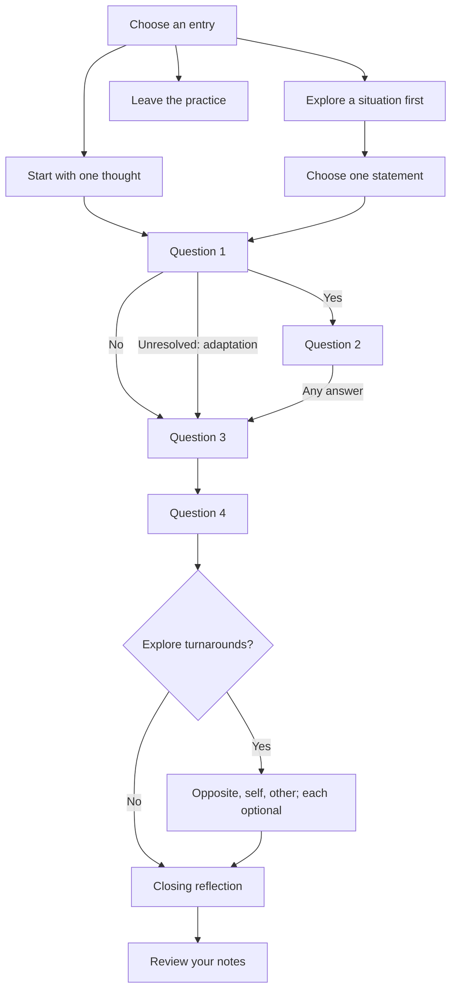

# The Work: review package

Prepared for review only. These files are outside `content/` and do not add, move, publish, or register anything in the Patternverse library.

- [Article draft](article.md): a faithful explanation with original examples, the four questions laid out in order, source links, and scope notes. Related patterns are omitted.
- [Integrated practice source](practice.pattern.md): a working self-paced prototype with two entry paths and shared inquiry. The entire practice is self-guided, without AI assistance.

## Placement proposal

**Proposed merged verse: Therapy & Wellbeing. New collection: Self-Inquiry.**

Therapy and Wellbeing are currently top-level **verses** in the library. I recommend combining them at that same level under the name **Therapy & Wellbeing**, with collections such as CBT, Sleep and Nightmares, and Self-Inquiry underneath. This gives psychological approaches and everyday wellbeing practices a shared home while keeping their differences visible in the articles.

If you intend “Therapy & Wellbeing” to be a collection specifically, that would be a different structural choice: a collection would group the content within a verse rather than replace the two top-level verses. The proposal here interprets your suggestion as merging the two existing top-level categories.

For a later merge, retain the existing `therapy` identity and rename its display title to Therapy & Wellbeing. Reassign current Wellbeing memberships to that same identity, deduplicating entries that already belong to both. Preserve former Wellbeing links through a redirect or equivalent compatibility route before removing its old verse entry. This is a proposal only; the current library has not been changed.

The Work would then sit in **Therapy & Wellbeing → Self-Inquiry**. The current CBT and Neuro-Linguistic Programming collections describe particular approaches; neither accurately describes The Work. The Reframing collection emphasizes practical problems, and Find New Possibilities emphasizes generating and testing options. Self-Inquiry provides a suitable collection without extending those collections beyond their existing purposes.

Start Self-Inquiry with this one article. Additional approaches can be selected later. The merged verse's description should make clear that inclusion covers both reflective practices and therapeutic approaches, without implying that all entries have the same clinical evidence.

Proposed collection metadata, for a later library addition:

```yaml
id: self-inquiry
type: collection
title: Self-Inquiry
summary: Examine thoughts, interpretations, and reactions through structured personal reflection.
status: draft
verses:
  - therapy
items:
  - the-work
```

The article's proposed metadata uses the existing `therapy` identity, intended to carry the combined display title after an approved merge. The files remain review artifacts regardless of the metadata they contain. After review, the practice can be embedded in the article's existing `patternverse-language` block format, giving the article one Practice action through the current runner. Its two entry paths and later branches use predefined prompts, without AI assistance.

## One practice, with conditional paths



The fuller opening explores the six broad worksheet areas: the upsetting judgment, desired change, advice, perceived needs, descriptions of the person, and the experience one does not want repeated. It then asks the participant to select one thought. This is a paraphrased opening, not a reproduction of the official Judge-Your-Neighbor form and not a complete implementation of every worksheet instruction. In particular, it does not apply the official special turnaround to the final recurrence statement.

Both entry routes continue into the same practice. A No at the first question skips the certainty question, as in the standard sequence. A Yes shows it. The extra unresolved route is labeled as a Patternverse adaptation. Turnarounds are offered after both remaining questions; the participant can omit the entire phase or leave any individual direction blank. No AI judges answers or proposes a supposedly correct belief.

The fuller opening adds roughly 10–15 minutes. One thought takes approximately 15–25 minutes; the fuller path approximately 25–40. These are estimates, not enforced timers.

## Fidelity and adaptations

The four core questions retain Katie's wording. Questions 1, 2, and 4 use the [official instructions](https://thework.com/instruction-the-work-byron-katie/); question 3 is also documented in the [One-Belief-at-a-Time exercise](https://thework.com/one-belief/). The directions and examples for turnarounds are independently written, informed by the [official FAQ](https://thework.com/faqs/).

The following are explicit adaptations: alternative entry routes; paraphrased worksheet prompts; unresolved-answer choices; optional notes and turnaround examples; the option to omit turnarounds; and the closing reflection about boundaries and possible action. The reader is not asked to agree with Katie's broader philosophical claims or demonstrate relief.

## Pattern metadata for later use

The repository accepts a limited frontmatter schema, so the following authoring metadata is kept here rather than added as unsupported fields to the article.

```yaml
domain: personal reflection
use_when:
  - Replaying a manageable everyday interaction.
  - Treating an interpretation of someone's behavior as settled fact.
  - Wanting a structured inquiry into a recurring judgment.
goals:
  - Notice the distinction between an event and its interpretation.
  - Observe reactions without requiring a particular conclusion.
  - Consider alternative perspectives grounded in concrete examples.
mechanisms:
  - Structured attention to one thought and situation.
  - Observation of emotional and behavioral responses.
  - Deliberate perspective taking and example checking.
difficulty: medium
estimated_practice_time: 15–25 minutes; 25–40 with the fuller opening
prerequisites:
  - One manageable everyday situation.
not_ideal_when:
  - Immediate danger or an urgent practical response requires attention.
  - Reflection feels overwhelming or becomes pressure to blame yourself.
example_user_queries:
  - I keep replaying what my friend said.
  - I am sure my colleague wants me to fail, but I want to examine that.
  - A cancelled plan has turned into a story about our entire friendship.
  - I want to question a thought without pretending everything is fine.
  - How can I notice what changes when I believe a judgment?
  - I want a structured way to look at my assumptions about someone.
  - I keep thinking they should have treated me differently.
  - Can I consider another perspective and still keep my boundaries?
  - I do not know whether my interpretation is the only possible one.
  - I want to understand my reaction before replying to a difficult message.
```

These mechanisms describe the exercise's design, not demonstrated clinical effects. The source links document the method, not validation of this adaptation.

## Visual decision

**Process/flow** for this review: the diagram above makes the conditional routes visible. No article illustration is proposed. The examples and practice steps explain the method more directly than decorative artwork.

## Editorial questions for review

1. Does merging the two top-level verses into **Therapy & Wellbeing**, with Self-Inquiry underneath, match your intended structure?
2. Does the two-route opening give enough fidelity, or do you want the complete official worksheet process, including its special final-statement handling and repeated inquiry into additional statements?
3. Does the article's balance of explanation, original examples, and distinctions from the broader philosophy fit the tone you want?

## Verification of the review prototype

The practice compiles without diagnostics in the existing shipped Rust/WebAssembly engine. Forty-one synthetic scenarios completed successfully, covering both entry paths, every opening answer branch, optional blank responses, turnaround exploration or omission, and leaving before inquiry. The checks also verified required-field validation and the final review of answers. No model was contacted, and these checks do not evaluate clinical effects.

The article's proposed metadata passes the content parser, and the review documents pass formatting checks. Related patterns and the optional-assistance proposal have been removed. The revised practice contains no model calls.

After review, the package can be added to the library using its established content schema and runner.
