Use this reference when a term interrupts your reading. You can make deliberate photographs
in automatic modes; the terms help you understand choices and limitations rather than pass
an entrance exam. Browse [[photography|Photography]] to explore the patterns by topic.

## Aperture and f-numbers

The aperture is the lens opening that admits light. The f-number relates focal length to
the diameter of the entrance pupil, the opening as viewed through the front optics. A smaller
number means a larger relative opening: f/2.8 is wider than f/8. At fixed illumination and
time, a wider opening admits more light. Full-stop steps such as f/2.8, f/4, f/5.6, and
f/8 approximately halve the admitted light at each step toward the larger number.

Aperture also affects depth of field. Extremely small openings can reduce fine detail through
diffraction, so the highest available number is not automatically best. Most phone cameras
have fixed physical apertures; model-specific exceptions exist. See [[choose-your-depth-of-field|Choose Your Depth of Field]].

## Shutter speed

Shutter speed names the exposure time. At 1/500 second, light is recorded for a shorter
interval than at 1/30 second. A shorter interval can reduce motion blur; a longer one can
describe movement. Subject speed, direction, magnification, and camera movement affect the
result. Stabilization helps with camera movement, not the independent movement of a subject.
Phone night and long-exposure modes may combine multiple captures rather than use one long
exposure. See [[freeze-or-show-motion|Freeze or Show Motion]].

## ISO

Digital ISO influences signal amplification and/or processing and the brightness the camera
aims to produce. **Raising ISO does not increase the light captured by the sensor when
aperture and time stay fixed.** It can allow automatic exposure to retain a short time
or small opening in dim light. Those choices may capture less light and produce a noisier
result; amplification and camera electronics also affect noise and highlight headroom.
More light, a longer time, or a wider opening are different physical choices. See [[expose-for-what-matters|Expose for What Matters]].

## Exposure and compensation

Exposure concerns light reaching the recording surface; displayed brightness also depends
on ISO and processing. A camera meter recommends settings according to its mode and measurements.
Exposure compensation adjusts that automatic target: positive generally brightens, negative
generally darkens. In manual mode with fixed ISO, it may only move the meter indication.
In manual mode with Auto ISO, it may change ISO instead. Check the device.

Clipped highlights have lost distinctions in one or more recorded channels. Darkening cannot
recreate missing data. Raw files offer flexibility, not unlimited recovery. See [[expose-for-what-matters|Expose for What Matters]] and [[edit-to-guide-attention|Edit to Guide Attention]].

## Focus and depth of field

Focus selects a distance of maximum sharpness. Depth of field is the surrounding range that
appears acceptably sharp for the intended size and viewing conditions. The transition is
gradual. Aperture, focusing distance, focal length under specified framing conditions, and
sensor/output format influence the result. Background distance strongly affects how blurred
that background looks, which is distinct from the range around the subject that remains sharp.

A lens cannot focus arbitrarily close; backing away may solve a failed close-up. Autofocus
may select a different target from the one you intend. See [[focus-on-what-matters|Focus on What Matters]] and [[choose-your-depth-of-field|Choose Your Depth of Field]].

## Focal length and angle of view

Focal length is an optical lens property expressed in millimeters. For a given sensor size,
a shorter focal length includes a wider angle of view; a longer one includes a narrower
view and makes a distant subject larger in the frame. The same millimeter value produces
different angles on different sensor sizes. “35 mm equivalent” describes a comparable angle
of view, not the lens's actual focal length. Digital zoom usually crops and may apply processing.

## Perspective and camera position

Perspective relationships follow camera position. Move closer and nearby objects grow relative
to distant objects. Zoom from one fixed position and you mainly change framing, while the
underlying perspective remains the same, apart from lens distortions. If you change focal
length and move to keep a face the same size, the changed position is what changes its
perspective proportions. Cropping cannot reveal a surface hidden at capture. See [[change-your-position|Change Your Position]] and [[crop-with-a-purpose|Crop with a Purpose]].

## White balance and color temperature

White balance changes how illumination colors are rendered. Color temperature, often expressed
in kelvin, describes one aspect of a source's color; lower-temperature sources tend toward
warmer appearance, higher toward cooler. Setting a higher kelvin white balance usually warms
the rendered image to compensate for a bluer source. Tint adjustments address another color
axis. Mixed sources cannot always be neutralized with one global setting. Preserving a warm
room can be a deliberate choice. See [[limit-the-color-palette|Limit the Color Palette]].

## Camera modes

| Mode | What it generally chooses | Your useful decision |
| --- | --- | --- |
| Auto | Most settings and sometimes processing/flash | Subject, position, timing; available overrides vary |
| Program, P | Aperture and time | Brightness target; some cameras allow shifting the pair |
| Aperture priority, A or Av | Time after you choose aperture | A depth-of-field/exposure tradeoff |
| Shutter priority, S or Tv | Aperture after you choose time | Motion appearance |
| Manual, M | You choose aperture and time | Consistency or direct control when useful |

ISO may be fixed or automatic in several modes. Controls have physical limits: shutter
priority cannot open a lens beyond its maximum aperture. Manual with Auto ISO still contains
automatic brightness control. Phones may expose fewer direct controls, without removing your
choices about scene, light, framing, and moment.

## Optics and computational photography

Lenses form optical images before processing. Phones and cameras may also merge captures,
reduce noise, reconstruct detail, map tones, or simulate background blur. A portrait-mode
“aperture” slider often changes simulated blur rather than a physical opening. Check hair,
glass, gaps, and moving subjects for processing errors. Computational results can be useful,
but do not treat them as proof of a particular optical setting or one uninterrupted instant.
See [[use-backlight|Use Backlight]] and [[freeze-or-show-motion|Freeze or Show Motion]].

## Further reading

Technical background: [Nikon's exposure-compensation manual](https://onlinemanual.nikonimglib.com/z7II_z6II/en/06_shooting_controls_03.html),
[depth of field](https://www.cambridgeincolour.com/tutorials/depth-of-field.htm),
[lenses and perspective](https://www.cambridgeincolour.com/tutorials/camera-lenses.htm), and
[light direction and apparent source size](https://www.cambridgeincolour.com/tutorials/portrait-lighting.htm).
Treat a manufacturer's controls as model-specific; the collection's aesthetic choices remain choices.
