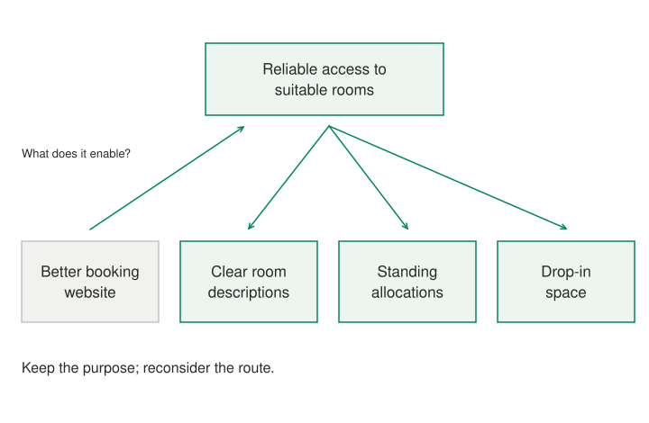

A university department wants a better room-booking website. The initial discussion concerns calendars, filters, and how many clicks it takes to reserve a space. Then an administrator asks why people need to book these rooms at all. The answer is not simply “to have a reservation.” They need somewhere suitable to teach, meet, or work together without discovering that the space is unavailable. That broader purpose opens options beyond improving a booking screen.

## Core idea

Abstraction laddering moves between a concrete request and the purposes it serves. Moving upward asks what achieving the request would make possible. Moving downward asks how that purpose could be realized. The important movement is often up and then down along a different route. It creates alternatives that the original wording excluded.

A problem can be framed at many useful levels. “Make the date picker easier to use” is specific enough for a small interface improvement. “Help people use shared space effectively” creates room to reconsider policies, room information, and coordination. “Improve human connection” is broader still, but may be too remote to guide the work at hand.

The method helps find a level at which there is room to invent and enough specificity to act. It does not establish a hierarchy in which the most abstract statement is the truest one. The original request may survive the exploration because its constraints are real and its scope is appropriate.

LUMA Institute documents abstraction laddering as a design-framing method using broader and narrower questions. The underlying reasoning is more general than one organization's toolkit. Here it is used as a practical way to change the solution space without abandoning the needs that made the first request sensible.

## When to use it

Use laddering when a request already contains a solution, when alternatives seem like minor variations, or when a problem is too vague to approach.

## How it works

An upward step should be understandable as a connection between means and ends. “Why improve the website?” might produce “so people can see availability,” which connects the action to an outcome. A jump to “because we value excellence” may be sincerely meant, but it does not yet explain what would change for the people using the rooms.

Likewise, a downward step should be a plausible way to serve the chosen purpose. If reliable teaching space is the outcome, a social event is not an equivalent alternative merely because it also promotes connection. The broader framing should not erase functional requirements, accessibility needs, or commitments.

It helps to preserve a short trail of the reasoning. The department can record the initial request, the purpose it serves, two alternative routes, and the requirements each must meet. That trail makes it possible to challenge a link without restarting the whole discussion.

## Worked examples



### Room booking

The department's first upward step is from booking to reliable access to a suitable room. Another upward step asks what reliable access supports: uninterrupted teaching and collaboration. Returning downward, possible routes include clearer room descriptions, an agreement for releasing unused reservations, standing allocations for predictable classes, and quiet drop-in areas that require no booking.

These are not interchangeable improvements. Each protects part of the purpose under different conditions. A recurring seminar may benefit from a standing allocation; an unpredictable small discussion may benefit from a drop-in room. The department can now investigate how much demand belongs to each situation before replacing software.

Notice that “build a faster booking website” would not have created this variety. It changes a property of the existing solution while retaining the assumption that every use of space should pass through the same reservation process. Laddering makes that assumption available for examination.

### A personal goal

A runner says, “I need a watch with more training metrics.” Asking what those metrics would enable reveals a desire to train consistently without getting injured. Moving down from that purpose produces different options: a simpler plan, recovery days, a training partner, or advice about a recurring discomfort. A new watch remains one option, but it is no longer the only expression of serious training.

## Pitfalls and limits

The method does not authorize someone else to decide that the runner's real motive is status or insecurity. The person supplies and corrects the purpose. A facilitator can ask about possibilities and point out a missing link, but should not substitute an interpretation of the person's motives for their own account.

This distinction is especially important in groups. Two people may want the same concrete thing for different reasons. One wants more room-booking information to reduce interruptions; another wants it to distribute scarce space fairly. A broader statement that combines both purposes can help, but only if the differences remain visible when options are evaluated.

Stop when a different level changes what you could reasonably investigate or build. Repeating “why” until every goal becomes happiness rarely improves a practical decision.

A good outcome can be a narrower problem. The department may discover that nearly all failures involve rooms requiring specialist equipment. That gives it a focused opportunity to test clearer information before changing the entire system. Movement down the ladder is as valuable as movement up.

## Related patterns

[[reframing-surface-higher-goals|Surface Higher-Level Goals]] clarifies what an immediate target enables. [[reframing-alternative-paths|Find Alternative Paths]] develops different routes to a chosen outcome. [[reframing-detect-baked-solution|Detect a Baked-In Solution]] helps notice when a request closes the ladder before the exploration begins. Abstraction laddering connects those moves in a deliberate change of level and return to action.

## Sources and attribution

[LUMA Institute's abstraction laddering reference](https://www.luma-institute.com/abstraction-laddering/) documents the broader–narrower movement. The room-allocation and running examples and the practice are original adaptations.

## Practice — Climb and Return

**Purpose:** Move between the purpose of a goal and concrete ways to achieve it to find a useful problem frame.

**Time:** About 12 minutes. The practice produces a reflection or plan; it does not execute actions for you.

```patternverse-language
:language 1
:title "Climb and Return"
:output result

!show {
About 12 minutes. Work with one manageable situation. This participant-led practice needs no AI. Review each group before Continue. The result is a reflection or plan; actions are not carried out or scheduled for you.
}
start = !form {
:title "Capture the starting request"
request = !ask {
What is the initial problem or requested solution?
}
constraints = !ask {
Which real requirements must alternatives preserve?
}
}
up = !form {
:title "Move toward purpose"
purpose = !ask {
What would satisfying that request make possible?
}
higher = !ask {
What does that purpose enable, if another step would change the options?
}
}
down = !form {
:title "Return by different routes"
route_one = !ask {
What is one concrete route to the chosen purpose?
}
route_two = !ask {
What substantially different route could also serve it?
}
preserved = !ask {
What does each route preserve or sacrifice?
}
}
review = !form {
:title "Choose a useful level"
frame = !ask {
What problem statement now leaves room to invent and is concrete enough to investigate?
}
test = !ask {
What small check would compare the new route with the original request?
}
}
result = {initial: start, purpose: up, alternatives: down, next: review}
!show {
Your revised frame: {{review.frame}}
Next check: {{review.test}}
}
-> end
```
