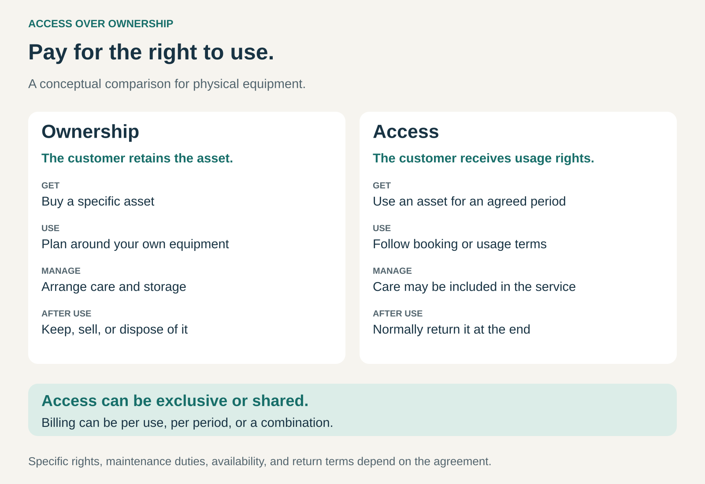

## What it is for

Give customers the use of something without requiring them to own it. Access over Ownership helps businesses serve customers who want a capability, experience, or selection while avoiding some of the cost and work of possession.

Someone needs a car for an afternoon, a dress for an event, or specialist equipment for a project. Buying the asset would create responsibilities that extend beyond the immediate need: storage, maintenance, depreciation, and eventual disposal.

An access offer separates using something from owning it.

The customer receives defined usage rights. Ownership of the asset—or the underlying intellectual property—remains with the provider, another asset owner, or the relevant rights holder.

## The core idea

Sell the ability to use an asset or resource under agreed conditions.

The arrangement might provide:

- **Temporary access to a specific asset:** a rental car or piece of equipment.
- **Access to a shared pool:** vehicles, workspaces, or other resources allocated through reservations.
- **A rotating selection:** clothing or equipment that customers can exchange.
- **Access to a digital catalog:** content available through an ongoing service.

Access can be exclusive. A business may keep leased equipment on its premises for years without owning it. Sharing the same physical item among many customers is one implementation, rather than a requirement.

The payment model is also a separate choice. Access can be charged per use, per period, through a subscription, or through a combination.

## How the arrangement changes

The graphic compares two arrangements for physical equipment.

An owner acquires an asset and decides how to retain, maintain, sell, or dispose of it, within applicable restrictions. An access customer receives a defined right to use an asset, normally returning it when that arrangement ends.

The provider may include maintenance, replacements, cleaning, or delivery. Those services need to be part of the agreement; they do not follow automatically from the word _access_.

The exchange therefore concerns both usage rights and responsibilities.

## Why it works

Access can make expensive or specialized resources practical for customers whose needs are occasional, temporary, or changing.

It can also reduce the work surrounding ownership. A customer may value having equipment repaired or clothing cleaned as much as avoiding the initial purchase.

For providers, the opportunity is to earn from an asset across multiple periods or customers. Better allocation can increase the useful service delivered by an existing asset.

Retaining an asset can also create a reason to invest in durability, repair, and recovery: the provider continues bearing the consequences of its condition.

These advantages depend on operations. A resource that is unavailable, unreliable, or difficult to obtain delivers little value merely by appearing in a catalog. Access businesses must make the promised use dependable.

## Famous examples

### Zipcar: a car for the trip

Zipcar lets approved members reserve vehicles, including round-trip cars booked by the hour or day. Its round-trip process requires customers to return the vehicle to its home location on time. [Zipcar’s booking model](https://www.zipcar.com/node/59), [Zipcar’s operating rules](https://www.zipcar.com/how-it-works).

The customer obtains use of a car for a reservation rather than acquiring a vehicle.

This can suit someone who needs occasional driving alongside other transport. The tradeoff is availability and coordination: the appropriate vehicle must be nearby, reservable, and returned according to the rules.

The product includes the reservation and access system as well as the car itself.

### Rent the Runway: a wardrobe that can change

Rent the Runway’s subscription lets customers select clothing and accessories, wear them, and exchange eligible items within their plan. Cleaning is included, and customers can purchase items separately if they wish. Items retained at home continue occupying available plan spots. [Rent the Runway’s subscription model](https://www.renttherunway.com/clothing-subscription).

The benefit is access to a changing selection without purchasing every piece.

Its operating challenge is substantial: garments must be available in suitable styles and sizes, delivered, returned, inspected, and prepared for another customer.

Buying a favorite item is a separate transaction. The rental itself provides temporary use.

### Hilti: dedicated tools with an ongoing service

Hilti’s UK Fleet Management offer combines tool use with services including repairs and maintenance for a monthly fee. Its guidance says contracts typically last three to five years, depending on the tools and trade, and customers cannot buy the fleet tools at the end. [Hilti’s UK Fleet Management offer](https://www.hilti.co.uk/content/resources/purchasing-and-logistics/fleet-management).

This demonstrates access without short-term sharing. A construction business can have tools dedicated to its work while obtaining them through a managed agreement.

It also shows why monthly billing should not be confused with monthly flexibility. The customer may avoid a large purchase while accepting a substantial contractual commitment.

### Spotify: access to a catalog

Spotify provides access to music and other content under a license. Its terms distinguish that access from a sale or transfer of the content and prohibit users from redistributing or selling it. [Spotify’s terms of use](https://www.spotify.com/us/legal/end-user-agreement/).

The customer can use an available catalog without assembling a purchased collection of recordings.

This extends the pattern beyond physical assets. The provider manages a service and access to licensed material, while the customer’s use depends on the applicable service terms.

Catalog access and ownership provide different kinds of continuity and control.

## The economics

For customers, a fair comparison considers the full cost of each arrangement over a realistic period.

Ownership can involve purchase cost, financing, maintenance, storage, and eventual resale proceeds. Access can involve membership charges, rental fees, usage charges, delivery, damage charges, and termination costs.

Lower upfront payment does not establish lower total cost. Frequent, predictable use may favor ownership. Occasional use or changing requirements may favor access.

For providers of physical assets, revenue must cover acquisition or financing, maintenance, logistics, idle periods, losses, and eventual replacement. Revenue collected across several rentals is meaningful only alongside those costs.

Utilization creates a tension. Too little use weakens the economics; insufficient spare capacity makes access unreliable at busy times.

Digital access has different cost drivers, including licensing, infrastructure, and customer acquisition. It still requires sufficient continuing value to support the service.

## Useful when

This pattern is especially useful when:

- **Needs are temporary or intermittent:** customers would otherwise own something that sits unused.
- **Variety matters:** customers benefit from changing their selection.
- **Ownership creates burdens:** maintenance, storage, or replacement require unwanted effort.
- **Requirements change:** customers need different capabilities over time.
- **The provider can deliver reliable availability:** its operations make access convenient and dependable.

Ownership can remain attractive when customers need constant availability, extensive customization, unrestricted control, or a long period of predictable use.

## Common mistakes and limits

**Confusing access with a subscription.** A subscription is a recurring commercial arrangement. Access describes the rights received. Either can exist without the other.

**Promising flexibility that the contract does not provide.** Minimum terms, reservation limits, return requirements, and cancellation charges shape the actual offer.

**Treating catalog size as availability.** Thousands of items are less useful if the needed size, location, or time slot is unavailable.

**Underestimating operating costs.** Cleaning, repairs, collection, redistribution, and customer support can consume the apparent advantage of repeated rentals.

**Ignoring dependence on the provider.** Service closure, changed terms, or lost availability can interrupt use. Continuity is part of the customer’s decision.

**Assuming reuse guarantees environmental benefits.** Repeated use can improve asset utilization, but the overall result also depends on product life, transport, servicing, and whether access encourages additional consumption.

## Related patterns

- [[outright-sale|Outright Sale:]] transfers ownership; Access over Ownership grants defined use.
- [[subscription|Subscription:]] can fund continuing access through recurring payments.
- [[pay-per-use|Pay per Use:]] can charge according to how much access the customer consumes.
- [[solution-provider|Solution Provider:]] can combine access with maintenance, support, and other responsibilities around the customer’s need.
