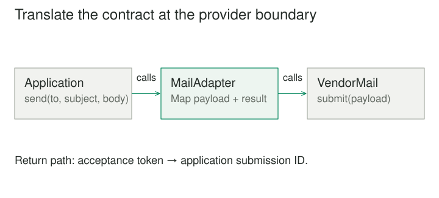

## Purpose and problem

An application asks its mail service to send a message with a recipient, subject, and body. A new provider exposes submit, expects a nested payload, and returns a provider-specific delivery token. Rewriting every caller around that API would spread the integration throughout the application. The behavior is useful; the interface is the obstacle.

## Core idea

Adapter translates between the interface a client expects and the interface an existing component provides. The client continues to use its own meaningful contract. The adapter understands both sides and performs the necessary conversion.



## How it works

The simplest adapter renames a method or rearranges arguments. A substantial adapter also translates values, errors, lifecycle rules, and sometimes the interpretation of a result. It is a compatibility boundary, not just a cosmetic wrapper.

In the common object adapter form, the adapter holds a reference to the existing component and delegates work to it. The classical class adapter form uses inheritance where the language and type relationships permit it. Composition generally makes the dependency and translation easier to isolate.

The crucial constraint is that the underlying component can actually satisfy the expected behavior. An adapter cannot manufacture synchronous completion from a service that only accepts work for later processing without changing what completion means. A common interface must have an honest semantic contract.

## Worked example

### A mail integration that keeps its promise

Suppose the application's MailSender contract returns a submission identifier when a provider accepts a message for delivery. The adapter maps recipient, subject, and body into the provider's payload, calls submit, and converts the returned token into the application's identifier type.

Before the adapter, order confirmation code knows the vendor's field names and exception types. Afterward, it depends only on MailSender. Switching providers changes the adapter and application wiring, while order logic remains stable.

The wording of the result matters. Acceptance does not prove delivery. If the old interface returned a value named delivered, carrying that name forward could preserve a misleading promise. The adapter may reveal that the application contract itself needs correction.

Failures need equally careful treatment. A malformed recipient and a temporary network failure may require different caller behavior. Converting every vendor error into false makes the integration easy to call but difficult to operate. A useful adapter normalizes errors without erasing distinctions the application needs.

### A small implementation

The application wants a submission identifier from send. The vendor accepts a differently shaped payload through submit. The adapter translates both the request and the result while preserving the promise of acceptance for delivery.

```python
class VendorMail:
    def submit(self, payload):
        self.last_payload = payload
        return {"accepted_token": "submission-42"}


class MailAdapter:
    def __init__(self, vendor):
        self.vendor = vendor

    def send(self, recipient, subject, body):
        response = self.vendor.submit({
            "destination": {"address": recipient},
            "message": {"subject": subject, "text": body},
        })
        return response["accepted_token"]


vendor = VendorMail()
mailer = MailAdapter(vendor)
print(mailer.send("reader@example.com", "Receipt", "Thank you"))
# submission-42
```

Order code can now depend on send rather than the vendor vocabulary. The local VendorMail is a test double: it records a payload and returns a fixed response without sending a message. A real adapter must also translate relevant error distinctions. The returned token means accepted submission, not completed delivery.

### A legacy temperature source

A building-monitoring application expects temperature readings in Celsius with a timestamp. A legacy device exposes a method returning a Fahrenheit number and provides a separate time value in its own format. A TemperatureSourceAdapter reads both, converts the unit, and constructs the application's reading value.

That isolates conversion from alert rules and charts. Threshold checks no longer need to remember which devices report Fahrenheit. Test cases can exercise the adapter's conversion directly rather than recreating it in every consumer.

However, reading the value and timestamp separately may introduce a consistency problem if the device updates between calls. The adapter should use an atomic reading if the device supports one, or document the limitation. Translating the shape of data does not remove the acquisition behavior of the source.

If a device reports an estimated rather than measured temperature, an adapter should not silently treat them as identical. Sometimes the correct response to incompatibility is a richer contract, not a more elaborate wrapper.

## When to use it

- An existing component has useful behavior behind an incompatible interface.
- A boundary should isolate an external API from application code.

Consider a simpler design when the underlying behaviors cannot satisfy the expected contract, or when both interfaces are owned locally and can be simplified directly.

## Tradeoffs and common mistakes

Adapter is useful for vendor SDKs, legacy libraries, file formats, and systems that cannot be changed easily. It allows application code to describe its own needs instead of inheriting a provider's vocabulary. This can make replacement, testing, and incremental migration more manageable.

The pattern is weaker when the expected contract is a forced universal abstraction. A single interface covering every database, transport, or payment provider can become so vague that important behavior disappears. Adapting to the narrow needs of a specific application is often clearer than building a supposed interface for every possible implementation.

Adapters can also accumulate hidden business decisions. Currency conversion policy, permission checks, or retry rules may belong in separate components if they are substantial. Keeping translation distinguishable from policy makes it easier to understand what changes when an external API changes.

## Related patterns

[[facade|Facade]] simplifies access to a subsystem; Adapter resolves a mismatch with an expected interface. A wrapper can serve both roles, but its reason for existing should be clear. [[proxy|Proxy]] usually preserves the subject's interface while controlling access. Adapter intentionally changes the interface seen by the client.

[[bridge|Bridge]] starts by separating two dimensions that are intended to vary independently. Adapter more often connects an already-existing component to a contract it was not designed to implement. A bridge can use an adapter for an implementation supplied by a legacy system.

## Sources

Adapter is one of the 23 patterns in Gamma, Helm, Johnson, and Vlissides, [*Design Patterns: Elements of Reusable Object-Oriented Software*](https://www.informit.com/store/design-patterns-elements-of-reusable-object-oriented-9780201633610). The examples, code, and illustrations here are original educational explanations.
