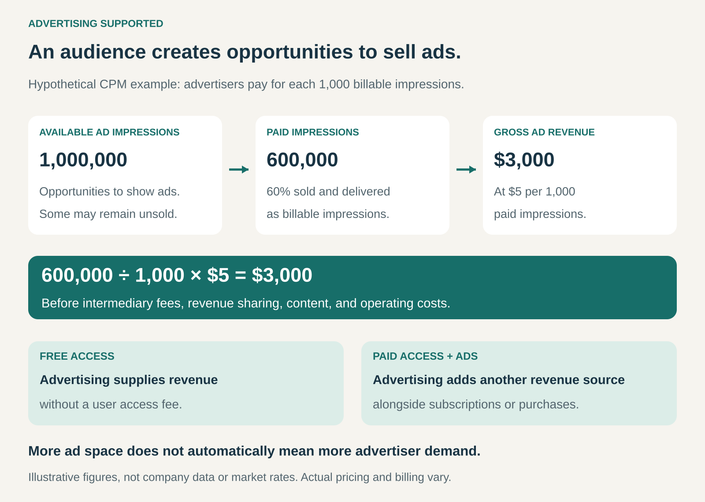

## What it is for

A publication attracts readers. A music service brings people back every day. A search engine reaches people while they are looking for something specific.

Those audiences can be valuable to businesses that want to reach potential customers.

Advertising Supported earns revenue by selling opportunities to display commercial messages within or alongside an offering. Advertising can finance free access, reduce reliance on user payments, or supplement subscriptions and purchases.

It is useful when a business attracts an audience that advertisers value and can accommodate advertising without weakening the experience that attracts people.

## The core idea

Create something people want to use, then sell advertisers defined opportunities to reach them.

The provider makes two offers:

- **To the audience:** useful content, entertainment, information, or another service.
- **To advertisers:** placements that can generate awareness, interest, visits, or other commercial results.

Advertising Supported is a specific form of third-party funding. The payer purchases a communication opportunity associated with the audience.

Users may still pay. Newspapers, magazines, and subscription streaming services can combine advertising income with direct customer revenue.

## How it works

The provider creates advertising inventory: available placements such as audio breaks, video slots, display spaces, sponsored listings, or newsletter positions.

It sells that inventory directly, through an advertising network, or through automated marketplaces. The agreement defines what advertisers receive and how payment is calculated.

Common arrangements include:

- **Payment per thousand impressions, or CPM:** advertisers pay for a specified number of qualifying ad displays or deliveries.
- **Payment per click, or CPC:** payment depends on someone clicking the advertisement.
- **Payment per qualified response:** advertisers pay for an agreed event, such as an eligible lead.
- **Fixed placement fees:** an advertiser purchases a position or campaign period for an agreed amount.

The billing event matters. A campaign optimized for conversions may still be charged through clicks or impressions. Google’s pricing guidance distinguishes several charging models across its advertising products. [Google: Advertising pricing models](https://business.google.com/us/resources/articles/how-much-google-ads-cost/)

In the graphic’s hypothetical example, one million available impressions produce 600,000 sold and delivered billable impressions. At $5 per thousand, they generate $3,000 before fees, revenue sharing, and operating costs.

## Why it works

**It connects advertisers with an existing audience.** The provider has already assembled people whom advertisers might otherwise struggle to reach.

**It can offer a relevant context.** An advertisement for accounting software may be valuable in a publication for finance professionals. A search advertisement can reach someone actively researching a purchase.

**It allows several advertisers to support one service.** Revenue can come from many campaigns rather than depending entirely on individual users’ willingness to pay.

**It creates different ways to package access.** A business can offer free access with ads, a paid plan with fewer interruptions, or a subscription supported by both advertising and customer payments.

Audience quality matters alongside size. A focused audience can be commercially attractive even when it is relatively small. Its value depends on advertiser demand, purchasing relevance, placement quality, and the results advertisers expect.

## Famous examples

### Google Search: advertising near expressed intent

Google Search brings users to a service where they describe what they want to find. Advertisers can purchase placements associated with relevant searches.

Google explains that advertising helps finance free access to Search and other products. Its Search Ads use a cost-per-click model, linking payment to users clicking advertisements. [Google’s business model](https://about.google/company-info/how-our-business-works/), [Google’s Search Ads pricing explanation](https://business.google.com/us/resources/articles/how-much-google-ads-cost/)

The distinctive feature is the context: someone searching for a particular product or service may be closer to a purchase than someone encountering a general advertisement.

The advertiser still needs a suitable offer and customer experience after the click. A paid visit does not guarantee a sale.

### Spotify: advertising alongside a subscription business

Spotify operates both Premium and Ad-Supported services. Its Ad-Supported service has no subscription fee and generates revenue primarily through display, audio, and video advertising.

Spotify describes this service as both an option for people unwilling or unable to subscribe and a channel through which some listeners become Premium subscribers. [Spotify’s 2025 annual report](https://www.sec.gov/Archives/edgar/data/1639920/000162828026006874/ck0001639920-20251231.htm)

This combines two mechanisms: advertising monetizes listening activity, while subscriptions provide another revenue stream.

Spotify also illustrates the importance of delivery costs. Its financial reporting accounts for content-related costs alongside the revenue generated by its services. Audience growth must therefore be evaluated together with the cost of serving that audience.

### Disney+: a paid offering can also carry advertising

Disney+ offers subscription plans that include advertising during much of its on-demand programming. It also offers plans with different advertising experiences. [Disney+: Advertising and subscription options](https://help.disneyplus.com/article/disneyplus-ads?redirect=false)

This illustrates a hybrid model. The customer pays for access, and advertisers supply additional revenue.

Disney explains that including advertising allows it to offer subscription options suited to different budgets. The experience depends on the plan and content; selected live and linear programming can contain advertisements across plans.

The example shows why “advertising supported” does not necessarily mean “free to use.”

## The economics

For a simple CPM arrangement:

**Advertising revenue = billable impressions ÷ 1,000 × realized CPM.**

The formula describes revenue before whatever deductions and costs apply. Intermediaries, content partners, and creators may receive a share. Content production, licensing, distribution, sales, technology, and support also need funding.

Three factors strongly influence the result:

**How many advertising opportunities exist.** Audience size, usage frequency, and placement availability affect potential inventory.

**How much inventory earns money.** Available space may remain unsold, be blocked, or fail to meet the conditions for billing.

**What advertisers pay.** Prices depend on demand, audience, format, context, quality, and commercial performance.

Increasing the number of ads may raise revenue temporarily while making the service less attractive. If people leave, use it less, or avoid the ads, the longer-term result can deteriorate.

The useful measure is the contribution advertising makes after its costs and its effects on the wider business.

## Useful when

Advertising Supported is particularly useful when:

- A service attracts a recurring or commercially relevant audience.
- Advertisers have a clear reason to reach that audience.
- Placements fit naturally into the experience.
- The provider can demonstrate credible delivery or results.
- Advertising income can cover a meaningful share of costs.

It is less suitable when usage is infrequent, advertiser interest is weak, or interruptions undermine the service’s main purpose.

## Common mistakes and limits

**Assuming traffic automatically produces sufficient revenue.** An audience creates inventory; advertiser demand determines whether that inventory has commercial value.

**Confusing impressions with people or attention.** One person can receive multiple impressions. Delivery alone does not establish that someone noticed, remembered, or acted on an advertisement.

**Optimizing only for ad volume.** More placements can create clutter and reduce retention. The effect on audience trust and continued use belongs in the calculation.

**Treating every campaign as a sales campaign.** Some advertisers seek awareness, others seek leads or purchases. Measurement should reflect what was actually promised.

**Obscuring commercial influence.** Paid placements and sponsored material need clear presentation so users can understand why they appear.

**Assuming personal targeting is essential.** Advertising can rely on context, location, or broad audience characteristics. Data collection and sharing require deliberate choices and clear explanations.

**Ignoring demand fluctuations.** Advertising budgets, prices, and buying patterns change. A business with substantial fixed costs can become exposed when campaign spending falls.

## Related patterns

[[third-party-funded-access|Third-Party-Funded Access / Hidden Revenue]] — Advertising is one specific way another party finances or supplements a user offering.

[[freemium|Freemium]] — Advertising can generate income from a free tier while paid upgrades provide additional features or a different advertising experience.

[[subscription|Subscription]] — Direct customer payments and advertising can operate together, as paid streaming and publishing models demonstrate.

[[affiliate-commerce|Affiliation]] — Affiliate arrangements typically reward referrals or attributed transactions. Advertising often sells placements, impressions, or clicks, although performance-based arrangements can overlap.
