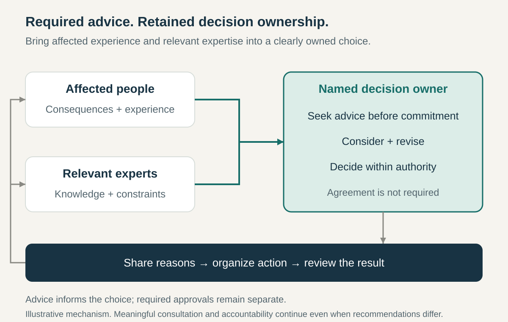

**Core question:** How can someone decide independently while learning from the people affected and those with relevant expertise?

## What it is for

Imagine a hypothetical training company choosing a new booking system. The operations lead understands the administrative work, tutors know what happens during courses, and an accessibility specialist can identify barriers customers may encounter. Waiting for everyone to approve one design could stall the choice. Letting operations decide alone could miss important consequences.

Advice Process combines identifiable decision ownership with an obligation to learn before committing. It applies across roles, teams, departments, and business units where people have real authority but need knowledge and perspectives distributed elsewhere.

Its central organizational commitment is that consultation can be mandatory without making every adviser an approver.

## The core idea

**Give a clearly identified owner the right to decide after genuinely seeking and considering advice from affected people and relevant experts.**

Dennis Bakke’s 2007 account describes the decision-maker seeking advice from peers and leaders while retaining the final choice. The obligation brings other people’s needs and knowledge into an individually owned decision. His claims about improved decisions and enjoyment are practitioner experience, rather than comparative proof. [Bakke, _Joy at Work_, June 2007](https://dennisbakke.blogspot.com/2007/06/9-everyone-must-get-advice-before.html)

The owner can accept, modify, or reject recommendations. They must still take the consultation seriously and remain answerable for their reasoning and the result.

Consensus seeks group agreement; consent-based arrangements address qualifying objections. Advice Process leaves the choice with its designated owner. It also differs from an optional request for suggestions: appropriate consultation is part of the permission to decide.

The organization must establish where that permission applies. Adopting the process does not by itself transfer a board’s reserved powers, another team’s resources, or required specialist approvals.

## How it works

**Establish ownership and scope.** Clarify the question, who may settle it, and which commitments the decision can authorize. The person noticing an opportunity may be well placed, but initiative alone need not establish authority. Where ownership is shared, define how the named owners will settle their choice.

**Find both kinds of adviser.** Include people who will experience the consequences and people who understand the subject. These categories overlap without being interchangeable. In the booking example, technical expertise cannot substitute for tutors’ experience, and tutors’ preferences cannot establish whether a system is accessible or supportable. Ask who is missing, including people who will implement the decision.

**Make advice possible before commitment.** Share the problem, options, constraints, relevant evidence, and a realistic response period. Invite people to challenge the framing, not merely choose between a favorite option and a weak alternative. Scale the effort to the consequences. For a large affected population, establish a credible way to gather differing experiences rather than consulting only familiar supporters.

**Consider rather than count responses.** Discuss concerns, investigate contradictions, and revise the proposal where warranted. A technically serious warning should not lose to several casual preferences. Seek further expertise when the advice reveals uncertainty the owner cannot assess. The process is not a vote, and disagreement need not end in a compromise satisfying nobody.

**Make and communicate the choice.** Explain the important advice, what changed, and why some recommendations were declined. Inform advisers and people responsible for implementation. A director offering advice should identify it as advice; otherwise an apparently optional opinion can quietly function as an order.

**Handle limits explicitly.** If consultation exposes an unmet approval requirement or a commitment outside the mandate, obtain the necessary authorization. If an essential adviser is unavailable, use an agreed substitute or exception route. A response deadline helps organize consultation; it does not turn missing advice into evidence of agreement. Urgent decisions need a previously agreed procedure proportionate to their consequences.

**Follow through and learn.** Name implementation responsibilities and the evidence or date for review. Check both the result and the consultation: were important voices missed, and did the information arrive early enough to matter? Reopen a choice when material facts change, rather than treating continued dissatisfaction alone as an unlimited appeal.

## Why it works

Advice can connect the owner to knowledge they do not possess while preserving a recognizable point of responsibility. Affected people can expose consequences that specialist analysis misses; experts can identify constraints that local experience overlooks.

Retained ownership also gives consultation an endpoint. The owner can settle a tradeoff without claiming universal agreement. Explaining the choice makes their judgment open to scrutiny and gives advisers feedback about how their contributions mattered.

These benefits depend on authority being respected and dissent being usable. People need time, information, and freedom to offer unwelcome advice. Without those conditions, consultation can become a ceremony around a decision already made. More conversations alone do not establish better judgment.

## Examples

### Equal Experts’ bounded implementation, consulted October 2026

Equal Experts’ playbook describes Advice Process for UK employees and other business units choosing to adopt it. Its guidance separates confirming a decision-maker from deciding the outcome. Below specified thresholds, employees can appoint themselves subject to constraints; larger commitments require leaders to confirm the owner. The owner then remains responsible for the choice and its consequences. [Equal Experts, _What Is the Advice Process?_](https://playbooks.equalexperts.com/advice-process/introduction/what-is-the-advice-process) and [_Confirming the Decision Maker_](https://playbooks.equalexperts.com/advice-process/how-the-ap-works/confirming-the-decision-maker)

For broad decisions, its advice guidance recommends a varied sample of affected colleagues, recording who was asked, rather than asking everyone individually. It favors conversation, followed by visible documentation and an opportunity for additional feedback. [Equal Experts, _Advice & Analysis_](https://playbooks.equalexperts.com/advice-process/how-the-ap-works/advice-and-analysis)

This shows an organizational adaptation with boundaries, an appointment mechanism, and deliberate consultation. The sources document the company’s stated process at consultation, not universal adoption across every unit or independent evidence that it improves performance.

### Happy’s pricing decision, recounted in 2024

In January 2024, Happy founder Henry Stewart described colleagues John and Ben deciding that company prices needed to rise. They used Advice Process and sought input. Stewart advised a smaller increase; they chose otherwise. He subsequently judged his own pricing assumptions outdated relative to their understanding of customers and the market. [Stewart, _6 Years With No Decisions at Happy_](https://www.happy.co.uk/blogs/6-years-with-no-decisions-at-happy/)

The revealing feature is what happened to the founder’s disagreement. It entered the decision as advice without becoming a veto. The named colleagues retained authority, and the founder accepted a choice he had not preferred. Their consultation did not require his agreement.

Stewart also suggests the pricing change helped the company survive the pandemic. That is his retrospective interpretation, not an isolated causal finding. The account does not give a precise date for the pricing decision or establish that every Happy decision uses this arrangement.

## Useful when

- **Authority is clear but knowledge is dispersed.** The owner needs operational experience, affected perspectives, and specialist input.
- **Consultation repeatedly becomes an approval queue.** People cannot distinguish offering advice from granting permission.
- **Initiative needs wider scrutiny.** Local proposals can proceed if their effects are properly examined.
- **Leaders want to contribute without taking over.** Their experience can inform another person’s decision.

## Common mistakes and limits

**Seeking endorsements.** Consult before commitment and include people likely to challenge assumptions.

**Ignoring inconvenient advice.** Declining a recommendation can be legitimate; failing to understand a material concern weakens the decision.

**Confusing advice with approval.** Label genuine authorization requirements separately and respect their scope.

**Overloading the same advisers.** Share consultation work and make requests proportionate. Representatives should not erase important differences among affected people.

**Treating participation as agreement.** Advisers can contribute constructively and still disagree with the outcome.

The process cannot supply missing authority, resolve every conflict over collective legitimacy, or replace required assurance. A collective decision rule may fit better where the group must formally authorize the commitment. Keep that distinction visible.

## Related patterns

- [[teamwork-clarify-decision-rights|Explicit Decision Rights]] establishes ownership, required approvals, and boundaries within which the process operates.
- [[decide-close-to-the-work|Decide Close to the Work]] helps locate an owner near relevant knowledge while recognizing when a wider view is needed.
- [[teamwork-make-it-safe-to-speak-up|Make It Safe to Speak Up]] helps advisers raise unwelcome evidence that meaningful consultation depends on.
