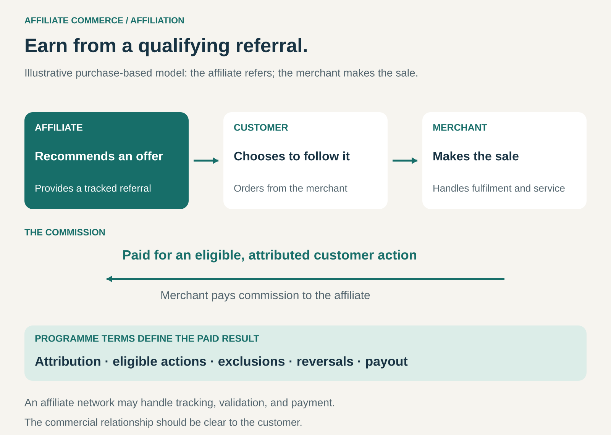

## What it is for

A publisher helps readers choose products but does not want to become a retailer. A creator has an audience that values their recommendations. A merchant wants additional customers and is willing to reward partners who bring qualifying business.

Affiliate Commerce connects those interests through tracked referrals and commission payments.

It is useful when one business can help people discover or choose an offering, while another business handles the resulting sale and delivery.

## The core idea

**Earn compensation when a referred customer completes an agreed, attributable action.**

An affiliate introduces an offering through a review, comparison, recommendation, directory, deal, or other placement. A tracked link, referral code, or similar mechanism connects the customer’s subsequent action with that introduction.

If the action qualifies under the programme’s terms, the affiliate receives compensation.

The paid result is commonly a purchase or completed booking. Some programmes also reward qualifying registrations, trials, subscriptions, or leads.

The affiliate usually does not become the seller. The customer transacts with the merchant, which handles the purchase and arranges fulfilment. The affiliate earns referral income rather than the full selling price.

An affiliate network may sit between the parties, helping merchants recruit partners and handling tracking, reporting, validation, and payments.

## How it works

The arrangement connects five activities.

**Establish the programme.** The merchant defines eligible partners, qualifying actions, compensation, attribution rules, exclusions, and permitted promotional methods.

**Reach a relevant audience.** The affiliate contributes access to people who may value the offering. That access can come from specialist knowledge, useful content, a community, search visibility, or shopping incentives.

**Make the introduction.** A recommendation or placement gives the customer a reason to consider the offer. The commercial relationship should be clear to the customer.

**Attribute and validate the result.** The programme determines whether a purchase or other action qualifies and which affiliate receives credit. A recorded click alone does not necessarily produce a commission.

**Settle the payment.** Commission is paid according to the programme’s conditions. Returns, cancellations, exclusions, or invalid activity may affect eligibility or reverse an earlier amount.

The commercial value lies in connecting relevant demand with an offering. Tracking makes that contribution payable under an agreement, although it does not perfectly establish what caused the customer’s decision.

## Why it works

Affiliates can contribute something the merchant would otherwise need to build or buy: an audience, useful comparisons, specialist credibility, or a place in the customer’s decision process.

A detailed buying guide can reduce uncertainty. A niche creator can introduce a product to people with a specific need. A rewards service can give shoppers an incentive to choose a participating merchant.

The affiliate can monetize this contribution without purchasing inventory or operating delivery infrastructure.

For the merchant, payment linked to a qualifying result can make acquisition spending easier to relate to commercial activity.

The incentives still need care. A high commission can encourage promotion of a poor fit. A tracked sale may also come from a customer who already intended to buy. Useful referrals and accurate attribution are separate questions.

## Famous examples

### Amazon Associates: a standardized referral programme

Amazon Associates provides linking tools that let publishers and creators refer their audiences to products and programmes on Amazon.

Participants can earn compensation from qualifying purchases and specified customer actions. Amazon’s guidance explains that purchase commissions depend on qualifying transactions and that commission arrangements vary by category or programme. [Amazon Associates](https://affiliate-program.amazon.com/?_nospa=true), [Amazon commission guidance](https://affiliate-program.amazon.com/help/node/topic/GWJ4AHCH7U5LCL86)

The example demonstrates the merchant side of the pattern: a common infrastructure lets many independent partners introduce customers under defined rules.

The affiliate contributes the referral. It does not need to purchase the recommended product for resale.

### Wirecutter: monetizing product recommendations

Wirecutter publishes product reviews and recommendations. The New York Times Company identifies Wirecutter affiliate referrals as a source of revenue, alongside other revenue streams across its business. Its reporting also includes Wirecutter within its subscription products. [The New York Times Company 2025 annual report](https://www.sec.gov/Archives/edgar/data/71691/000007169126000011/nyt-20251231.htm)

The pattern connects help with choosing a product to a potential commission when the reader subsequently makes a qualifying purchase.

The publisher’s contribution is the decision support: organizing information, comparing alternatives, and giving readers a reason to consider particular products.

That also makes credibility commercially important. Readers need confidence in the usefulness of the recommendation, while the publisher has a financial relationship with the resulting commerce.

### Rakuten: sharing referral income with shoppers

Rakuten’s U.S. cash-back service explains that participating merchants pay it commissions for referred purchases. Rakuten shares part of that commission with members as cash back.

Its disclosure also describes other merchant-funded promotional activity, so referral commissions are part of a broader commercial arrangement. [Rakuten advertising disclosure](https://www.rakuten.com/help/article/advertising-disclosure)

This illustrates an alternative to editorial recommendations. The affiliate attracts and directs shoppers partly by returning some of the referral income to them.

The merchant gains a route to customers, the shopper receives an eligible reward, and the affiliate retains part of the compensation to support its business.

## The economics

Affiliate income depends on several linked factors: relevant traffic, referral activity, qualifying conversion, eligible transaction value, and the commission arrangement.

Consider a hypothetical purchase-based programme:

- An affiliate generates 10,000 outbound referral clicks.
- Those referrals produce 200 approved qualifying orders.
- Each order has an eligible value of $100.
- The commission rate is 5%.

The merchant records $20,000 in qualifying order value. The affiliate earns $1,000 in commission before its own costs.

That is an average of $0.10 per outbound click. It must cover the affiliate’s content, audience acquisition, tools, staff, and other expenses.

These figures are illustrative, not the terms of any example company.

The commission basis matters. A percentage of the customer’s purchase value differs substantially from a percentage of the merchant’s own commission or revenue. A fixed payment for a registration is another arrangement again.

Pending commissions also differ from settled income. Validation, cancellations, returns, and payment timing affect what the affiliate ultimately receives.

For the merchant, the relevant calculation includes contribution after product and service costs, affiliate payments, and any network fees. Attributed sales are not automatically additional sales.

## Useful when

- **An audience benefits from recommendations or discovery.** The affiliate can make choosing easier or introduce relevant offerings.
- **Another business can fulfil the transaction well.** The affiliate can refer customers to a dependable purchasing experience.
- **Qualifying actions can be measured adequately.** Both sides understand how credit and payment are determined.
- **The commission supports the affiliate’s work.** Audience size alone is insufficient without suitable conversion and compensation.
- **The merchant gains valuable distribution.** The partnership reaches customers or supports decisions in ways worth funding.

## Common mistakes and limits

**Treating traffic as income.** Visits, views, and clicks need to produce qualifying results under the programme’s rules.

**Choosing recommendations mainly by commission.** A poor recommendation can damage the trust that makes future referrals valuable.

**Hiding the commercial relationship.** Customers should understand when a recommendation or placement can generate compensation.

**Assuming every purchase will be credited.** Attribution conditions, competing referrals, excluded products, and validation rules affect payment.

**Ignoring the merchant experience.** Unavailable products, confusing checkout, poor delivery, or difficult returns can undermine the affiliate’s recommendation.

**Depending on one programme.** Changes to rates, eligibility, or programme availability can alter income even when the affiliate’s audience remains stable.

**Confusing attribution with causation.** Receiving credit for a transaction does not establish that the transaction would have been lost without the referral.

## Related patterns

[[lead-generation|Lead Generation]] creates opportunities for another business to pursue. Affiliate programmes can pay for leads or for later actions such as purchases.

[[advertising-supported|Advertising Supported]] monetizes access to an audience. Affiliation commonly links compensation to attributed customer actions and can coexist with other advertising arrangements.

[[curation|Curation]] helps people navigate options. Affiliate commissions can fund that work while introducing incentives that need careful handling.

[[dropshipping|Dropshipping]] separates a retailer’s sale from supplier fulfilment. An affiliate usually refers the customer to another seller and earns a commission.
