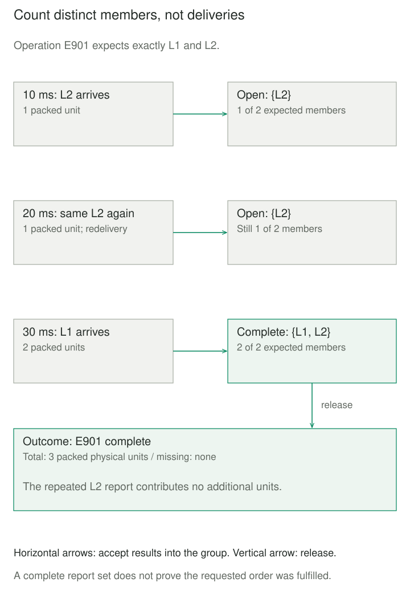

## Purpose and problem

A shop sends two order lines to separate packing workers. The mug result arrives first, twice; the book result arrives later. The status screen needs one summary for the order operation, rather than three unrelated notifications or a premature declaration that both lines have reported.

Waiting for two deliveries is insufficient because retries can repeat a result. Waiting indefinitely is also unsafe: one worker might never reply. The design needs to remember partial progress while making its definition of a finished group explicit.

## Core idea

An **Aggregator** collects related messages until a completion condition permits it to produce one combined result. Three decisions define the pattern: **correlation** identifies the group, **completeness** decides when to release it, and **combination** determines the output's meaning.

The mental model is **group, wait, combine**. Message Aggregator is a descriptive name for this messaging pattern. It differs from a DDD Aggregate, which protects domain invariants behind a root, and from Fowler's Event Aggregator, which centralizes event subscriptions without requiring a complete group or reducing its contents.



## How it works

### Specify membership and release separately

Choose a correlation key for one operation or revision, not simply a long-lived order ID. Otherwise a delayed result from yesterday can enter today's group. The receiver must validate membership and source authority; knowing a correlation value is not permission to contribute.

Completeness might mean all expected members, a quorum, the first acceptable answer, or a time-bounded selection. A shipping summary may require every line, while a quote comparison can intentionally select among responses received before a deadline. These policies produce different business meanings. If membership is unknown, a trustworthy end marker or another explicit completion rule is needed.

Duplicate handling belongs to the group contract. Count a member once, and define what conflicting replacements mean. A sum is order-independent; concatenating records is not. Receipt order should not silently become business order.

### Own the state and its lifecycle

The group owner serializes membership updates and release, including timeout races. Multiple instances need coordinated ownership or storage concurrency control; a process-local lock cannot coordinate independent servers. Spring Integration documents group-level locking and retained completion metadata for late arrivals.

Define whether expiry releases a partial result, discards the group, or produces an incomplete outcome. Also distinguish an absolute deadline from an inactivity timer that resets on traffic. Camel exposes several completion policies; choosing one is part of the application contract.

Durable implementations must coordinate stored progress, input acknowledgment, and output publication. A crash after marking a group complete but before sending its summary can lose the output; the reverse order can duplicate it. A transactional handoff plus idempotent downstream processing may be needed. RabbitMQ publisher confirms and consumer acknowledgments cover separate transport boundaries, not this whole workflow.


## Worked example

### One bounded packing-result group

Save these files together and run `python3 demo.py` with Python 3.10 or later. Inputs come from authorized workers: operation ID, line ID, and 0–1000 packed physical units. Zero is a valid report. Complete means every expected line reported, not that requested quantities were fulfilled.

`aggregator.py` owns one group of 1–100 unique expected IDs. Identifiers are ASCII strings of 1–64 characters. Calls are sequential; integer timestamps use one nondecreasing, monotonic millisecond clock starting at zero. The caller schedules `poll` even if no messages arrive. Empty work takes a separate path upstream.

```python
from dataclasses import dataclass
import re


def identifier(value):
    if not isinstance(value, str) or not re.fullmatch(r"[A-Za-z0-9_-]{1,64}", value):
        raise ValueError("Invalid identifier")
    return value


@dataclass(frozen=True)
class Outcome:
    group_id: str
    status: str
    total_units: int | None
    missing: tuple


class Aggregator:
    def __init__(self, group_id, expected, deadline_ms):
        self.group_id = identifier(group_id)
        if not isinstance(expected, (list, tuple)) or not 1 <= len(expected) <= 100:
            raise ValueError("Expected 1..100 members")
        self.expected = frozenset(identifier(item) for item in expected)
        if len(self.expected) != len(expected):
            raise ValueError("Repeated expected member")
        if type(deadline_ms) is not int or deadline_ms < 0:
            raise ValueError("Invalid deadline")
        self.deadline = deadline_ms
        self.seen, self.last_ms, self.result = {}, 0, None

    def poll(self, now_ms):
        if type(now_ms) is not int or now_ms < self.last_ms:
            raise ValueError("Clock must be nondecreasing integer milliseconds")
        self.last_ms = now_ms
        if self.result is None and now_ms >= self.deadline:
            missing = tuple(sorted(self.expected - self.seen.keys()))
            self.result = Outcome(self.group_id, "timed_out", None, missing)
            return self.result
        return None

    def accept(self, group_id, line_id, units, now_ms):
        if identifier(group_id) != self.group_id or identifier(line_id) not in self.expected:
            raise ValueError("Unexpected group or member")
        if type(units) is not int or not 0 <= units <= 1000:
            raise ValueError("Packed units must be an integer from 0 to 1000")
        due = self.poll(now_ms)
        if self.result is not None:
            return due
        if line_id in self.seen:
            if self.seen[line_id] != units:
                raise ValueError("Conflicting duplicate")
            return None
        self.seen[line_id] = units
        if self.seen.keys() == self.expected:
            self.result = Outcome(self.group_id, "complete", sum(self.seen.values()), ())
            return self.result
        return None
```

`demo.py` sends reordered results, repeats a member, and tests the exact deadline:

```python
from aggregator import Aggregator


a = Aggregator("E901", ["L1", "L2"], deadline_ms=100)
print("first:", a.accept("E901", "L2", 1, now_ms=10))
print("duplicate:", a.accept("E901", "L2", 1, now_ms=20))
result = a.accept("E901", "L1", 2, now_ms=30)
print(result.group_id, result.status, result.total_units)
print("after closure:", a.accept("E901", "L1", 2, now_ms=40))

b = Aggregator("E902", ["L1", "L2"], deadline_ms=100)
b.accept("E902", "L1", 2, now_ms=20)
result = b.accept("E902", "L2", 1, now_ms=100)
print(result.group_id, result.status, "missing:", result.missing)
```

The first two outputs are `first: None` and `duplicate: None`. Then come `E901 complete 3`, `after closure: None`, and `E902 timed_out missing: ('L2',)`. At 100 milliseconds expiry wins; no partial total masquerades as a complete result. Each instance returns at most one outcome, retains it in `result`, and ignores subsequent valid contributions. Conflicting duplicates are rejected while open.

## When to use it

Use Aggregator when several independently arriving facts must support one downstream decision: document analysis sections, distributed line results, or competing offers. State the release policy before selecting infrastructure.

If one synchronous function already has all values, ordinary collection processing may suffice. If consumers need independent events, forcing a combined result introduces unnecessary waiting.

## Tradeoffs and common mistakes

Slow or missing members retain state and delay decisions. Bound active groups, members, payload bytes, and completion records; the example bounds one group only. Discarding closed-group metadata too soon lets late messages recreate old work. Never reuse an operation ID during its possible redelivery lifetime.

This in-memory simulation has no restart recovery, transport, automatic scheduling, or reliable publication. Its single local release is not exactly-once delivery. The caller must treat stored state and configuration as private, using `accept` and `poll` to update progress. After a timeout, workers may still finish; cancellation and compensation require separate protocols. A complete set of reports also does not establish an atomic snapshot across independently changing systems.

## Related patterns

- [[splitter|Splitter]] creates independent parts; Aggregator can later combine their results, but need not reconstruct the original payload.
- [[correlation-identifier|Correlation Identifier]] associates messages with their group; it supplies neither membership nor a release policy.
- [[data-idempotent-writes|Idempotent Writes]] prevents repeated deliveries from repeating effects. Group-level duplicate suppression alone does not protect an external output consumer.
- [[aggregate|Aggregate]] controls a domain consistency boundary. Aggregator manages a messaging group's progress and release.

## Sources

- [Hohpe and Woolf: Aggregator](https://www.enterpriseintegrationpatterns.com/patterns/messaging/Aggregator.html) establishes correlation, completeness, combination, and alternative release policies.
- [Spring Integration: Aggregator](https://docs.spring.io/spring-integration/reference/aggregator.html) documents group storage, locking, expiry, and late-message retention.
- [Apache Camel: Aggregate](https://camel.apache.org/components/4.22.x/eips/aggregate-eip.html) documents completion conditions, inactivity timeouts, closed keys, and persistent repositories.
- [RabbitMQ: Acknowledgements and Confirms](https://www.rabbitmq.com/docs/confirms) distinguishes transport confirmation boundaries.
- Fowler's [Event Aggregator](https://martinfowler.com/eaaDev/EventAggregator.html) and [DDD Aggregate](https://martinfowler.com/bliki/DDD_Aggregate.html) distinguish similarly named patterns.

The bounded packing simulation, deadline policy, validation limits, fixtures, and illustrations are original teaching material. Order-result collection follows EIP's motivating context.
