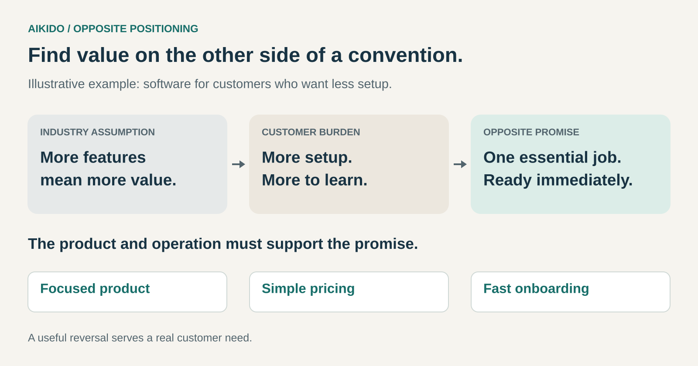

## What it is for

Use this pattern when competitors keep improving the same things, while some customers would benefit from a different set of priorities. Opposite positioning helps a business find an attractive alternative to an established industry convention—especially when that convention creates expense, complexity, inconvenience, or exclusion.

The opportunity is to build an offering around something customers value that the prevailing approach makes difficult to obtain.

## The core idea

Imagine a market for project-management software. Providers compete through longer feature lists, more configuration options, and increasingly sophisticated reporting.

For a large organization, those capabilities may be valuable. For a small team trying to coordinate a weekly workload, they may mean setup, training, and maintenance.

A provider could organize its offering around a different promise: one essential workflow, ready immediately.

That reversal becomes meaningful when it shapes the product and the business behind it. A focused workflow, straightforward pricing, and quick onboarding would support the promise. An extensive implementation project would undermine it.

The [Business Model Navigator calls this pattern Aikido](https://purchase.businessmodelnavigator.com/pattern?id=3): adopting a position opposed to an established competitive approach. “Opposite positioning” makes the practical mechanism explicit.

## How an industry strength becomes a customer burden

An established strength usually exists for a reason. Extensive choice serves customers with varied requirements. Personal service helps people who want guidance. Sophisticated products reward experienced users.

Each strength also carries consequences.

Choice requires selection. Personal service can require appointments and waiting. Sophistication can demand knowledge and practice. A business that understands these consequences may discover customers who would willingly exchange part of the conventional benefit for something else.

The reversal therefore depends on three connected elements:

- **A prevailing assumption:** what providers commonly treat as desirable.
- **A customer tension:** the burden that assumption creates for a particular group.
- **A credible alternative:** an offering whose design resolves that tension.

“Fewer features” becomes useful when it means less work for the customer. “Less personal service” becomes useful when it means immediate access and greater independence. The customer benefit gives the reversal its direction.

## Nintendo Wii: making participation easier

Nintendo’s Wii, introduced in 2006, made accessibility central to its approach to console gaming. The controller was part of that positioning.

In Nintendo’s development interviews, Shigeru Miyamoto described wanting a controller people would feel inclined to pick up. The team questioned conventions such as holding a controller with both hands. Satoru Iwata connected the remote’s name and familiar form to the everyday television remote—something many people already felt comfortable using. [Nintendo’s account of the Wii Remote’s development](https://iwataasks.nintendo.com/interviews/wii/wii_remote/0/1/).

Viewed through opposite positioning, the move changed the customer’s point of entry. Familiar actions and approachable interaction became important parts of the offer.

The controller gave substance to that promise. Accessibility appeared in the interface customers actually encountered, rather than remaining an advertising claim.

This case illustrates a reversal of priorities. It does not establish that accessibility alone explains the Wii’s results, or that every gaming customer preferred that approach.

## Swatch: changing what a Swiss watch could mean

Swatch’s launch in 1983 challenged an established image of the Swiss watch as an expensive, enduring possession. It presented an affordable, expressive accessory that could be chosen for its design and worn as a “second watch.” MoMA describes this shift toward stylish, collectible accessories in its account of the early Swatch designs. [MoMA’s Swatch collection entry](https://www.moma.org/collection/works/3248).

The positioning had an operational foundation. Swatch Group’s history describes a watch built from 51 components and assembled on automated production lines. Simplified construction helped support the accessible offer while retaining Swiss manufacture. [Swatch Group’s history](https://www.swatchgroup.com/en/swatch-group/swatch-group-history).

The historical context matters: Swiss producers also faced strong competition from inexpensive quartz watches. Swatch combined manufacturing innovation with a distinctive proposition; the story involves considerably more than a change in brand image.

Through this pattern’s lens, the useful lesson is the alignment between meaning and production. An expressive, accessible watch required a product and cost structure capable of delivering it.

## What makes the position credible

Opposite positioning becomes stronger when customers can recognize the difference through experience.

A business promising independence needs tools customers can use without assistance. A business promising simplicity needs clear decisions about scope. A business promising an unusually personal experience needs time, staffing, and economics that support that attention.

These choices often involve deliberate sacrifices. Serving the chosen customer well may mean declining features, channels, or service arrangements that would attract someone else.

The coherence matters more than the number of differences. A focused business can reverse one consequential convention while retaining many familiar features of its category.

## When it helps

This pattern is particularly useful when customers repeatedly describe the same frustration with the category: too much choice, excessive complexity, intimidating expertise, inflexible processes, or a service level they do not need.

It can also help when potential customers stay outside a market because the conventional offer seems designed for somebody else. Their reluctance may reveal a different definition of value.

The opportunity becomes more convincing when the alternative has workable economics. Removing complexity might reduce delivery costs. Providing greater flexibility might justify a premium. Either arrangement needs a customer benefit substantial enough to support purchasing.

## Common mistakes and limits

The first mistake is choosing a reversal before understanding the customer. An unusual offer can attract attention without creating a reason to buy.

Another is removing something customers consider essential. A feature may appear unnecessary until the circumstances in which it matters become visible. Successful positioning requires an accurate understanding of the trade-off customers will accept.

A third is expressing opposition entirely through messaging. The promise loses credibility when purchasing, delivery, or use reproduces the same burdens customers hoped to escape.

Competitors can also respond. A different slogan or feature may be straightforward to imitate. A coordinated set of product, operational, and commercial choices can require a more substantial response, although it offers no permanent protection.

Finally, famous examples are illustrations, not controlled evidence. They help explain the mechanism; they cannot establish that reversing a convention will succeed in another market.

## Related patterns

[[no-frills|No Frills]] can express opposite positioning when customers prefer an essential benefit at lower cost. Its focus is the removal of extras.

[[ultimate-luxury|Ultimate Luxury]] can also express a reversal when a category prioritizes speed, standardization, or low prices and customers value exceptional attention or exclusivity.

[[experience-selling|Experience Selling]] changes the surrounding experience into part of the offering. It can support opposite positioning when the conventional customer journey is itself a source of dissatisfaction.

[[reverse-innovation|Reverse Innovation]] concerns transferring solutions developed in one market context into another. Such a transfer may challenge established assumptions, but its defining mechanism is the movement between contexts.
