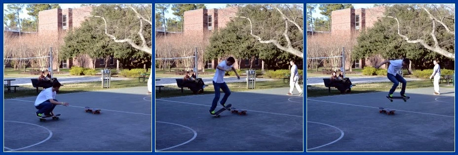

A skateboarder crouches, straightens, and jumps. If you wait to notice the airborne shape before
raising the camera, the opportunity may already have passed. Watching the crouch gives you
information about what comes next. You can prepare the frame, focus behavior, and exposure
before the movement reaches the instant you want to show.

Observe an unfolding event and use its visible cues to get ready. Anticipation is informed
preparation, not predicting the future perfectly. A direction of travel, a repeated action,
a change in posture, or a person's attention can suggest when and where a useful moment
may occur. Stay responsive when the event departs from your expectation.

[Original sequence](https://commons.wikimedia.org/wiki/File:Popping_An_Ollie_(I_think)_(8463588620).jpg)
· [CC BY 2.0](https://creativecommons.org/licenses/by/2.0/). Converted to WebP; order retained.

## Prepare for a condition, not an abstract peak

Think of a useful moment as a visible condition. You might want feet separated from the
ground, a hand meeting another hand, or a face turned into light. “The best moment” is
too vague to prepare for. A recognizable condition helps you choose a position and notice
the cues that precede it.

In the sequence, the airborne phase shows a spatial separation that the crouch cannot. That
makes it useful for an image about lift. The crouch might better explain effort or preparation.
The selection follows intention, not a rule that the highest or fastest instant is always
best. [[choose-your-subject|Choose Your Subject]] establishes that prior decision.

Anticipation differs from [[find-the-frame-then-wait|Find the Frame, Then Wait]]. There, a fixed
composition provides the structure while an event enters it. Here, you may follow the subject
or adjust the frame as behavior unfolds. [[work-the-scene|Work the Scene]] concerns deliberate
variation more broadly, including subjects that are not about to move.

## Observe a repeated action

At a public demonstration or organized sport, watch an action before photographing it. A
person may consistently shift their weight before a jump, or glance toward a teammate before
passing. You can choose a view where the resulting gesture has a clear outline and enough
space around it. Keep your position safe and avoid interfering with the participants.

If you want an airborne shape, check the background behind the likely location, not merely
where the person starts. A dark body against a dark wall may merge at the critical point.
Moving beforehand can make the eventual moment readable. A short enough exposure may preserve
the gesture; a longer one may communicate movement differently. [[freeze-or-show-motion|Freeze or Show Motion]] explains that choice.

A burst can increase the number of nearby instants available, but it does not replace
positioning or intention. Camera buffers, focus behavior, and phone processing differ. Some
devices delay a capture while combining images, or retain frames from just before a press.
Learn the behavior of the device in your hand rather than assuming a burst guarantees the moment.

## Follow interaction without scripting it

At a family gathering, someone begins telling a familiar story. You notice the listeners
lean forward and the speaker pause before a punchline. Holding the camera ready can help
you catch a shared response. The useful image might show the listeners' hands and faces
together rather than a single laughing mouth.

Do not treat the expected reaction as an obligation. People may respond differently, and
some may prefer not to be photographed. Ask about their comfort in advance when possible,
and remain part of the social situation. Repeatedly asking for an authentic laugh can turn
the interaction into a performance that nobody wanted.

If you miss the first response, consider whether another unforced moment is available rather
than demanding a reconstruction. In documentary contexts, a directed reenactment should not
be represented as the original event. [[give-people-something-to-do|Give People Something to Do]]
covers explicitly collaborative activity, where some direction is understood and welcomed.

## Anticipate a changing environment

At the coast, a wave builds before it breaks. Watching a few cycles can help you choose
where to frame the spray and when to begin photographing. Water does not repeat exactly,
so leave room for variation. Stay well back from hazardous edges and unpredictable surf;
a photograph is not a reason to test how close you can stand.

In a street scene, a person approaching a patch of light gives another cue. You can prepare
for their face or clothing to become visible there, while accepting that they may stop,
turn, or take a different route. The scene's event remains theirs. Your task is to observe
without obstructing or manipulating it.

## Review the preparation as well as the result

This pattern helps with gestures, sport, ordinary movement, animals observed without disturbance,
and social interactions where readiness matters. It works with phones and cameras. If focus
repeatedly lands behind a moving person, [[focus-on-what-matters|Focus on What Matters]] may
be the next useful change rather than simply pressing earlier.

When reviewing, compare frames before and after your selection. Ask which visible cue helped
and what remained unpredictable. A missed frame can reveal that you chose the wrong background
or began following too late. [[review-one-thing-at-a-time|Review One Thing at a Time]] turns
that observation into a specific next experiment. Anticipation develops through noticing
patterns in events while preserving the freedom to photograph something you did not expect.
