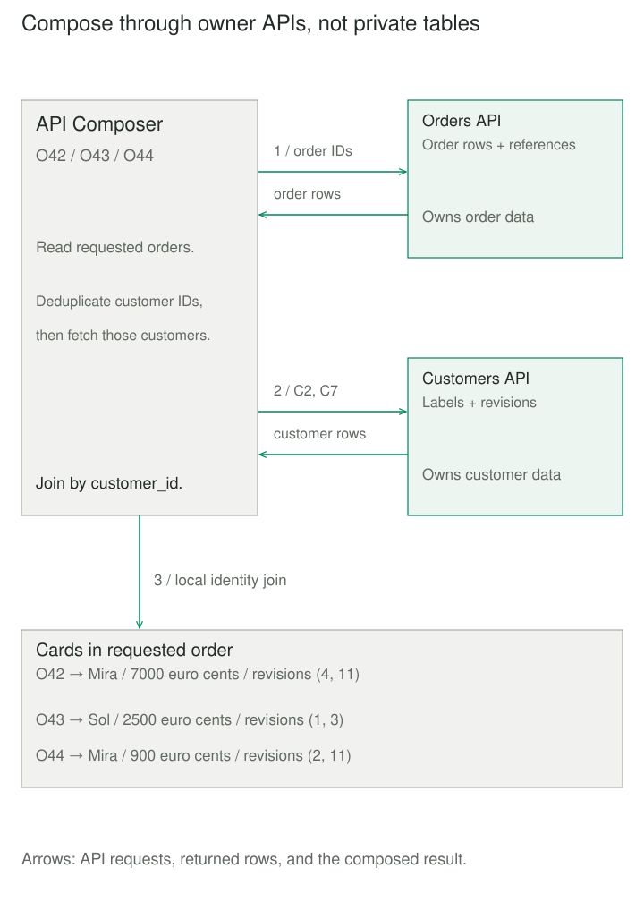
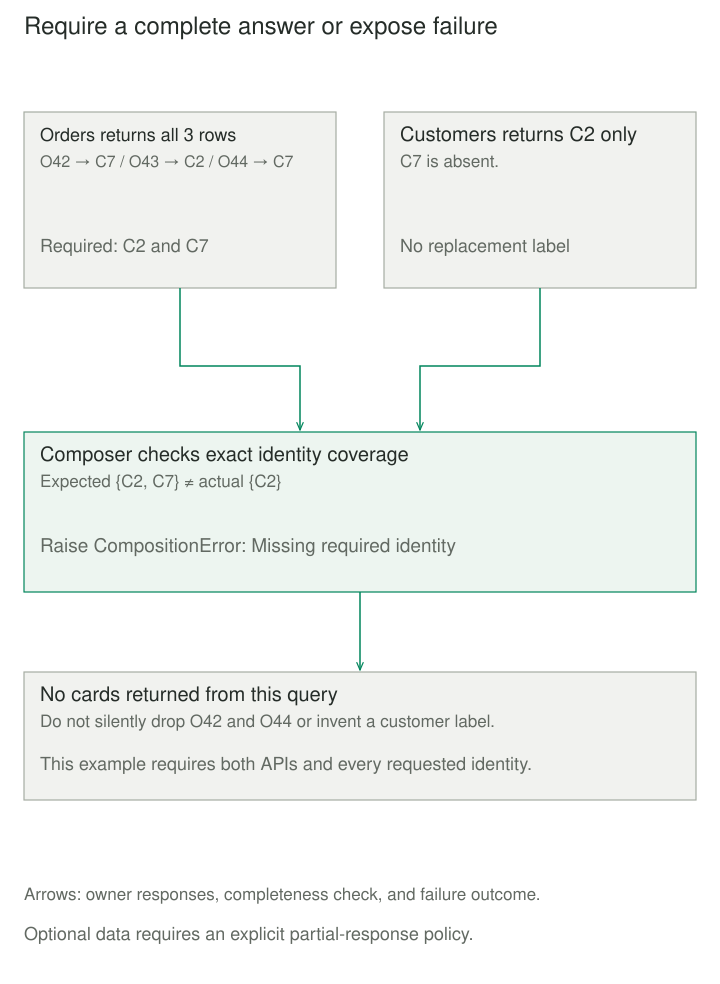

## Purpose and problem

An order dashboard needs order totals and customer labels. Orders owns the orders; Customers owns the labels. The old SQL join crossed both tables, but those tables now belong to independently evolving services. Giving the dashboard access to both databases would couple it to private schemas.

The client could assemble everything itself. Then every client needs the lookup sequence, identity matching, and failure policy. A screen with fifty orders can easily become fifty customer requests. The application needs one useful answer without taking ownership of another service's storage.

## Core idea

**Ask the owners; join their answers.** An API Composer implements a query by invoking the services responsible for its data and combining the returned representations in memory.

API Composer names the component, not a separate pattern. It might live in a client, gateway, backend for a frontend, or dedicated query service. **Gateway Aggregation** describes aggregation at a gateway; that placement is not required here. An API gateway that merely routes calls does not perform composition.

The join needs explicit identity and cardinality rules. Match a customer by customer ID, not by its position in a response. Decide whether missing data means absence, a forbidden record, an unavailable dependency, or an invalid contract. These meanings should not collapse into a convenient default.



## How it works

### Plan the read before making calls

Select only the fields and records needed. Bound page sizes, response bytes, and downstream work. Batch repeated keys where contracts permit. Independent reads can run concurrently; dependent reads add to the critical path. Parallelism does not remove fan-out cost or make a large in-memory join efficient.

Each owner still enforces its own data contract. The composer must propagate appropriate caller context, authorize the requested view, and expose only permitted fields. Authentication at the front door is insufficient if downstream calls use broader privileges. Clients and adapters own their connection pools and cleanup.

### Choose a consistency and failure contract

Separate reads do not create a shared snapshot. An order revision and customer revision describe different observations, not one comparable global version. A display may tolerate that combination; a decision requiring a cross-service invariant needs another protocol.

Define required and optional dependencies. A required failure can fail the whole query. An optional failure can return an explicitly incomplete result when the product permits it. Do not represent an unavailable balance as zero or a missing customer as a successful empty join.

Use an overall time budget, bounded per-service calls, cancellation, and controlled retries. Monitor dependency latency, response sizes, and fan-out. Caching can reduce load while changing freshness and authorization requirements. A materialized read model can replace repeated expensive composition, with its own maintenance and lag contract.



## Worked example

### Three cards, two batch calls

Save `composition.py` and `demo.py` together; run `python3 demo.py` with Python 3.11+. The asynchronous functions stand in for read APIs. Their adapters are assumed to return validated, immutable response records—data transfer objects, or DTOs—with valid IDs, nonnegative totals in integer euro cents, positive version numbers maintained by each service, and labels the caller is allowed to see. The composer checks request bounds, response identity, and missing results; it does not implement network decoding or authentication.

A request contains 1–50 distinct ASCII IDs of 1–64 characters. Both APIs return at most fifty rows. Customer IDs are deduplicated and sorted for the second batch; the final cards follow requested order. Both services are required. The total cooperative timeout covers both dependent reads, rather than restarting a full budget per call.

```python
import asyncio
import math
import re
from dataclasses import dataclass


class CompositionError(Exception):
    pass


@dataclass(frozen=True)
class Order:
    id: str
    customer_id: str
    total_cents: int
    revision: int


@dataclass(frozen=True)
class Customer:
    id: str
    label: str
    revision: int


def identifier(value):
    if not isinstance(value, str) or not re.fullmatch(r"[A-Za-z0-9_-]{1,64}", value):
        raise ValueError("Invalid identifier")
    return value


def indexed(rows, requested):
    if len(rows) > 50:
        raise CompositionError("Oversized API response")
    result = {}
    for row in rows:
        if row.id not in requested or row.id in result:
            raise CompositionError("Duplicate or unexpected identity")
        result[row.id] = row
    if set(result) != set(requested):
        raise CompositionError("Missing required identity")
    return result


async def compose(order_ids, read_orders, read_customers, budget_s=0.2):
    if not isinstance(order_ids, (list, tuple)) or not 1 <= len(order_ids) <= 50:
        raise ValueError("Request must contain 1–50 order IDs")
    ids = tuple(identifier(value) for value in order_ids)
    if len(set(ids)) != len(ids):
        raise ValueError("Duplicate requested ID")
    if (type(budget_s) not in (int, float) or not math.isfinite(budget_s)
            or not 0.01 <= budget_s <= 1):
        raise ValueError("Budget must be 0.01–1 seconds")
    try:
        async with asyncio.timeout(budget_s):
            orders = indexed(await read_orders(ids), ids)
            customer_ids = tuple(sorted({orders[key].customer_id for key in ids}))
            customers = indexed(await read_customers(customer_ids), customer_ids)
            return [{"order_id": key, "customer_label": customers[orders[key].customer_id].label,
                     "total_cents": orders[key].total_cents, "currency": "EUR",
                     "observed_revisions": (orders[key].revision,
                         customers[orders[key].customer_id].revision)} for key in ids]
    except TimeoutError as error:
        raise CompositionError("Read timed out") from error
    except ConnectionError as error:
        raise CompositionError("Dependency unavailable") from error
```

The fixtures deliberately return rows out of order. O42 and O44 share C7. The final call omits C7 to demonstrate the required-data policy.

```python
import asyncio
from composition import Order, Customer, CompositionError, compose


calls = []


async def read_orders(ids):
    calls.append(("orders", ids))
    await asyncio.sleep(0)
    return [Order("O43", "C2", 2500, 1), Order("O44", "C7", 900, 2),
            Order("O42", "C7", 7000, 4)]


async def read_customers(ids):
    calls.append(("customers", ids))
    await asyncio.sleep(0)
    return [Customer("C7", "Mira", 11), Customer("C2", "Sol", 3)]


async def incomplete_customers(ids):
    return [Customer("C2", "Sol", 3)]


async def main():
    ids = ("O42", "O43", "O44")
    for card in await compose(ids, read_orders, read_customers):
        cents = card["total_cents"]
        print(card["order_id"], card["customer_label"],
              f"EUR {cents // 100}.{cents % 100:02d}", card["observed_revisions"])
    print("batches:", len(calls), calls[-1][1])
    try:
        await compose(ids, read_orders, incomplete_customers)
    except CompositionError as error:
        print("rejected:", error)


asyncio.run(main())
```

The cards print `O42 Mira EUR 70.00 (4, 11)`, `O43 Sol EUR 25.00 (1, 3)`, and `O44 Mira EUR 9.00 (2, 11)`. The revision pair is `(order, customer)`. Then `batches: 2 ('C2', 'C7')` reports two upstream calls and the distinct customer batch; `rejected: Missing required identity` confirms that no incomplete cards are returned.

The timeout relies on cooperative adapters and does not preempt blocking code or guarantee a hard wall-clock limit. External cancellation propagates; adapters must release their requests. There is no HTTP, storage, caching, retry loop, cross-service snapshot, or production authorization implementation here.

## When to use it

Use API Composition for selective queries spanning a modest number of owners, where existing API contracts can supply bounded results and the combined freshness is acceptable. It avoids maintaining another stored copy solely for an occasional read.

For a single owner, an ordinary query or batch endpoint may suffice. For large joins, broad scans, expensive repeated dashboards, or requirements for a coordinated historical view, consider a purpose-built read model instead.

## Tradeoffs and common mistakes

Each query inherits dependency latency and availability. Nested composition can multiply requests invisibly. A read-only screen can still overload its services. Capacity planning and bulkheads matter alongside request-level timeouts.

Do not recreate database joins by fetching whole tables through APIs. Pagination, duplicate identities, missing rows, currency meanings, and authorization all affect correctness. Sorting or slicing a partially joined page can also make totals and page membership misleading. Evolve the query contract deliberately rather than silently changing its join semantics.

## Related patterns

- [[database-per-service|Database per Service]] keeps data private to its owner. API Composition reads across owners through their published contracts.
- [[cqrs|CQRS]] separates command and query models; API Composition can implement a query side without requiring a stored read database.
- [[data-materialized-views|Materialized Views]] stores derived answers for reuse, trading maintenance and freshness management for cheaper reads.
- [[aggregator|Aggregator]] collects correlated messages until a completion condition is met. API Composition is an on-demand query plan and identity join; an asynchronous implementation may use aggregation internally.

## Sources

- [Richardson: API Composition](https://microservices.io/patterns/data/api-composition.html) establishes owner API calls and in-memory joins, with large-result limitations.
- [Richardson: Database per Service](https://microservices.io/patterns/data/database-per-service.html) explains private data ownership and cross-service query choices.
- Microsoft: [Gateway Aggregation](https://learn.microsoft.com/en-us/azure/architecture/patterns/gateway-aggregation) addresses placement, dependency failures, partial responses, and operational limits; [Data considerations](https://learn.microsoft.com/en-us/azure/architecture/microservices/design/data-considerations) discusses ownership and cross-service data access.
- [Python 3.11: Coroutines and Tasks](https://docs.python.org/3.11/library/asyncio-task.html) documents cooperative timeouts, cancellation, and coroutine execution.

The order/customer fixtures, Python example, and diagrams are original teaching material.
