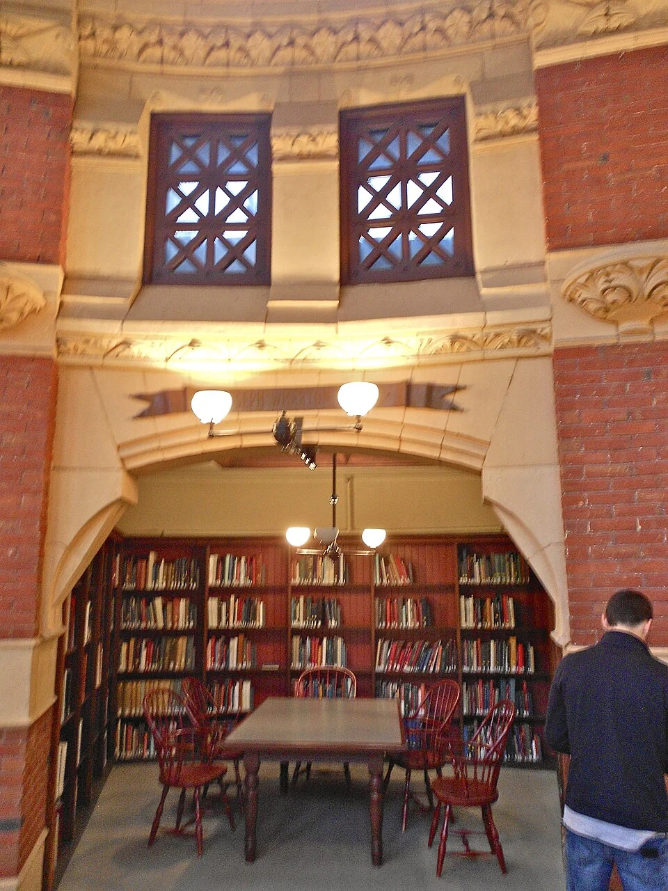
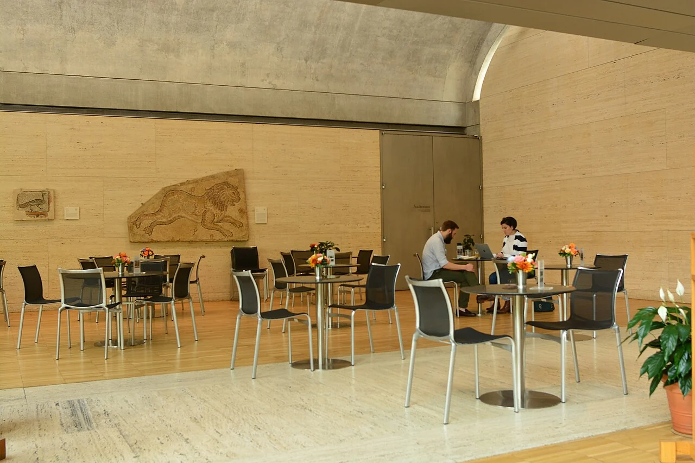

## What it is for

A shared lounge is comfortable when several people gather, but a person reading alone feels as if they are occupying a stage. There are chairs everywhere and no smaller setting. They move to the edge, turn a chair slightly away and pull a plant beside it. They are making an alcove with whatever the room allows.

## The core idea

Alexander's **Alcoves** gives a larger room smaller places within it. An alcove is a partly enclosed pocket made by a recess, short wall, canopy or furniture. It lets a reader or small group stay connected to the room while occupying a more contained setting. Its shape, approach and furniture should fit that activity, with a clear way in and out and a useful view toward or away from the larger gathering.

## How it works

Place a smaller pocket beside the larger room. A short wall turning into the space—a return wall—can give a seat a protected side; a canopy can lower the apparent ceiling. Keep the approach clear and choose its view. Then establish whether the activity needs partial enclosure, quieter conditions or full speech privacy.

## Why it works

A large room can imply a group even when it is empty. A smaller pocket gives one person or a small group a clearer territory. A protected back and a framed outward view may reduce exposure while keeping awareness of the larger activity. The person can participate at the edge rather than choosing only between full involvement and leaving.

These effects depend on individual preference and context. Some people find a deep recess comfortable; others find it confining or difficult to exit. A good arrangement offers options. It also recognizes that visual separation is not acoustic separation. A small canopy may change perceived scale while leaving conversation in the larger room completely audible. Describe the benefit accurately rather than promising a quiet room where none exists.

## Architectural examples

### Furness Library — a smaller room at the edge

At Furness Library, a broad arch connects a smaller reading area to the surrounding interior. The framed opening and lower enclosure distinguish a place for a table while allowing a view into the larger room. It is an example of a room within a room: the smaller place has an identity without becoming completely detached from the shared setting.

[Photograph source](https://commons.wikimedia.org/wiki/File:Furness_Lib_nook_UPenn.JPG) · [License](http://creativecommons.org/publicdomain/zero/1.0/deed.en)

### The Hall of the Kings, Alhambra

In the Alhambra's Hall of the Kings, smaller alcoves flank a larger hall and relate to openings toward the court. The Patronato's account describes those connections. Several scales of gathering can therefore be read within the same arrangement. For a contemporary setting, the useful question is which activities benefit from a smaller pocket and how they should remain connected to the room around them.

### A school library — illustrative scenario

Consider a school library. A broad reading room includes an edge pocket with a few seats and a low screen, visible from the staffed area. Pupils can read with less exposure while remaining connected to supervision. The location avoids the main route and allows a wheelchair to join the same group. A completely hidden recess might offer more enclosure but conflict with the school's safeguarding and operational needs.

### The Kimbell Art Museum: an occupied-edge comparison

[Photograph source](https://commons.wikimedia.org/wiki/File:Kimbell_Art_Museum_interior_02.jpg) · [License](https://creativecommons.org/licenses/by-sa/4.0)

The Kimbell photograph offers a comparison at the edge of a larger institution. Its overhead form helps distinguish a smaller occupied setting. An alcove can use a similar change in enclosure without reproducing the museum's particular furniture or geometry. Compare what a seated person can see, where others pass and how the overhead boundary changes the scale of the place.

## Design considerations

A reading place, a confidential conversation and a place for relief from overwhelming noise or activity have different requirements. An alcove can support the first while failing the others. If speech privacy is essential, a properly designed enclosed room may be necessary. If low stimulation is the aim, glare, mechanical noise and passing movement matter as much as the small footprint. Start with the activity, not the image of a snug niche.

Compare how the pocket works for one reader, two companions and a small group. An arrangement that suits a solitary reader may leave a pair facing awkwardly into a wall. Move chairs and test conversation distance rather than assuming built-in upholstery can accommodate every use. Where the room serves several groups, a modest open corner with movable supportive chairs may be more adaptable than a tightly fitted booth.

An alcove can also become a storage bay if nobody owns its maintenance. Consider cleaning, damaged upholstery, power access and how furniture can be replaced. If a bench is fixed, inspect the space behind and beneath it for maintenance needs. The architectural promise of a protected corner should not depend on inaccessible surfaces that become neglected over time.

Test sightlines from seated and standing positions, including people with different heights and mobility. Coordinate fire safety, acoustics, accessibility and safeguarding where relevant. Avoid claiming health benefits from enclosure alone; responses vary and some users need a more open setting.

## Useful when

This pattern helps in shared homes, libraries, schools, offices and waiting areas where people want varied degrees of participation. It is especially useful when a large room must support both groups and individuals. It can be implemented with modest furniture changes, but built-in elements may offer a more dependable arrangement where circulation and maintenance need consistency.

- Our large room has no smaller place to sit quietly.
- Can someone withdraw without leaving a shared space?
- How do we add a reading corner without another enclosed room?
- The open lounge feels too exposed for one person.
- We need a quieter edge beside a communal activity.
- How can an alcove remain visible enough for supervision?
- Our seating niche feels cramped rather than comfortable.
- Would a screen or a deep wall recess help this room?

## Common mistakes and limits

Common mistakes include making the recess too shallow for the intended furniture, placing it in an escape route, and giving the only enclosed seat to people able to climb onto a high platform. Another is lining every edge with identical small booths, removing places for larger groups and reducing flexibility. The right mix depends on the building's actual users and routines.

## Related patterns

[[arch-refuge|Refuge]] develops the choice of protected exposure, [[arch-common-areas-at-the-heart|Common Areas at the Heart]] supplies the larger social setting, and [[arch-flexibly-linked-rooms|Flexibly Linked Rooms]] offers stronger separation when a pocket is insufficient.

## Sources and provenance

Established named pattern. Christopher Alexander, Sara Ishikawa, Murray Silverstein, with Max Jacobson, Ingrid Fiksdahl-King and Shlomo Angel. The explanations and diagrams here are independently authored.

- [A Pattern Language, pattern 179; Alexander, Ishikawa, Silverstein and colleagues](https://www.patternlanguage.com/apl/aplsummary.htm)
- [Patronato de la Alhambra: The Hall of the Kings](https://www.alhambra-patronato.es/en/edificios-lugares/the-hall-of-the-kings)
- [Kimbell Art Museum: The Louis I. Kahn Building](https://50.kimbellart.org/architecture/the-louis-i-kahn-building/)
- [University of Pennsylvania: Fisher Fine Arts Library](https://facilities.upenn.edu/maps/locations/fisher-fine-arts-library-anne-and-jerome)
