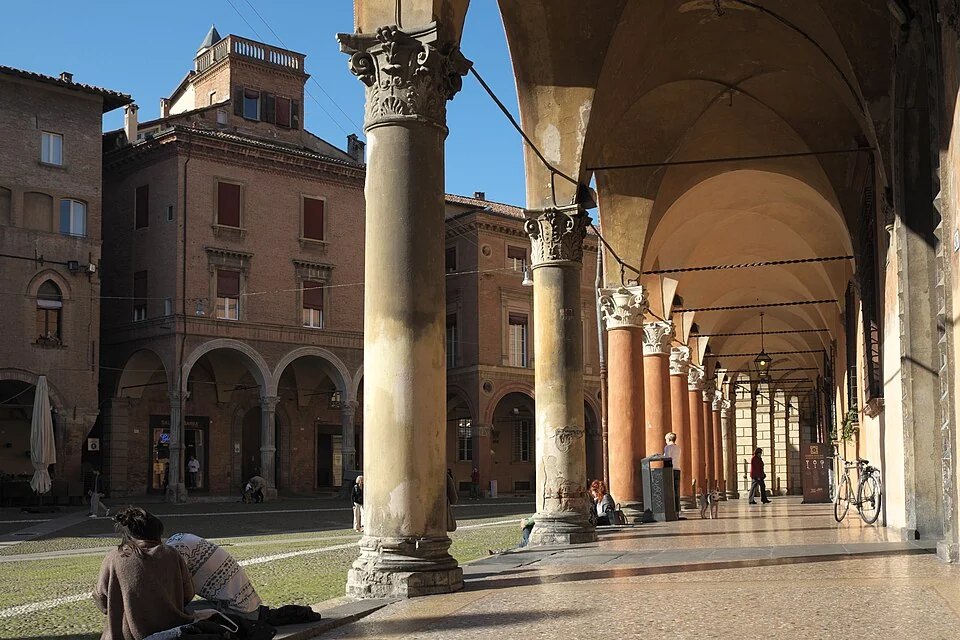
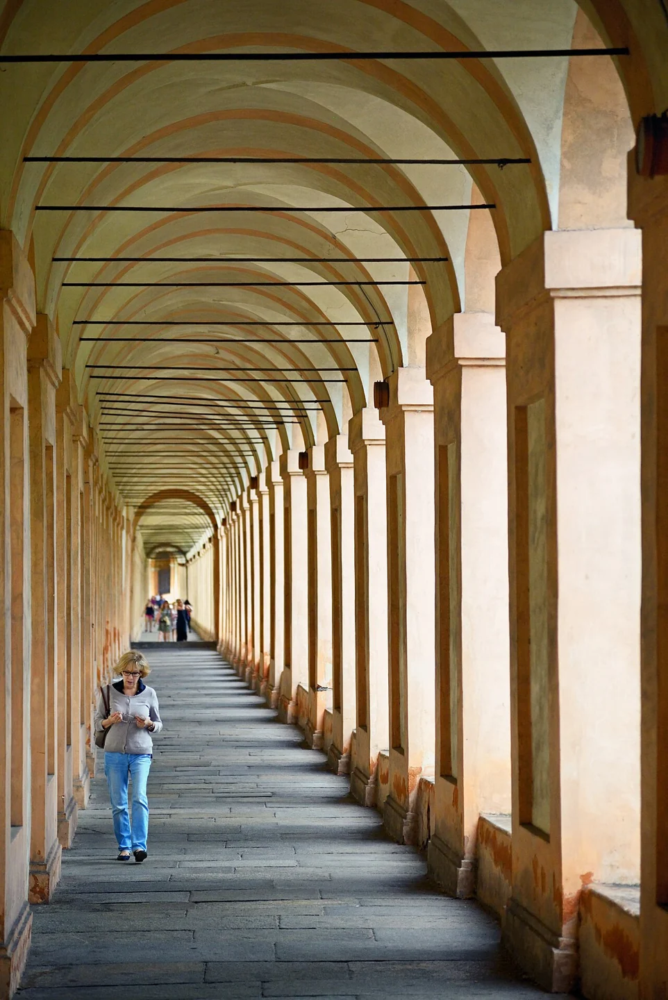

## What it is for

A street has useful shops and public rooms, yet rain turns the walk between them into a series of sprints. Each entrance has its own small canopy, leaving the gaps exposed. On another street, a continuous covered edge lets people browse, pause and meet without stepping out of the ordinary pedestrian route. The roof is doing more than protecting a doorway: it is organizing a shared piece of city.

## The core idea

An **Arcade**, in Alexander's pattern, is a sheltered walkway along a building edge, open toward the street or court. Columns or solid supports hold its roof and mark a space between outside and inside. Arches are optional; a contemporary covered walkway can serve the same purpose. Its value comes from connecting useful destinations while giving people room to walk, enter and pause.

## How it works

Connect public destinations with a continuous sheltered edge. Lay out the clear walking zone separately from doors, columns, queues and seats. Check its connections at corners and entrances, and establish how public access and maintenance will operate. Test the roof against the weather it is meant to moderate.

## Why it works

An arcade gives several activities room to coexist. A person can keep walking, turn toward a shop or pause beside the wall while still seeing the street. The repeated spaces between supports are called bays; their rhythm can make a route easier to follow. Roof cover provides shelter, although its depth and orientation determine how much low sun or wind-driven rain reaches the walkway.

The key relationship is continuity. A single attractive bay does little for someone trying to reach the next destination in heavy rain. Connections at corners and crossings matter, as do opening hours and ownership. A route advertised as public but routinely closed by a private operator is a different urban proposition from one whose public access is secured. Clarify that arrangement before using the arcade as a central circulation strategy.

## Architectural examples

### Bologna’s porticoes

Bologna's porticoes—its roofed walkways along building fronts—form an extensive and varied network. UNESCO describes how sheltered movement, commerce and public use meet along edges that often belong to private buildings. The two photographs show different parts of that relationship: a street portico with doorways and a long repeated route toward the Sanctuary of the Madonna di San Luca.

[Photograph source](https://commons.wikimedia.org/wiki/File:Bologna_Portico_di_Santo_Stefano_325.jpg) · [License](https://creativecommons.org/licenses/by-sa/3.0)

[Photograph source](https://commons.wikimedia.org/wiki/File:Arcade_of_Sanctuary_of_the_Madonna_di_San_Luca,_Bologna,_Italy.jpg) · [License](https://creativecommons.org/licenses/by-sa/3.0)

The San Luca portico makes continuity particularly easy to see. One bay leads toward the next, so the roof belongs to a journey as well as a building. For a new route, assess steps, slopes, resting places and opening hours along its entire length. A break at a crossing or a locked gate can determine who reaches the destination, regardless of the quality of individual bays.

### A clinic campus — illustrative scenario

An illustrative example is a group of clinic buildings. A continuous sheltered path could connect reception, a pharmacy and transport pickup, with seats beside rather than within the clear route. The roof must connect at doors without introducing leaks or awkward level changes. Privacy and infection-control requirements may limit some informal waiting uses. The pattern supplies a spatial option, not an assumption that every clinical function belongs along an open gallery.

## Design considerations

The clear walking zone and the occupied edge are different needs. Door swings, queues, seating, signs and columns can progressively consume the route until shelter remains only for people who can squeeze through. Draw these uses at the same time. Test the experience of someone using a wheelchair, carrying shopping or walking beside another person. A nominal width on a dimension string does not guarantee an unobstructed path in use.

A shallow roof may shade a high midday sun while doing little against low western sun or wind-driven rain. The arcade's orientation and height matter, as do local wind conditions and the placement of drainage. Water falling from its edge should not create a wet crossing at every entrance. In cold conditions, sheltered routes still need suitable surfaces and winter maintenance.

Coordinate roof supports, foundations, drainage, lighting, access and fire separation before fixing the walkway layout. A column moved to simplify the structure can narrow a doorway approach; an outlet can put water across the main path. Where the arcade is part of an emergency escape route, have the fire designer assess that role with the proposed doors, furniture and uses in place.

## Useful when

This pattern helps where regular pedestrian movement meets strong sun, frequent rain or a sequence of public entrances. It can also support school circulation and courtyard edges. Its value decreases where the roof darkens already gloomy rooms, where a route has no nearby destinations, or where maintenance and public access cannot be sustained. An empty walkway lined with columns can feel more isolated than a well-observed open pavement.

- People hurry past our building because there is no shelter.
- Could a covered walkway make the street more usable?
- How wide should a sheltered edge feel when people also stop there?
- Our shopfront canopy does not connect to the next entrance.
- How can a building offer shade without closing itself to the street?
- We need a dry route between public rooms.
- Can columns make a walking route confusing or inaccessible?
- Why do some colonnades feel welcoming and others deserted?

## Common mistakes and limits

Common mistakes include treating columns as decoration, placing every piece of furniture in the circulation line, and allowing café enclosures to erase the shared route. Another is assuming a historical form performs well in any climate. A deep covered edge can reduce daylight to adjoining interiors and may require careful lighting. Balance its public benefit with the conditions of people working or living behind it.

## Related patterns

[[arch-building-edge|Building Edge]] develops the places to pause, [[arch-positive-outdoor-space|Positive Outdoor Space]] organizes the wider public room, and [[arch-inclusive-arrival|Inclusive Arrival]] checks who can use the route with dignity.

## Sources and provenance

Established named pattern. Christopher Alexander, Sara Ishikawa, Murray Silverstein, with Max Jacobson, Ingrid Fiksdahl-King and Shlomo Angel. The explanations and diagrams here are independently authored.

- [A Pattern Language, pattern 119; Alexander, Ishikawa, Silverstein and colleagues](https://www.patternlanguage.com/apl/aplsummary.htm)
- [UNESCO: The Porticoes of Bologna](https://whc.unesco.org/en/list/1650)
