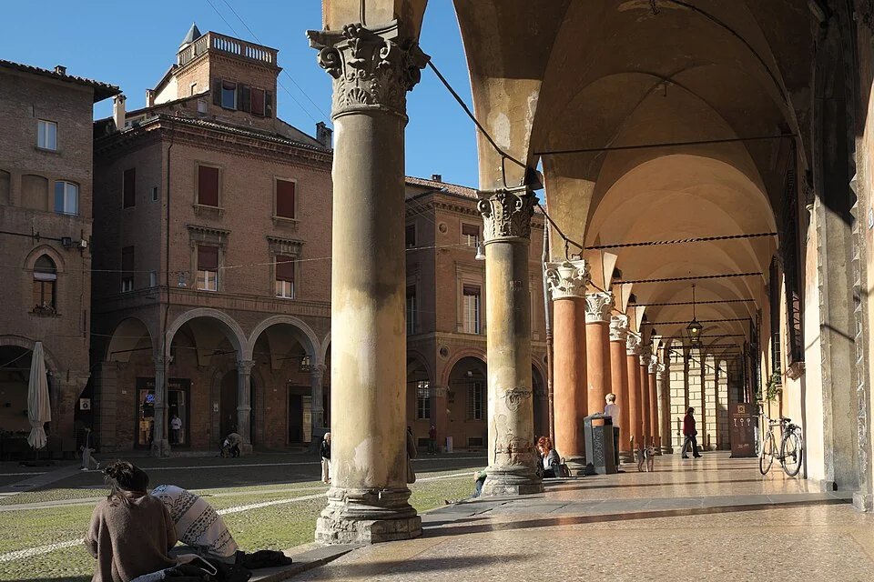
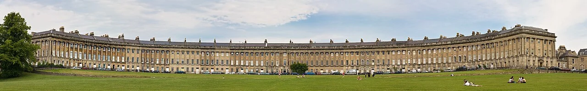

## What it is for

People waiting for a community event cluster in front of the doors because there is nowhere else to stand. The facade extends for a long distance, but it offers no seat, shelter, view or understandable recess. The building has a boundary and the street has a pavement. The ordinary act of pausing between them has been left undesigned.

## The core idea

Alexander's **Building Edge** treats the meeting of a building and its surroundings as a place with depth. A doorway, window, covered strip or seat can support waiting, watching, entering or withdrawing. Decide what belongs on both sides: a public hall may open toward the street while a bedroom needs protection. Give those relationships enough space to work beside the route people use to pass.

## How it works

Identify what happens on both sides of the frontage. Give waiting, sitting, entrance operation and privacy enough depth to coexist beside a dependable passing route. Use openings, shelter and small occupied pockets where they support actual activities, and check who can use and maintain each part of the edge.

## Why it works

The center of an open space can feel exposed. Beside a building, a person may have shelter behind them and a view across what is happening. A doorway gives a reason to approach; a seat makes it possible to stay. These small features offer different choices. Someone waiting quietly needs a comfortable position even when they have no interest in joining a conversation.

Depth allows several activities to coexist. A person can stand out of the passing line, residents can maintain a small privacy buffer, and a public room can open toward the street when appropriate. With no depth, each activity competes for the same narrow strip. A deep setback is not automatically successful, however. If it has no useful threshold or clear access, it may simply push the building farther away.

## Architectural examples

### Bologna’s occupied porticoes

Bologna's porticoes demonstrate a strong, continuous building edge: interior destinations meet a sheltered public route through repeated bays. Within that larger pattern, the placement of doors, shopfronts and places to pause determines the experience at a person's scale. The edge is not just a line of columns viewed from a distance. It is a succession of opportunities and constraints encountered while moving.

[Photograph source](https://commons.wikimedia.org/wiki/File:Bologna_Portico_di_Santo_Stefano_325.jpg) · [License](https://creativecommons.org/licenses/by-sa/3.0)

### A housing entrance — illustrative scenario

An illustrative example is a housing entrance facing a public square. A small sheltered waiting recess beside the door, a view from the shared lobby and a low planted boundary can support arrival without placing everyone directly against ground-floor bedroom windows. The private rooms remain protected, while the entrance participates in the square. The design should make clear which seat is public and which space belongs to residents.

Rules and ownership shape the invitation. Who may sit, how long can they stay, and who looks after the space? A ledge fitted with deterrent devices offers a different welcome from an ordinary bench. Consider whether people can use the edge without buying something or being challenged, and whether residents still have the privacy they need beside a busy public route.

### Royal Crescent, Bath: a landscape-edge comparison

Royal Crescent shows the building edge at a larger scale. The long inhabited frontage gives the lawn a clear boundary and a recognizable backdrop. The photograph helps place individual doors and waiting spots within a wider setting: the public space is shaped by the building as a whole, while everyday comfort depends on the smaller relationships along its base.

[Photograph source](https://commons.wikimedia.org/wiki/File:Royal_Crescent_in_Bath,_England_-_July_2006.jpg) · [License](https://creativecommons.org/licenses/by/2.5)

## Design considerations

A workshop may need robust openings and occasional loading; a nursery may need secure visibility and careful separation from traffic. A library can benefit from outward-facing reading places, while a counseling room may require more visual and acoustic protection. The same architectural depth can serve different degrees of connection. Avoid prescribing full-height glazing as the universal answer to an inactive frontage.

An inhabited edge should not become an obstacle course. Draw queues, chairs, bins, bicycles, door operation and maintenance access. Keep an understandable route through the place at different times of day. People with visual or mobility impairments need predictable clear space, and delivery patterns may change where waiting is comfortable. Temporary furniture can undermine a carefully designed edge if its everyday location is never agreed.

Assess the edge across ordinary changes of use: a rainy morning, an event queue and a quiet evening can expose different conflicts. Involve the people who clean and manage it, since their working routes often reveal constraints omitted from architectural photographs.

Weathering, drainage, thermal continuity, security, fire access and accessibility need project-specific detailing. A built-in seat against a facade can complicate moisture control or maintenance if its connections are poorly considered. Resolve those questions with the responsible designers.

## Useful when

This pattern helps when designing civic ground floors, communal entrances, courtyards and building approaches. In renovation, it may suggest a small change with disproportionate usefulness: moving a bench out of the door swing, adding shelter, opening a blocked window where appropriate, or giving a waiting area a view. Check whether the intervention responds to a real activity rather than an imagined population in a rendering.

- Our building meets the pavement with a blank wall.
- Where can people wait without blocking the entrance?
- How can a ground-floor facade contribute to public life?
- We need places to pause along a long building.
- Residents want privacy but the street feels deserted.
- Can a sheltered bench improve the edge of a community building?
- Our setback has become unusable planting behind a fence.
- How do we make the boundary between indoors and outdoors useful?

## Common mistakes and limits

Common mistakes include exposing private rooms to constant observation, placing seats beside noisy exhausts, and using planting that blocks sightlines as it grows. Another is making a recess that feels hidden after dark. Lighting, nearby occupation and the ability to choose another route matter. Design decisions should respond to local experience rather than simplistic claims that visibility alone eliminates insecurity.

## Related patterns

[[arch-arcades|Arcades]] develops continuous shelter; [[arch-window-place|Window Place]] examines occupation on the indoor side; [[arch-positive-outdoor-space|Positive Outdoor Space]] relates the edge to the larger space it helps define.

## Sources and provenance

Established named pattern. Christopher Alexander, Sara Ishikawa, Murray Silverstein, with Max Jacobson, Ingrid Fiksdahl-King and Shlomo Angel. The explanations and diagrams here are independently authored.

- [A Pattern Language, pattern 160; Alexander, Ishikawa, Silverstein and colleagues](https://www.patternlanguage.com/apl/aplsummary.htm)
- [UNESCO: The Porticoes of Bologna](https://whc.unesco.org/en/list/1650)
