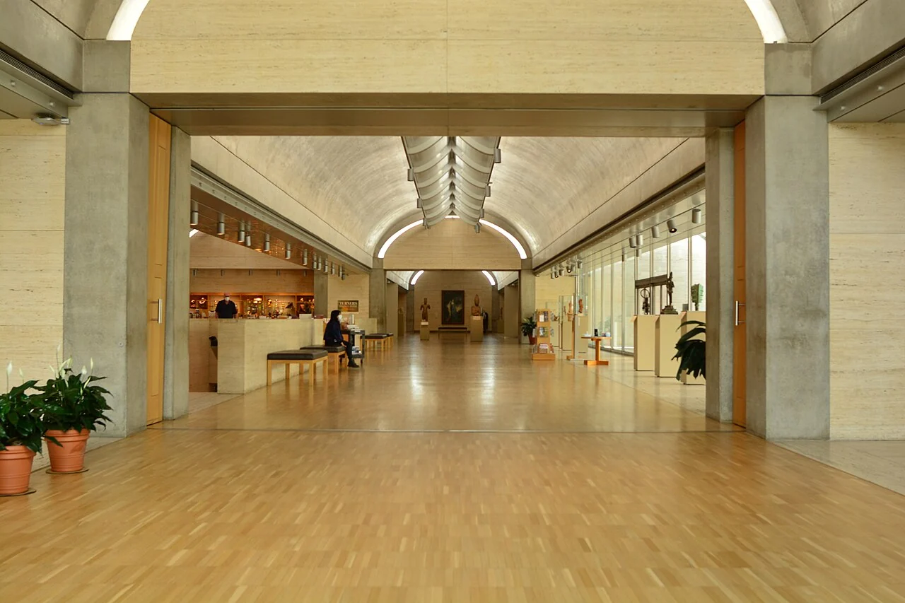
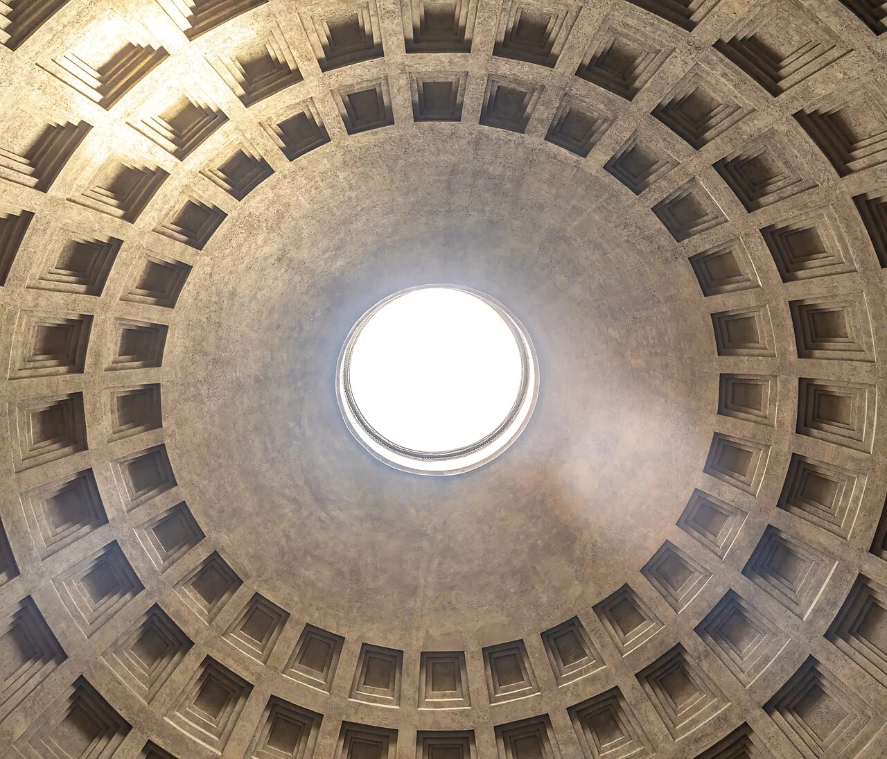

## What it is for

A small sitting area occupies the corner of a lofty hall. The furniture is comfortable, yet the group feels lost in the volume. Elsewhere, a room intended for active work has been given the same low ceiling as a narrow corridor. A uniform floor-to-floor dimension has become a uniform spatial experience, regardless of what happens below it.

## The core idea

Alexander's **Ceiling Height Variety** uses overhead height to help different activities find a suitable scale. A lower edge can contain a sitting group; a taller room can make space for equipment, movement or a gathering. Width, light, materials and sound affect the result together. Choose the height for the whole activity and its users, since the same low canopy may feel sheltered to one person and confining to another.

## How it works

Draw a section—a vertical cut through the room—with people, furniture and movement shown. Compare the clear height above each activity, including beams, ducts and lighting. A small canopy may give a sitting area its own scale while leaving the main room tall. Check that it preserves daylight, views and access to equipment above.

## Why it works

People do not encounter ceiling height as an isolated number. A narrow tall room, a broad low room and a compact low room create different relationships. Openings and furnishings provide reference points. An overhead canopy may make a sitting area feel smaller even when the main ceiling remains high above it. The useful design question is how the whole volume fits the activity and the people using it.

Height changes can also organize a sequence. Moving through a modest threshold into a taller room makes the difference perceptible. Repeating this effect everywhere weakens it and can become disorienting. Use a clear hierarchy rather than a collection of dramatic ceiling gestures. Sometimes a consistent height is appropriate, especially where activities change frequently and the building needs an adaptable framework.

## Architectural examples

### The Kimbell — overhead form at gallery scale

At the Kimbell, the curved gallery ceiling is visible above display walls and the space where visitors stand. It gives a smaller-scale reference alongside the Pantheon's dome. Compare the overhead form with the width and use below it: the effect comes from those relationships together. A room can have a distinct overhead character without reproducing a monumental height.

[Photograph source](https://commons.wikimedia.org/wiki/File:Kimbell_Art_Museum_interior_01.jpg) · [License](https://creativecommons.org/licenses/by-sa/4.0)

### The Pantheon, Rome

In Rome's Pantheon, the oculus is the central opening in the dome, and coffering is the pattern of recessed panels across its surface. Both make the overhead height and curve easy to read. The room provides an extreme reference for ceiling, light and enclosure acting together. Compare that sense of volume with the Kimbell's more closely occupied gallery to see how scale changes the relationship.

[Photograph source](https://commons.wikimedia.org/wiki/File:Pantheon_(Rome),_Dome_interior.jpg) · [License](http://creativecommons.org/publicdomain/zero/1.0/deed.en)

### A neighborhood library — illustrative scenario

Consider a neighborhood library with a taller main reading room and lower edge areas for small groups. The change can be made by a partial canopy or service zone rather than lowering the entire room. Seats remain accessible and visible, and the larger volume continues to admit useful light. Acoustics need their own design; the lower area is not automatically quiet because it feels contained.

### A workshop — illustrative scenario

Another illustrative scenario is a workshop where extra height supports equipment, storage handling or overhead services. Here the benefit is functional as well as experiential. Reducing the height to create a fashionable intimate atmosphere could make the space less useful. Establish the actual clearance, ventilation and maintenance needs before choosing a spatial effect. Design decisions should follow the work rather than an abstract preference for high or low rooms.

## Design considerations

The ceiling line drawn in an interior sketch may compete with beams, ducts, lighting, sprinklers and maintenance access. A desired change in height becomes difficult when these systems have already been fixed independently. Draw a coordinated section at the points where the spatial change matters. Identify the clear height people will experience, not only the structural floor-to-floor distance.

Tall rooms can need more enclosure and different structural, heating and cooling arrangements. Warm air may collect higher up, a temperature layering called stratification. How much that matters depends on the activity and air-distribution system. A lower ceiling may simplify some services while reducing daylight or future options. Compare the usable conditions and operating demands of each arrangement, with the relevant designers involved.

In renovation, a reversible overhead element may preserve more future options than permanently filling a tall volume. Check whether it blocks high windows or access to existing services. A small change that clarifies one occupied area can be useful without becoming the organizing idea for every room. Keep a record of the original clearances and the reasons for the intervention, so later adaptation does not have to rediscover them.

Use mock-ups or spatial models when scale is difficult to judge, and involve qualified designers for structure, acoustics, access, ventilation and fire requirements. Consider people with different statures, sensory preferences and movement needs.

## Useful when

This pattern helps in civic rooms, homes, schools and workplaces where several activities share a building or a large room. It can also guide conversion: existing high volumes may be valuable, while a localized lower enclosure supports a smaller use without filling the whole space with a new floor. Preserving variety can be more useful than forcing every part into the same standard section.

- Every room has the same height and the building feels monotonous.
- Can a lower ceiling make a sitting area feel more contained?
- How do we distinguish spaces without adding walls?
- Our hall feels impressive but uncomfortable for a small group.
- Where is extra room height actually useful?
- Will a lowered ceiling solve the noise in our open room?
- How do services and structure affect changes in ceiling height?
- Can a tall space remain comfortable and economical?

## Common mistakes and limits

Unexpected low elements can obstruct people or make a route difficult to understand. Check head clearance along the actual movement paths, including changes of level. Sound also needs its own explanation: a lower hard ceiling may still reflect speech strongly, while a tall room with suitable absorbing surfaces can work well. Decide whether the problem concerns scale, noise or both before changing the ceiling.

## Related patterns

[[arch-alcoves|Alcoves]] provides smaller territory, [[arch-structural-bay-rhythm|Structural Bay Rhythm]] coordinates the supporting frame, and [[arch-flexibly-linked-rooms|Flexibly Linked Rooms]] lets activity boundaries change while the section remains stable.

## Sources and provenance

Established named pattern. Christopher Alexander, Sara Ishikawa, Murray Silverstein, with Max Jacobson, Ingrid Fiksdahl-King and Shlomo Angel. The explanations and diagrams here are independently authored.

- [A Pattern Language, pattern 190; Alexander, Ishikawa, Silverstein and colleagues](https://www.patternlanguage.com/apl/aplsummary.htm)
- [Ching: Architecture, Form, Space, and Order (proportion, scale and spatial qualities)](https://www.wiley.com/en-us/architecture-form-space-and-order-5th-edition-p-9781119853374)
- [Pantheon: Italian Ministry of Culture site](https://direzionemuseiroma.cultura.gov.it/pantheon/)
