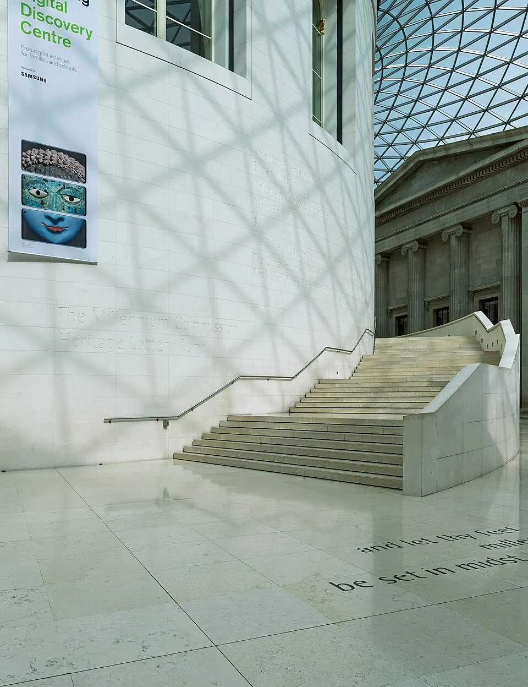
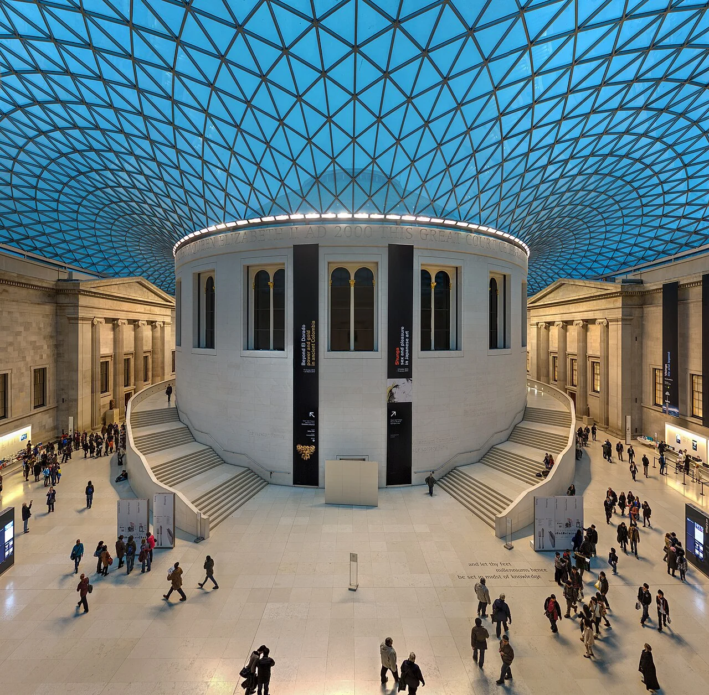

## What it is for

A visitor follows a sign toward reception, reaches an identical four-way junction and has to search for another sign. A staff member offers directions using landmarks the visitor has never seen. The building technically contains a route to every room, but that route does little to explain the building. Navigation has become a repeated act of recovery.

## The core idea

**Circulation as Orientation** makes routes help people understand a building. Circulation means the paths, corridors, stairs and lifts used to move through it; orientation means knowing where you are and where to go next. Recognizable destinations, outdoor views and consistent information can help visitors make decisions as they travel, with signs confirming what the space already suggests.

## How it works

Trace a first-time visitor's journey from entrance to destination. Put a recognizable view, landmark or clear instruction before each choice of direction. Check the stair, lift and step-free routes together so each reaches useful information. Test the route with people who do not already know the building, and notice where they hesitate.

## Why it works

Wayfinding is the process of finding and following a route. At a junction, a visitor needs enough information to choose before turning. A visible reception desk, courtyard or distinct lift lobby can help. A landmark hidden around the corner arrives too late for that decision. Pair spatial clues with clear names and appropriate visual, spoken or tactile information so the route works for different needs.

A route also has a sequence. Passing from a street entrance into a generous shared hall and then toward a quieter wing can establish an understandable hierarchy. Repeated identical corridors may be economical but give fewer clues about progress. Distinction does not require visual spectacle. A view of the same garden from several points can be a dependable reference if it helps people understand their relative positions.

## Architectural examples

### The British Museum’s Great Court

In the British Museum's Great Court, redesigned by Foster and Partners, routes pass around the recognizable central Reading Room. The museum describes the redesign as reopening connections across its main floor. The photographs show how the central form remains visible while people move or climb the stair. It gives visitors a stable reference within this large room, one part of the wider museum's wayfinding system.

[Photograph source](https://commons.wikimedia.org/wiki/File:Staircase_at_Queen_Elizabeth_II_Great_Court,_British_Museum,_London,_UK_julesvernex2.jpg) · [License](https://creativecommons.org/licenses/by-sa/4.0)

[Photograph source](https://commons.wikimedia.org/wiki/File:British_Museum_Great_Court,_London,_UK_-_Diliff.jpg) · [License](https://creativecommons.org/licenses/by-sa/3.0)

### A health center — illustrative scenario

Consider a health center with two similar treatment wings. A clear arrival hall offers a visible reception desk, daylight from a small garden and distinct views toward each wing. Appointment information uses the same names as signs in the building. The garden helps orientation, while accessible signs and staff support provide information that a visual landmark alone cannot supply.

The example also shows why a beautiful landmark is insufficient. A person with limited vision may use tactile, auditory or verbal information. A person under stress may have difficulty interpreting a complex map. A good system uses several mutually consistent cues, with routes and destinations named in plain language. Avoid making color the only distinction between two departments, particularly when color vision varies and signs may be viewed in poor light.

## Design considerations

A first visit, a changed entrance, a lift outage or an evening event can disrupt familiar routines. Ask whether the route remains understandable under those conditions. Where several entrances operate, establish how each connects to the same information system. A staff-only shortcut should not appear to be the obvious public route. Temporary barriers need the same clarity as permanent design.

A prominent stair may offer a memorable view while the lift opens into an unmarked service corridor. That divides the building's legibility by mobility. Locate or connect routes so people using lifts and step-free paths can reach useful orientation cues and public information. Where existing constraints prevent identical routes, explain the alternative clearly and preserve dignity rather than treating it as a back-of-house exception.

Review maintenance as part of orientation. A useful view can disappear behind a new display, and an accurate sign can become wrong after a departmental move. Assign responsibility for updating the whole route rather than allowing each room to accumulate its own local instructions.

Coordinate wayfinding with access expertise, fire strategy, security and the people who operate the building. Ordinary orientation and emergency escape have related but distinct requirements; a pleasant open route is not automatically a compliant escape route. Test the design with people unfamiliar with the plan, including a range of sensory and cognitive needs.

## Useful when

This pattern helps in hospitals, campuses, libraries, transport buildings and other places with unfamiliar users. It also matters in small buildings where a single ambiguous entrance can cause disproportionate confusion. Begin by observing where people stop, turn back or ask for help. That evidence may reveal a spatial problem that another layer of signs will not resolve.

- I keep getting lost in this building even with signs.
- How can a corridor help people understand where they are?
- Visitors cannot find reception after entering.
- Every floor looks identical and people take the wrong turn.
- Can daylight or a courtyard help with wayfinding?
- How do we make a hospital route less confusing?
- Where should we put a landmark inside a public building?
- Our signs are compensating for a confusing plan.

## Common mistakes and limits

Common mistakes include identical numbering on several wings, changes in department names between booking and arrival, and decorative floor patterns that compete with directional cues. Too many signs can also obscure the important instruction. Remove conflicting information as part of the design. A coherent small system is usually easier to maintain than a dense accumulation of local fixes.

## Related patterns

[[arch-main-entrance|Main Entrance]] starts the journey, [[arch-common-areas-at-the-heart|Common Areas at the Heart]] supplies useful landmarks, and [[arch-inclusive-arrival|Inclusive Arrival]] keeps those cues available across different routes.

## Sources and provenance

Modern editorial synthesis, not a named pattern attributed to a single historical author. Patternverse editorial synthesis; source organizations credited in article. The explanations and diagrams here are independently authored.

- [British Museum: The Great Court](https://www.britishmuseum.org/about-us/british-museum-story/architecture/great-court)
- [Ching: Architecture, Form, Space, and Order (circulation chapter contents)](https://www.wiley.com/en-us/architecture-form-space-and-order-5th-edition-p-9781119853374)
