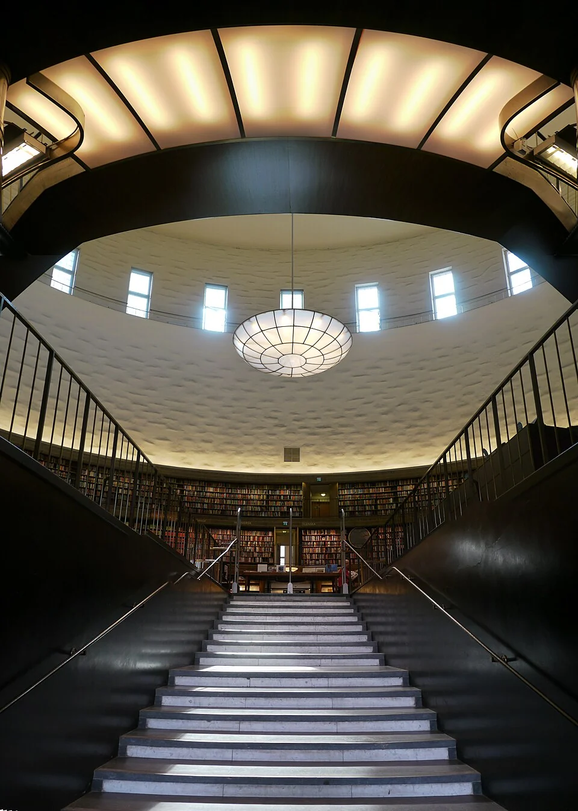

## What it is for

The new common room contains comfortable furniture, a generous table and a good coffee machine. It is also beyond two security doors at the end of a corridor. People rarely go there unless they have booked a meeting. Meanwhile, conversations block the small landing outside the kitchen. The informal center of the building has emerged somewhere other than the room designed for it.

## The core idea

Alexander and his coauthors' **Common Areas at the Heart** puts shared space where everyday journeys make it easy to notice and use. The heart is a practical center of activity, which may sit to one side of the plan. A room beside the kitchen or laundry can offer more chances to meet than a larger common room reached only through a long corridor and several doors.

## How it works

Locate a shared place beside ordinary journeys and give people a practical reason to enter. Keep a route past it that does not require participation. Provide a mix of shared and quieter settings, then agree access, booking and care so the room remains available in everyday operation.

## Why it works

Passing near a shared room makes it possible to notice a familiar person or join something already happening. A kitchen, shared resource or good view gives a reason to enter even without a planned gathering. The room still needs to be comfortable and available. Its location creates opportunities for contact; the people using it decide whether and how to take them up.

The distinction between passing beside and passing through matters. A route through the center of a conversation can make both movement and staying uncomfortable. A clear path along the edge allows someone to continue without performing sociability. People need the option to withdraw, particularly where noise, fatigue or social anxiety make a busy communal room demanding. A common place succeeds through choice as much as encounter.

## Architectural examples

### Stockholm Public Library

At Gunnar Asplund's Stockholm Public Library, the circular book hall forms a clear shared center among lower surrounding wings. A circular room of this kind is called a rotunda. The library's architectural account describes the arrangement, and the photographs show the contrast between the approach and the large central room. It offers a recognizable point of reference as people move through the building.

[Photograph source](https://commons.wikimedia.org/wiki/File:Trapp_stockholm_folkebibl.jpg) · [License](https://creativecommons.org/licenses/by-sa/3.0)

[Photograph source](https://commons.wikimedia.org/wiki/File:An_image_of_the_stacks_of_the_Stockholm_Public_Library.jpg) · [License](http://creativecommons.org/publicdomain/zero/1.0/deed.en)

### Cooperative housing — illustrative scenario

An illustrative example is a small cooperative housing scheme. Its shared kitchen is placed near the main pedestrian arrival and laundry rather than in a remote leftover room. Residents can see whether cooking is underway and join without a formal invitation. A separate route reaches private homes, and a quiet sitting pocket allows limited participation. Acoustic separation and an agreed cleaning arrangement are essential; proximity alone will not resolve disputes about use.

### An office meeting place — illustrative scenario

In an illustrative office, a meeting place sits at the central junction but also beside a noisy production route. People can find it easily yet struggle to talk there. Moving it a little away, with a clear connection and view from the route, improves its usefulness. The important relationship is convenient proximity; the exact geometric center matters less than being easy to reach and comfortable to occupy.

## Design considerations

Ask who regards the place as theirs, who can invite others, and who maintains it. A room shared by several departments can be valuable yet neglected if each assumes another controls the budget. Furniture arrangements, noticeboards and booking rules influence whether spontaneous use remains possible. If the room is permanently reserved, the plan's social promise has been replaced by an administrative barrier.

A room should remain useful when only one person occupies it. A good reading seat, a small work surface or an outdoor view can support that quieter state, so the space does not depend on a constant social event to justify its existence.

Coordinate occupancy, escape, acoustics, ventilation and operational responsibilities with the responsible designers and managers. After occupation, assess what people do there and who stays away. Do not treat attendance alone as the measure of belonging.

## Useful when

This pattern helps in housing, schools, workplaces and civic buildings where shared life is desired but difficult to initiate. It can also inform renovation when informal gathering already occurs in cramped circulation. Observe that behavior before deciding it is disorder to eliminate. The improvised meeting point may reveal a better location for a deliberate shared place, provided access and fire requirements can be met.

- Our shared lounge is always empty.
- How can ordinary routes support casual meetings?
- People have to make a special trip to reach the common room.
- We want a shared place without forcing everyone to socialize.
- Where should a communal kitchen go in a housing scheme?
- Our office breakout space interrupts quiet work.
- Can a central space help people understand the building?
- The common room belongs to nobody and is poorly maintained.

## Common mistakes and limits

Common mistakes include forcing everyone through a café, putting all quiet seats at the busiest junction, and assuming that open-plan space is automatically inclusive. Some people need acoustic relief or predictable low-stimulation routes. A quieter adjacent room or alcove may let them remain connected without continual exposure. The provision should be usable and dignified, not a token chair beside the service door.

Centralization also has practical limits. A large campus may need several local common places rather than one distant grand hall. Different groups can have different schedules and security needs. Consider accessibility across the actual site and whether paid access, transport or opening hours exclude intended users. A room that is geographically central can still be unavailable to many of them.

## Related patterns

[[arch-intimacy-gradient|Intimacy Gradient]] preserves options for privacy, [[arch-circulation-as-orientation|Circulation as Orientation]] makes the shared place an understandable landmark, and [[arch-alcoves|Alcoves]] provides smaller settings along its edge.

## Sources and provenance

Established named pattern. Christopher Alexander, Sara Ishikawa, Murray Silverstein, with Max Jacobson, Ingrid Fiksdahl-King and Shlomo Angel. The explanations and diagrams here are independently authored.

- [A Pattern Language, pattern 129; Alexander, Ishikawa, Silverstein and colleagues](https://www.patternlanguage.com/apl/aplsummary.htm)
- [Stockholms stadsbibliotek: Architecture by Gunnar Asplund](https://biblioteket.stockholm.se/om-stadsbiblioteket-av-gunnar-asplund)
