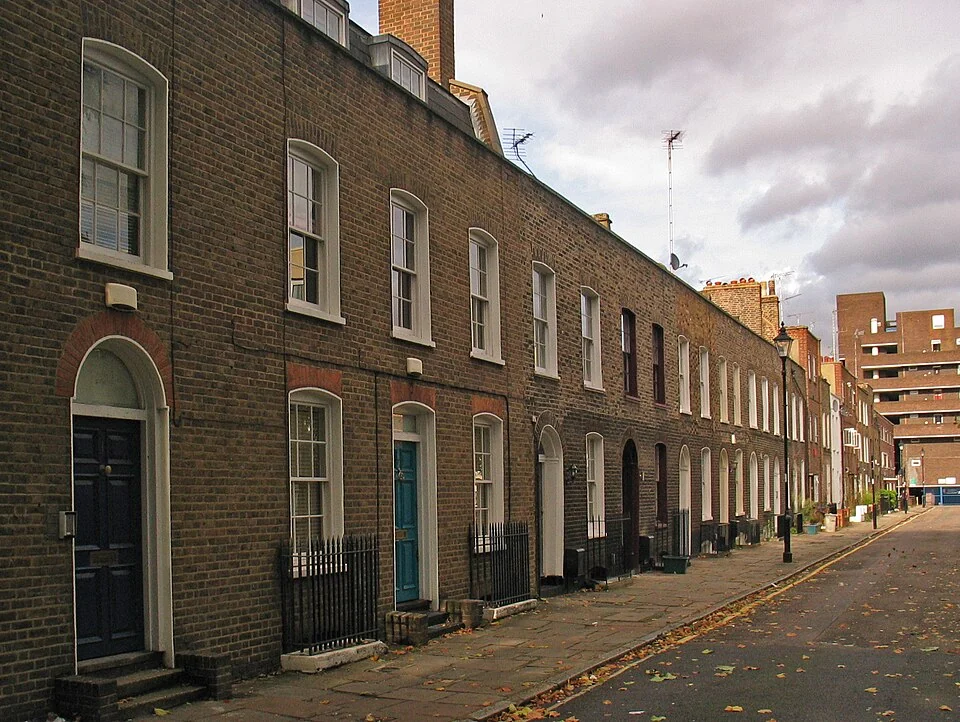
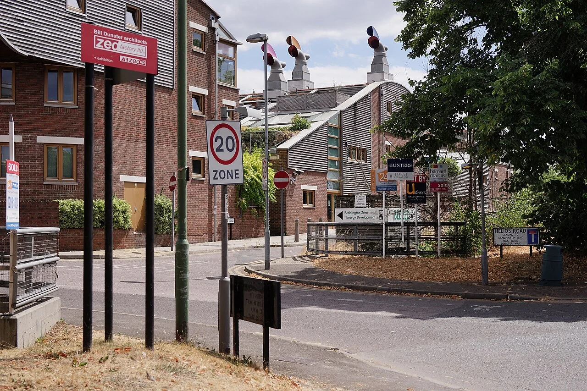

## What it is for

The required rooms have barely changed, but each design revision adds another bay, recess or glazed projection. The building grows a longer perimeter without gaining much useful room. Those folds need foundations, junctions, drainage and maintenance. They also change the amount of enclosure through which heat can move. Shape has become a recurring cost even though it is being discussed mainly as appearance.

## The core idea

**Compact Building Form** asks how much outside surface a building needs to provide its useful rooms. The envelope is that separating construction: walls, roof, windows and floors at the ground. A simpler shape can use less material and reduce unwanted heat transfer. Keep daylight, access and room quality in the comparison. The smallest perimeter is useful only if the plan works.

## How it works

Mark the spaces that are heated or cooled, and draw their boundary. Compare forms providing the same useful rooms, including roof and ground surfaces. For each projection or recess, ask what it adds: a better view, daylight, shelter or simply more outside wall. Resolve room depth and access alongside that comparison.

## Why it works

Heat transfer through an enclosure depends on its area, thermal properties and the conditions across it. More exposed surface can create more opportunity for unwanted heat exchange. Corners and projections also create junctions where heat can escape more readily or air can leak. A compact form can simplify these tasks, but good geometry cannot compensate for poorly executed construction or unsuitable windows and ventilation.

A conditioned space is one whose indoor temperature is deliberately controlled by heating or cooling. Its boundary may differ from the building's outer silhouette: an open canopy or unheated store is a different case from a heated room. Compare the actual exposed surfaces around the controlled spaces, including roofs and ground contact. Use the same room and area assumptions for each option so the result remains meaningful.

## Architectural examples

### A London terrace — shared walls made visible

On Wynyatt Street, adjoining houses replace the side gaps found between detached homes. Their shared walls make one source of compactness visible from the street. The photograph is a starting point for understanding the arrangement. Plans and sections would be needed to include the rear form, roof and floor area in a measured comparison with another housing scheme.

[Photograph source](https://commons.wikimedia.org/wiki/File:Terraced_houses,_Wynyatt_Street_-_geograph.org.uk_-_3685539.jpg) · [License](https://creativecommons.org/licenses/by-sa/2.0)

### A terrace and detached pavilions — illustrative comparison

Consider two hypothetical housing schemes with comparable useful floor area. One arranges homes in a short terrace; the other separates them into detached pavilions. Shared party walls in the terrace reduce exposed surface per home, while the pavilions may offer more external faces and private outdoor edges. The terrace needs careful acoustic separation, access and daylight planning. The pavilions need to justify their additional envelope and land use.

### BedZED, London

BedZED in south London provides a real comparison with a clustered housing arrangement rather than scattered detached objects. Designed by Bill Dunster Architects with a wider project team, it combined housing form with an explicit environmental ambition. Its published project history also records lessons after occupation. Do not treat its distinctive roof terminals or a single photograph as evidence that any copied component will reproduce the whole development's performance.

[Photograph source](https://commons.wikimedia.org/wiki/File:BedZED_-_geograph.org.uk_-_5853022.jpg) · [License](https://creativecommons.org/licenses/by-sa/2.0)

The examples help identify what an extra edge contributes. A courtyard may add outside wall while giving rooms daylight and residents a shared garden. A narrow wing may fit an existing site better than a deep block. Record that benefit beside the material and maintenance cost. This makes the choice explainable and lets a simpler option compete fairly with a more complex shape.

## Design considerations

A deep plan can reduce perimeter while making occupied rooms dependent on borrowed light or complex ventilation routes. The useful area might also shrink once corridors and internal service spaces are included. Compare space available for the required activities, alongside total floor area including circulation and service zones. A building that is geometrically efficient but difficult to inhabit has optimized the wrong boundary.

A simple shape can make the protective boundary easier to connect, but roof-edge walls, balconies, openings and pipes crossing it still need careful details. Large windows can dominate heat loss and solar gain—the heat entering from sunlight—even in a compact building. Assess these conditions with the intended use and local climate. Geometry, construction quality, shading and ventilation need to work together.

Use an explicit comparison table with a few agreed measures: useful area, exposed envelope, daylight, likely thermal performance, access, material quantities and cost. Test uncertainty rather than hiding it behind a single polished rendering. The Passive House approach treats envelope quality, windows, airtightness and ventilation as linked concerns; this guide draws on that broad integration without claiming a numerical design threshold.

## Useful when

This pattern helps at feasibility, when alternatives can still change shape, and during value review when facade complexity has accumulated without a clear purpose. It is particularly useful alongside envelope and whole-life assessments. It can also support renovation: avoid an elaborate extension if a simpler addition or internal reorganization can meet the need while preserving the existing building.

- Our building has many projections but little extra usable space.
- Can a simpler shape reduce energy demand?
- How do we compare a compact block with several wings?
- Does reducing facade area make a building more sustainable?
- We need efficient housing without dark deep rooms.
- Our facade budget is growing because the plan is complicated.
- How much articulation does this building actually need?
- Can a courtyard be worth the extra envelope?

## Common mistakes and limits

Common mistakes include comparing unlike programs, ignoring roof geometry, and presenting a surface-to-volume ratio as a complete sustainability score. Taller compact buildings may introduce structural, vertical transport or fire-design demands that a simple perimeter sketch omits. A courtyard adds enclosure but can create meaningful daylight and shared outdoor life. Evaluate those consequences rather than declaring either compactness or articulation inherently virtuous.

## Related patterns

[[arch-wings-of-light|Wings of Light]] makes the daylight case for more edges. [[arch-continuous-thermal-envelope|Continuous Thermal Envelope]] asks whether the chosen boundary can be built continuously. [[arch-compare-spatial-alternatives|Compare Spatial Alternatives]] keeps both strategies open long enough for their actual consequences to become visible.

## Sources and provenance

Modern editorial synthesis, not a named pattern attributed to a single historical author. Patternverse editorial synthesis; source organizations credited in article. The explanations and diagrams here are independently authored.

- [Passive House Institute: Building Certification](https://passivehouse.com/03_certification/02_certification_buildings/01_benefits-of-certification/01_benefits-of-certification.htm)
- [Bioregional: The BedZED Story (2017)](https://www.bioregional.com/uploads/downloads/The-BedZED-Story_Bioregional_2017.pdf)
