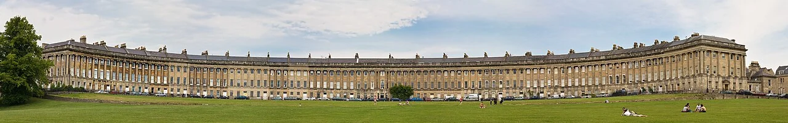
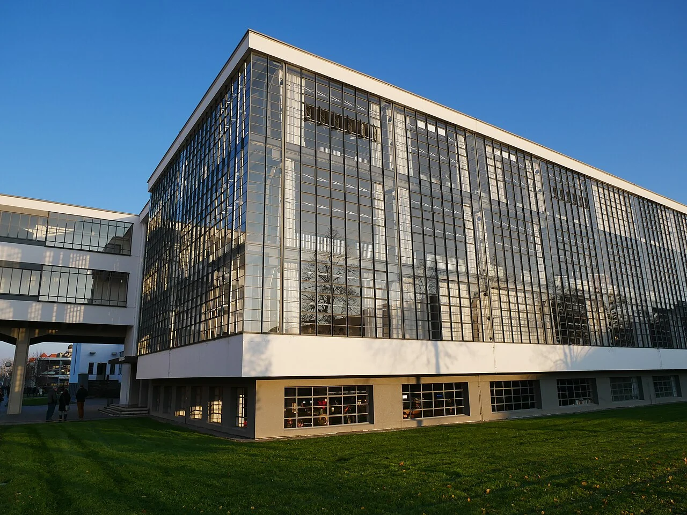

## What it is for

Three options are presented to a client. They share the same footprint, entrance and circulation, differing mainly in the location of one wall. One has a polished rendering and naturally attracts the most support. The project has performed the appearance of comparison while leaving its most consequential spatial assumptions untouched.

## The core idea

**Compare Spatial Alternatives** examines different ways to organize a building or site against the same brief—the activities and outcomes the project must support. Keep the consequential choices open long enough to understand them: reuse or replacement, deep block or shallow wings, one shared entrance or several. A manageable set of options can reveal the tradeoffs and the unknowns that need investigation before a decision.

## How it works

Agree what the building needs to provide and how the options will be compared. Draw a small set of meaningfully different layouts to similar detail. Show benefits, costs and unknowns beside each one. Investigate the uncertainty most likely to change the choice, then record the reasons for proceeding and the conditions that could require another look.

## Why it works

Alternatives need a comparable purpose. A small renovation and a much larger new building may deliver different accommodation, so raw cost or carbon totals can mislead. State the required activities, useful capacity, access, comfort and time horizon. If one option changes the brief, identify that explicitly. Sometimes changing the brief is worthwhile, but it should not happen invisibly inside a comparison table.

A genuinely different alternative changes a meaningful relationship: retained versus replaced structure, compact block versus shallow wings, centralized versus distributed shared rooms, or one public arrival versus several local entrances. Cosmetic differences may matter later, but they do not substitute for testing the organizing idea. Select a manageable set that spans the real decision rather than a large collection of near-duplicates.

## Architectural examples

### Built forms as references for a comparison

The terrace and building wings provide two visible references for organizing space. One creates a continuous edge; the other separates volumes and leaves gaps between them. These are different built projects, so they are references rather than competing answers to one brief. Use them to name relationships worth testing, then draw proposals for the actual site with consistent area, access and environmental assumptions.

[Photograph source](https://commons.wikimedia.org/wiki/File:Royal_Crescent_in_Bath,_England_-_July_2006.jpg) · [License](https://creativecommons.org/licenses/by/2.5)

[Photograph source](https://commons.wikimedia.org/wiki/File:Fassade_des_Bauhausgeb%C3%A4des,_Dessau_2019.jpg) · [License](https://creativecommons.org/licenses/by-sa/4.0)

### A school project — illustrative comparison

In a hypothetical school project, one scheme extends the existing wing, another reorganizes underused rooms and a third adds a separate pavilion. Compare teaching relationships, accessible journeys, construction disruption, daylight, operating demands and resource use. The pavilion's attractive separation may create long outdoor travel; the internal option may save construction while compromising acoustic separation. The comparison should reveal those differences before a preferred image becomes politically difficult to change.

### Housing form — illustrative comparison

In a hypothetical housing project, a compact block is compared with courtyard and shallow-wing arrangements. All are drawn to the same useful accommodation and site constraints. The courtyard may improve outdoor relationships while adding facade and privacy questions. The compact block may reduce enclosure while increasing depth. No pattern wins automatically. The decision depends on the brief and evidence at the actual site.

Agree the comparison criteria before the final presentations, while the team is still open to different answers. Include qualities that resist a single number: a valued tree, a welcoming arrival or a useful sequence of rooms. Describe what each option makes possible. That gives people something concrete to discuss and makes it harder for the most polished image to determine the outcome by itself.

## Design considerations

A simple table can preserve several dimensions without forcing them into one score. Record what is known, what is estimated and what remains uncertain. A single weighted total may be useful in some contexts, but its weights encode judgments. Show them and test whether a reasonable change alters the ranking. Do not allow numerical presentation to disguise a preference as an objective result.

If the decision depends on an unknown structural condition, a survey may be more valuable than another rendering. If daylight is the disputed benefit, an appropriate study may clarify it. If users cannot understand the proposed arrival, a simple plan walkthrough or mock-up may reveal the problem. Direct the next investigation toward the assumption most likely to change the choice.

Keep the comparison materials visually fair. Use the same scale, similar drawing conventions and comparable amounts of furniture and landscape. An empty diagram can look less appealing than a fully furnished perspective even when it describes a better plan. Where one option is more developed because of earlier work, say so and avoid treating the extra detail as evidence of greater feasibility. Fair presentation does not require identical imagery; it requires making the underlying differences understandable without quietly privileging one scheme.

Professional advice may be needed for structural feasibility, access, fire strategy, environmental modeling and whole-life assessment. The comparison should make those needs visible rather than implying that a plan sketch proves compliance.

## Useful when

This pattern helps when exploring feasibility, reviewing proposed purchases, making significant design changes or considering renovation. It is particularly valuable where irreversible actions such as demolition or site clearance are being considered. It can also rescue a project that has become attached to a complex form: compare a simpler version delivering the same service, rather than arguing about taste alone.

- We chose a building layout before comparing any real alternatives.
- How can we evaluate different plans fairly?
- Every option looks like a minor version of the same design.
- Should we compare refurbishment, extension and a new building?
- The most polished rendering keeps winning the discussion.
- How do we compare daylight, access and cost without one misleading score?
- What makes an architectural option genuinely different?
- We need to explain why one layout is preferable.

## Common mistakes and limits

Common mistakes include comparing unequal levels of detail, giving one option an unrealistic cost allowance, and treating an attractive precedent as evidence of performance. Another is allowing option appraisal to continue indefinitely after the key uncertainty has been resolved. Set a decision point, record the reasons and identify conditions that would justify revisiting it. A clear choice can still acknowledge costs and limits.

## Related patterns

[[arch-compact-building-form|Compact Building Form]] and [[arch-reuse-before-replacement|Reuse Before Replacement]] supply consequential alternatives. The existing [[reframing-alternative-paths|Find Alternative Paths]] addresses the broader reasoning move; this guide adds the spatial, operational and technical comparisons particular to buildings.

## Sources and provenance

Modern editorial synthesis, not a named pattern attributed to a single historical author. Patternverse editorial synthesis; source organizations credited in article. The explanations and diagrams here are independently authored.

- [AIA Framework: Design for Integration](https://www.aia.org/design-excellence/aia-framework-design-excellence)
- [RIBA: Plan for Use Guide](https://www.riba.org/work/insights-and-resources/plan-for-use-guide/)
