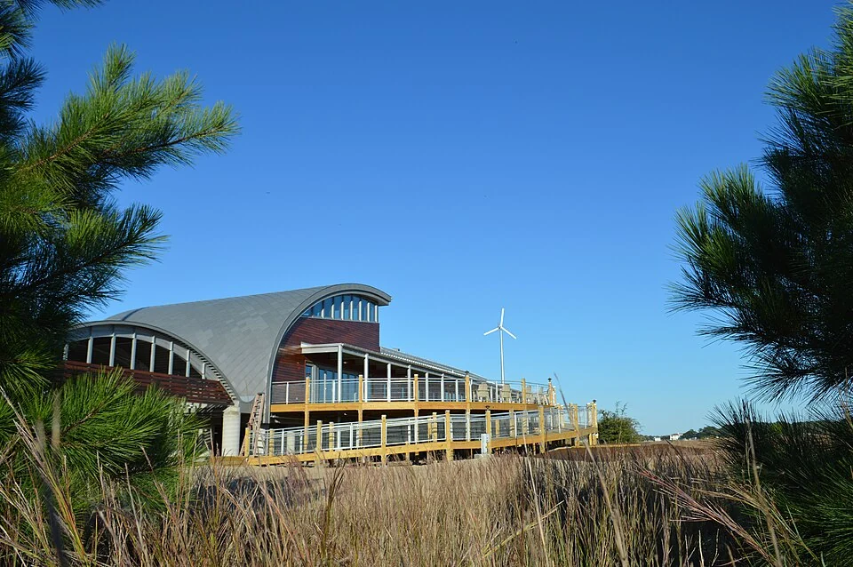
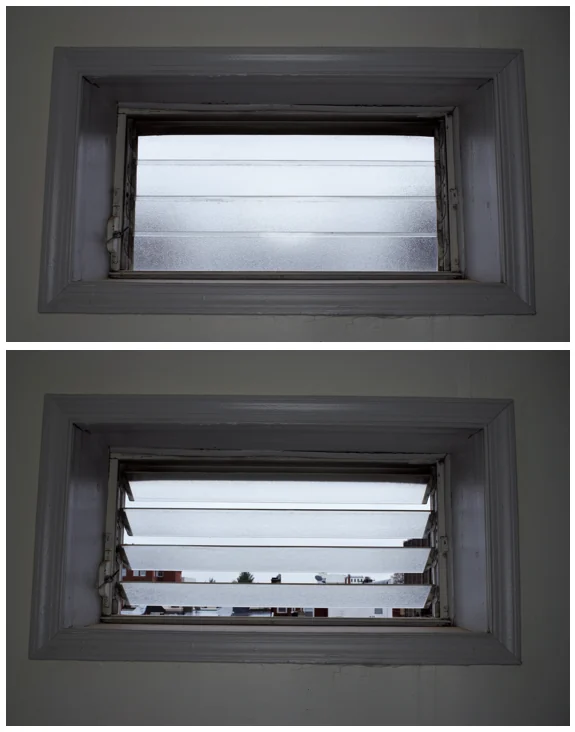

## What it is for

A room has windows on opposite walls, but the expected breeze never arrives. One opening faces a sheltered recess, the other is kept shut because of traffic noise, and an internal door blocks the connection. The plan shows two arrows. The occupied building contains no reliable air path.

## The core idea

**Cross Ventilation** provides a path for outdoor air to enter through one opening and leave through another. Wind can push more strongly against one part of a building than another; this pressure difference can drive the flow. Room layout and usable openings determine where the air travels. A window kept shut for noise or privacy breaks the intended path, even when a drawing shows windows on both sides.

## How it works

Locate openings where the expected pressure difference can move air through the occupied room. Follow the complete path, including doors, screens and devices limiting how far windows open. Check whether those parts can be used during the relevant weather and activities. Coordinate privacy, noise, security and mechanical ventilation with that operating arrangement.

## Why it works

Wind can create different pressures across a building. Air may enter through one opening and leave through another, depending on wind direction, surrounding obstructions and opening geometry. Internal partitions, closed doors and restrictive screens add resistance. The useful path should reach occupied areas rather than short-circuiting between nearby openings while leaving the rest of the room poorly served.

Air can also move because warmer air rises and leaves through a high opening, drawing replacement air in below. This is often called stack ventilation. It can work alongside wind-driven flow, but it responds to different conditions. Identifying the driver helps a designer ask when the flow could weaken or reverse. Arrows in a section need that explanation before they describe a dependable ventilation strategy.

## Architectural examples

### Brock Environmental Center — a documented mixed-mode building

SmithGroupJJR's Brock Environmental Center in Virginia Beach had to support offices and education in a coastal climate with humid summers and cold winters. Its design-team account describes a long, shallow plan and windows selected to catch seasonal winds. Cross flow works alongside stack ventilation, where rising warm air leaves through higher openings. The building therefore combines natural and mechanical modes rather than relying on cross ventilation all year.

Low and high openings on the north and south faces provide possible inlet and outlet routes. When sensors identify suitable outdoor conditions, cooling switches off and staff receive a message to open windows. A mixture of hand-operated and motorized windows supports this change; upper windows can also open at night to cool the interior before the next working day. The published design account predicted natural-ventilation cooling for over 11% of occupied annual hours. That is a modelled opportunity, not a measured annual saving. [Read the design team's account](https://www.hpbmagazine.org/brock-environmental-center-virginia-beach-va/).

The team's WBDG submission also reports environmental measurements and occupant-satisfaction results above comparison benchmarks. Those findings concern the complete mixed-mode building, including its controls, shading and mechanical systems. The useful lesson is to design the air path and the decision to use it together: a viable route needs suitable weather, usable windows and an operating arrangement people understand. [See the project-team report](https://legacy.wbdg.org/ar/case-study/brock-environmental-center).

[Photograph source](https://commons.wikimedia.org/wiki/File:Brock_Environmental_Center.jpg) · [License](https://creativecommons.org/licenses/by-sa/4.0)

### An operable louvre window — the controllable opening

A louvre window uses slats that tilt to open or close a series of gaps. The photograph compares those two states, showing one controllable part of an air path. Follow the question into the room: where can the air leave, and will doors or screens obstruct it? The window comparison explains operation, while airflow through the complete space needs its own assessment.

[Photograph source](https://commons.wikimedia.org/wiki/File:Jalousie_full.png) · [License](https://creativecommons.org/licenses/by-sa/4.0)

### A shallow classroom — illustrative scenario

In a hypothetical shallow classroom, operable openings on two suitably exposed sides allow a potential cross path through the occupied zone. Opening controls are usable, the arrangement considers security and weather, and noise levels are evaluated. The ventilation designer still needs to establish what the openings can provide under relevant conditions. A breeze on one spring visit does not establish year-round adequacy.

### An apartment with a private-room air path — illustrative scenario

In a hypothetical apartment, the only potential through path crosses a bedroom. It works on an empty-plan drawing but requires the bedroom door to stay open during private use. An alternative layout might provide a separate circulation connection or a different ventilation strategy. The lesson is that privacy and ventilation are linked design conditions. Do not assume occupants will sacrifice one to make the other diagram work.

A courtyard creates another possible constraint. It may be sheltered from the pressure differences expected at an exposed facade, and surrounding rooms may exchange odors or noise. The presence of open sky does not establish that the court is a dependable source of fresh, cool air. Examine the actual geometry and environmental conditions, especially where many rooms rely on the same enclosed outside space.

## Design considerations

Outdoor air can cool a room when the conditions and heat balance support it. It can also bring heat, humidity, pollution, pollen or smoke. Natural ventilation should not be used uncritically during poor outdoor air quality. Air movement may improve perceived comfort in some conditions without reducing air temperature; ventilation for pollutant removal is a related but separate requirement. State which purpose the design is meant to serve.

Record which openings must be available, who controls them and what happens during rain, strong wind, cold weather or absence. Night cooling requires a different security and control arrangement from a window opened while someone is present. Screens and restrictors may reduce effective opening area. Include those actual components in analysis rather than sizing an ideal unobstructed hole and adding restrictions later.

Use several kinds of evidence. A drawing sets out the intended air path. Commissioning—checking the installed system and controls—shows how it works under the test conditions. Occupants can explain whether they actually use the windows. If an opening stays shut, investigate noise, insects, security or difficult hardware. Those findings may point toward a different control or ventilation mode. Check the revised arrangement during the conditions that matter, including periods when the intended wind is absent.

Consult an environmental or ventilation specialist about performance, local requirements and safeguards. Commission the building with its actual controls and explain appropriate operation to occupants.

## Useful when

This pattern helps in suitable climates and locations where operable openings can genuinely be used. It is particularly relevant when arranging the building form and room layout, before room depth and internal barriers become fixed. It may be limited by external noise, security, exposure, air quality or the need for tightly controlled indoor conditions. Mechanical ventilation, or a mixed-mode system combining it with natural ventilation, may be more dependable for some uses and periods.

- The room has opening windows but the air barely moves.
- Can openings on two sides improve natural ventilation?
- Our internal doors block the intended airflow.
- When is outdoor air too hot or polluted for window ventilation?
- How do we plan a useful air path through a building?
- Can a courtyard ventilate surrounding rooms automatically?
- We want summer air movement without losing privacy.
- Does opening a window replace a designed ventilation system?

## Common mistakes and limits

An air path through normally closed doors is unlikely to work as drawn. Nor can a design rely on the prevailing wind occurring whenever cooling is needed. Control indoor pollutant sources as well as providing ventilation. Openings between rooms can transmit sound or breach fire-separated areas, so coordinate them with the acoustic and fire designs before deciding where air can pass.

## Related patterns

[[arch-wings-of-light|Wings of Light]] can make shallower air paths possible, [[arch-courtyards-which-live|Courtyards Which Live]] tests the shared outdoor source, and [[arch-continuous-thermal-envelope|Continuous Thermal Envelope]] distinguishes controlled ventilation from uncontrolled leakage through construction.

## Sources and provenance

Modern editorial synthesis, not a named pattern attributed to a single historical author. Patternverse editorial synthesis; source organizations credited in article. The explanations and diagrams here are independently authored.

- [U.S. Department of Energy, Building Science Education: Natural Ventilation and Cooling](https://bsesc.energy.gov/energy-basics/natural-ventilation-and-cooling)
- [WBDG: Natural Ventilation (supplementary reference)](https://www.wbdg.org/resources/natural-ventilation)
- [Coffield, Lappano and Mella: Brock Environmental Center, High Performing Buildings (2016)](https://www.hpbmagazine.org/brock-environmental-center-virginia-beach-va/)
- [WBDG: Brock Environmental Center project-team case study](https://legacy.wbdg.org/ar/case-study/brock-environmental-center)
