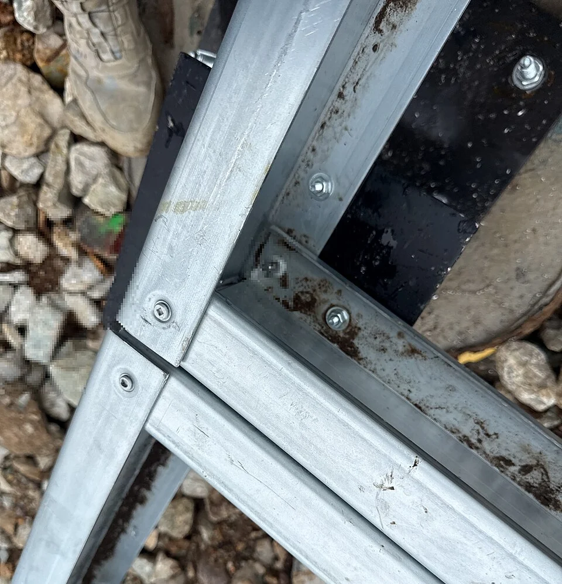

## What it is for

A temporary pavilion is advertised as circular because its beams are bolted together. At removal, the bolts are hidden behind bonded finishes, the lifting points are unclear and nobody has kept the assembly records. The structure may be physically separable, but a future contractor cannot confidently recover useful parts. Reversibility was treated as a connection type rather than a complete design problem.

## The core idea

**Design for Disassembly** plans how useful components can be taken apart safely and recovered for another use. A reusable door or beam needs more than a joint that opens: workers must reach it, support it during removal, move it without damage and establish its condition. Plan the connections, handling, information and likely destination together so the option of reuse survives beyond the original construction drawing.

## How it works

Choose a realistic level of future recovery: component, assembly or building. Plan accessible connections, a safe removal sequence, handling and storage with qualified specialists. Link identifiers to records of material and condition, and establish who can organize the recovery rather than treating removability alone as proof of reuse.

## Why it works

Reusing an intact door preserves its function as a door. Recycling its material takes a different route, often involving further processing before the material can be used again. Both can be appropriate, but they need different plans. For a recovered structural member, the next project also needs evidence of identity, condition and relevant properties before deciding whether it is suitable for the proposed load and use.

Connections matter because destructive removal can damage otherwise useful parts. Accessible mechanical connections may support recovery, while some bonded systems are difficult to separate. That is not a universal rule against adhesives or composite construction. Actual structure, fire performance, durability and environmental control may require specific assemblies. Evaluate the whole consequence rather than substituting a reversible joint that cannot perform its original job.

## Architectural examples

### Amsterdam’s temporary courthouse — a completed second use

Amsterdam needed a working courthouse while its permanent replacement was being built. The Dutch Central Government Real Estate Agency made removal and reuse part of the contract, alongside design, construction and maintenance. cepezed and its partners therefore treated the temporary building as a set of recoverable parts. The arrangement also gave the contractor a financial interest in their residual value—the value remaining after the courthouse's first use. [Read the original client's account](https://www.rijksvastgoedbedrijf.nl/actueel/nieuws/2026/04/13/circulariteit-loont-hoe-een-tijdelijk-gebouw-twee-levens-kreeg).

The design used detachable steelwork, floor units and facade components. Dismantling took place in 2021–22, followed by storage before the next project. This is the practical interval often missing from a drawing of a reversible joint: components need identification, handling space, protection and a party responsible for finding and organizing their next use.

cepezed's September 2025 account describes the completed reassembly at Kennispark Twente in Enschede, where Lagemaat and Groothuis Bouwgroep reconstructed it as an office and knowledge lab. The internal layout changed, and solar-control glazing moved to another facade to suit the new orientation. Those adaptations make this a documented second use, beyond an intention to recover parts. The transferable lesson is to join physical separability with contracts, records, storage and a credible next project. The two primary accounts document the reuse; this guide makes no quantified carbon-saving claim. [See the architect's reassembly account and photographs](https://www.cepezed.com/recent/een-gebouw-demonteren-en-elders-weer-opbouwen-kan-gewoon/).

### A bolted assembly — one part of a removal sequence

In the bolted connection photograph, the fasteners identify potential points of separation. Use the detail to ask which bolts need access, which member needs support first and what later finishes might obstruct the work. Those questions connect the joint to a removal sequence. Engineers and contractors need to establish that sequence for the whole assembly before it can be safely dismantled.

[Photograph source](https://commons.wikimedia.org/wiki/File:Steel_floor_joist_bolted_connection_detail,_Stone_County_Missouri,_2026-05-05.jpg) · [License](https://creativecommons.org/licenses/by/4.0)

### An exhibition pavilion — illustrative scenario

In an illustrative exhibition pavilion, repeated timber members use accessible connections and have a documented removal order. Temporary bracing, lifting, storage and transport are planned before construction. Each member carries an identifier linked to its records, sometimes called a material passport. Those records help the next team assess the component; its condition and suitability still need checking for the next use.

### An office fit-out — illustrative scenario

In an illustrative office fit-out—the internal partitions, finishes and equipment—demountable walls are designed to be taken apart. Standard-size doors can be kept when the layout changes, and services leave their fixings reachable. A likely next use elsewhere in the building gives recovery a practical destination. Allocate storage, responsibility and time for condition checks as part of the arrangement.

These scenarios show why disassembly belongs at several levels. A whole building may remain in use while interior components change; a temporary structure may move as an assembly; selected elements may be salvaged from a building that cannot remain. Choose the level appropriate to the likely change. Designing every minor part for a distant hypothetical second life can add complexity with little realistic benefit.

## Design considerations

Identify which connections are released first, which parts temporarily support others and where workers and equipment can operate. A sequence that leaves an unstable wall or an unsupported member is not a design for safe disassembly. Qualified engineers and contractors need to establish the actual method. The conceptual diagram here is an inquiry into the sequence, not a demolition instruction.

Records should describe material identity, relevant properties, dimensions, connections, maintenance and changes made after construction. Keep them accessible and update them when parts are altered. A sophisticated database is not essential to every small project; a clear, durable record linked to physical identifiers may be more dependable. Information that disappears with a contractor's account does little for future recovery.

Agree who will own the recovery decision. A tenant may value reusable fit-out while the landlord controls removal, or a contractor may prefer rapid demolition because the contract gives no time for salvage. The physical design and commercial arrangement need to support each other. Consider a realistic destination for components, the space needed to sort them and the evidence a receiving project would require. Those arrangements can change, but identifying them early is more credible than counting material as reused before anyone has accepted it.

The U.S. EPA's guidance supports designing for adaptation, accessible connections and safe recovery. Local waste, product and construction requirements still need professional review.

## Useful when

This pattern helps in temporary buildings, repeated fit-outs and long-term construction where future adaptation is plausible. It also improves questions asked when buying components: can components be repaired, are interfaces documented, and what happens when one supplier disappears? A standard understandable assembly may offer better recovery prospects than a proprietary reversible system dependent on an unavailable specialist tool.

- Can these building components be used again after this project?
- We want a structure that can be taken apart safely.
- Does bolting components together guarantee future reuse?
- How do we keep a record of materials for later recovery?
- Our temporary building should not become demolition waste.
- What makes a reusable component worth recovering?
- How do we compare reuse with recycling?
- Can reversible connections still meet structural and fire requirements?

## Common mistakes and limits

Common mistakes include assuming bolts prove reusability, ignoring contamination or coatings, and counting every removed component as a future reused one. Storage damage, transport distance, testing and market demand affect the result. Report actual recovery when it occurs and distinguish it from design potential. A responsible claim can be modest: the assembly preserves a feasible recovery route, subject to future condition and needs.

## Related patterns

[[arch-repairable-connections|Repairable Connections]] addresses routine component care, [[arch-loose-fit-layers|Shearing Layers]] identifies likely change cycles, and [[arch-reuse-before-replacement|Reuse Before Replacement]] asks whether the whole building can remain useful before any disassembly is considered.

## Sources and provenance

Modern editorial synthesis, not a named pattern attributed to a single historical author. Patternverse editorial synthesis; source organizations credited in article. The explanations and diagrams here are independently authored.

- [U.S. EPA: Best Practices for Reducing, Reusing and Recycling Construction and Demolition Materials](https://www.epa.gov/smm/best-practices-reducing-reusing-and-recycling-construction-and-demolition-materials)
- [cepezed: Dismantling a building and rebuilding it elsewhere (18 September 2025)](https://www.cepezed.com/recent/een-gebouw-demonteren-en-elders-weer-opbouwen-kan-gewoon/)
- [Rijksvastgoedbedrijf: Circulariteit loont, hoe een tijdelijk gebouw twee levens kreeg (13 April 2026)](https://www.rijksvastgoedbedrijf.nl/actueel/nieuws/2026/04/13/circulariteit-loont-hoe-een-tijdelijk-gebouw-twee-levens-kreeg)
