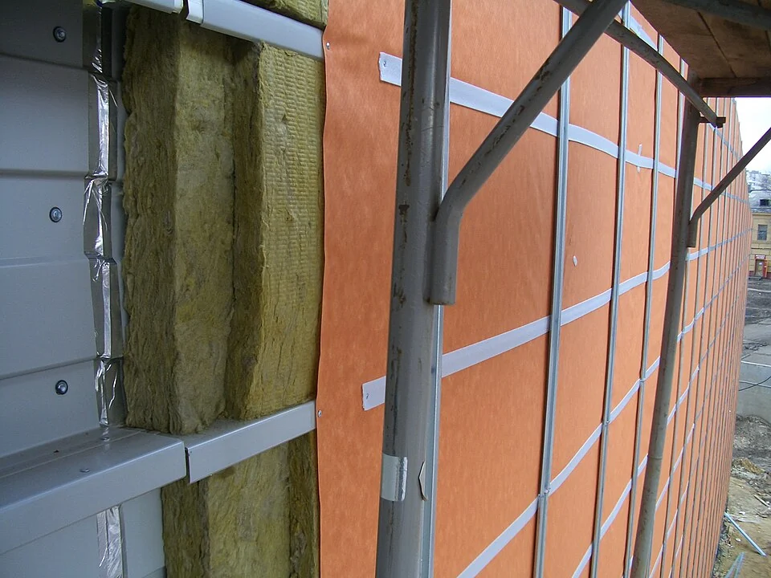

## What it is for

A building's outer wall is expected to stay dry because every joint has been sealed. One joint fails, rain reaches the layers behind it, and the water has nowhere to leave. Weather and building movement will test those joints repeatedly. A more forgiving wall anticipates some water entry and gives it a controlled way out.

## The core idea

A **Drained and Ventilated Rainscreen** separates the cladding—the outer covering that sheds most rain—from the wall behind it. A cavity, or gap between the layers, provides a route for water to drain. Openings can also allow air movement to help drying. Drainage and ventilation need deliberate design: a wall can drain without having the same airflow as another ventilated system.

## How it works

Start at a joint where rain could pass the outer covering. Follow it down the protected drainage surface to an outlet, including what happens at windows, supports and the base of the wall. Coordinate this route with drying and fire protection. Review the order of construction so installers can keep the gap clear and inspect it before closure.

## Why it works

Cladding can deflect much of the rain while joints, interfaces and exposure allow some water to pass. A secondary water-control layer and a drainage path provide another line of defense. Gravity can carry liquid downward if the route remains continuous and outlets remain usable. Drying depends on the materials, climate and assembly; a gap alone does not guarantee that wet construction will dry safely.

Each layer has a job. Cladding sheds most rain; supports hold it in place; the water-control layer protects the inner wall; insulation slows heat transfer; and an air barrier limits leakage. Their order varies between systems. John Straube's rain-control guidance explains these different tasks. Knowing these roles makes a wall section easier to follow and helps explain why the assembly changes with materials and climate.

## Architectural examples

### An exposed facade assembly — layers before closure

In the installation photograph, parts of the outer covering are still missing. That makes the insulation, protective layer and metal supports easier to distinguish. Compare the exposed layers with the water-path diagram: where could water fall, and where would it leave? The window and base details need separate drawings because they are outside this view.

[Photograph source](https://commons.wikimedia.org/wiki/File:%D0%9C%D0%BE%D0%BD%D1%82%D0%B0%D0%B6_%D0%B2%D0%B5%D0%BD%D1%82%D0%B8%D0%BB%D0%B8%D1%80%D1%83%D0%B5%D0%BC%D1%8B%D1%85_%D1%84%D0%B0%D1%81%D0%B0%D0%B4%D0%BD%D1%8B%D1%85_%D1%81%D0%B8%D1%81%D1%82%D0%B5%D0%BC_%D1%81_%D0%BF%D1%80%D0%B8%D0%BC%D0%B5%D0%BD%D0%B5%D0%BD%D0%B8%D0%B5%D0%BC_%D1%83%D1%82%D0%B5%D0%BF%D0%BB%D0%B8%D1%82%D0%B5%D0%BB%D1%8F_%D0%B8_%D0%B3%D0%B8%D0%B4%D1%80%D0%BE%D0%B8%D0%B7%D0%BE%D0%BB%D1%8F%D1%86%D0%B8%D0%BE%D0%BD%D0%BD%D1%8B%D1%85_%D0%BC%D0%B0%D1%82%D0%B5%D1%80%D0%B8%D0%B0%D0%BB%D0%BE%D0%B2.JPG) · [License](https://creativecommons.org/licenses/by-sa/3.0)

### Timber cladding — illustrative scenario

In a hypothetical low-rise timber-clad building, water entering a cladding joint reaches a protected drainage surface and leaves at a designed base. The cladding support does not block the intended flow. The base also addresses insects, splashback, maintenance and the required separation from ground. Actual materials, dimensions and fire provisions must be established for the project; the route is the point of the example.

### A panel facade window — illustrative scenario

In a hypothetical panel facade with a window, the cavity is interrupted by the opening. Water arriving above it needs to be directed outward without entering the frame junction or trapped layers below. The sill below the window, head above it and jambs at its sides must agree with the whole-wall strategy. A perfect-looking typical wall section is insufficient if every opening creates a concealed reservoir.

### A balcony or sign fixing — illustrative scenario

A third scenario involves a balcony or sign fixing. Supports penetrate the outer layer and may cross the water-control system. Each penetration needs coordinated support, movement allowance and water management. Sealant may have a legitimate role, but it should not be used as an unexplained substitute for the underlying drainage logic. Ask how the joint will be inspected and repaired after the facade is occupied.

## Design considerations

The cavity also needs fire design. A gap behind cladding can provide a route for fire and smoke, so the required materials and cavity barriers—elements that restrict their spread—must be established for the building. Facade and fire specialists need to coordinate these provisions with drainage and any intended airflow. Neither the gap nor the cladding can be judged safely in isolation from the complete wall system.

Construction tolerances and debris can obstruct a theoretically continuous cavity. Mortar, displaced insulation or poorly placed supports may change the route. Draw inspection points and installation sequences that make hidden work reviewable. Consider how openings at the base and other outlets remain accessible to maintenance. A drainage strategy that cannot be checked becomes dependent on assumptions that may not survive construction.

Drainage removes liquid water; drying removes moisture still held in materials. A clear outlet can solve the first problem while wet timber or insulation remains behind the cladding. The wall needs a way for that moisture to escape under local weather and indoor conditions. Adding an impermeable layer can trap another moisture source. Investigate the existing construction before changing it, and use moisture analysis where needed. Sometimes repairing one leaking window junction is more appropriate than replacing the whole facade.

Before specifying the assembly, agree who is responsible for the supports, water-control connections, fire protection and inspection. The drawings here explain those relationships. Qualified designers must establish the actual layer arrangement, cavity size and material requirements for the project.

## Useful when

This pattern helps when designing or repairing exposed cladding assemblies, particularly where an outer layer is expected to admit some incidental water. It does not establish that every existing wall needs a new cavity, nor that adding one will fix a damp building. Diagnose the moisture source: plumbing leakage, ground moisture, air leakage and condensation may require different interventions.

- Rain keeps finding its way behind our cladding.
- Should a facade rely on one perfect outer seal?
- How can a wall drain water that gets past the outer layer?
- What happens at the bottom of a cladding cavity?
- Can ventilation behind cladding help it dry?
- Our facade detail has no clear route for water to leave.
- How do windows interrupt a rainscreen strategy?
- Is a cavity wall automatically safe and durable?

## Common mistakes and limits

Common mistakes include blocking drainage with horizontal members, confusing airtightness with rain control, and assuming ventilation can compensate for uncontrolled water entry. Another is selecting cladding primarily by appearance while leaving support and cavity coordination to separate late decisions. The parts need to form one coherent assembly, with responsibility for interfaces made explicit in contracts and site inspections.

## Related patterns

[[arch-continuous-thermal-envelope|Continuous Thermal Envelope]] coordinates the protected boundary, [[arch-repairable-connections|Repairable Connections]] addresses future access, and [[arch-building-edge|Building Edge]] brings the base of the facade into contact with people, paving, planting and splashback.

## Sources and provenance

Modern editorial synthesis, not a named pattern attributed to a single historical author. Patternverse editorial synthesis; source organizations credited in article. The explanations and diagrams here are independently authored.

- [John Straube, Building Science Corporation: BSD-013, Rain Control in Buildings](https://buildingscience.com/documents/digests/bsd-013-rain-control-in-buildings)
- [Whole Building Design Guide: Building Envelope Design Guide](https://www.wbdg.org/building-envelope-design-guide)
