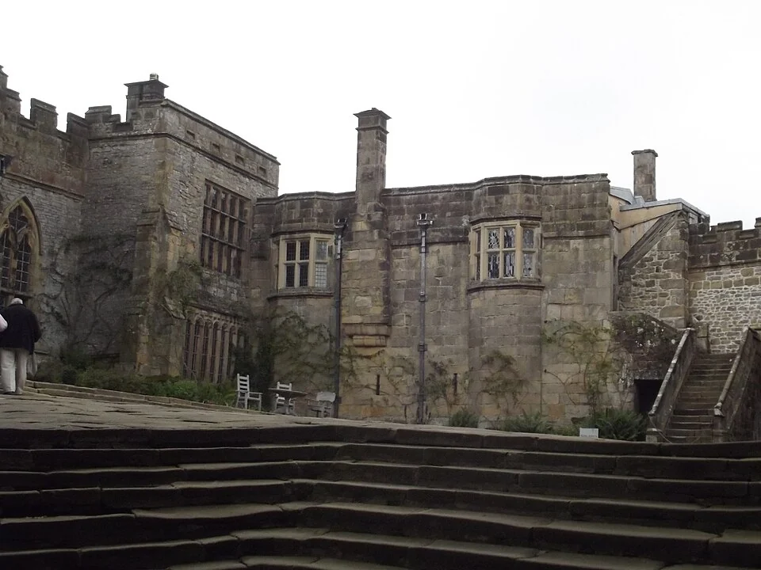
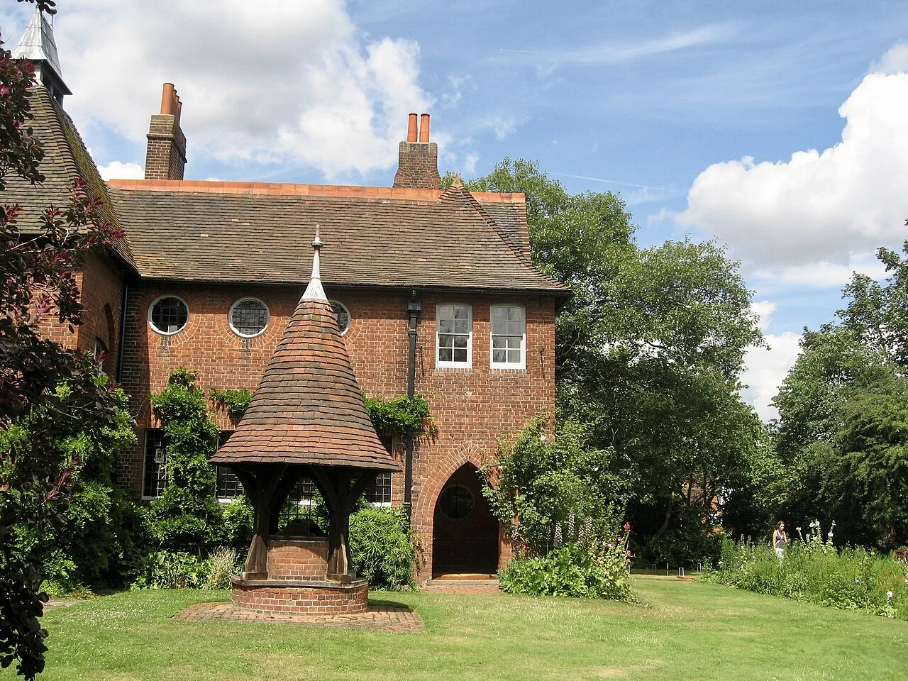

## What it is for

A door opens directly from a noisy pavement into a quiet counseling room. Every arrival interrupts the conversation inside, while visitors hesitate because they cannot tell whether they are already intruding. Another building has three security doors and a dark vestibule, making arrival feel like a test. Both need a better transition, though in opposite ways.

## The core idea

Alexander's **Entrance Transition** gives people a short, understandable change between outside and inside. A canopy, turn, screen or change in light can show where to wait, how to enter and how private the next space is. A vestibule is a small entrance space between outer and inner doors. The sequence can stay level and compact while giving arrival more shelter and clarity.

## How it works

Arrange a short, understandable sequence from approach to public or shared interior. Shelter the actions of waiting and opening the door, then use enclosure, light or a screen to mark changes in privacy. Keep maneuvering space and the onward route clear, with controls and information available at the point of need.

## Why it works

Arrival brings practical and social questions together: is this the right door, should I ring, and where can I wait? Different parts of the entrance answer them. A recess shelters someone opening the door. A vestibule can reduce drafts. A screen or waiting space can protect a conversation farther inside. Choose the elements for those purposes, keeping the onward route easy to understand.

A long sequence is not inherently better. Each additional turn or door can make access harder, particularly for someone with fatigue, limited dexterity or unfamiliarity with the building. A useful transition reduces uncertainty rather than adding it. Keep the destination visible or clearly indicated, and place any controls where people can comfortably reach and understand them. Space and information should reinforce one another.

## Architectural examples

### Haddon Hall — a historic arrival sequence

At Haddon Hall, the approach crosses an outdoor room before reaching a recessed doorway. The courtyard, steps and doorway make successive thresholds visible. This historic example helps explain the depth of a transition. A contemporary design needs to make the same welcome available through a clear step-free route, using shelter and enclosure to mark the change where steps would create a barrier.

[Photograph source](https://commons.wikimedia.org/wiki/File:Haddon_Hall_-_Lower_Courtyard_(15190340021).jpg) · [License](https://creativecommons.org/licenses/by-sa/2.0)

### Red House, Bexleyheath

Philip Webb's Red House, built for William Morris in Bexleyheath, gives the domestic entrance a projecting form between the garden and rooms. The doorway has an identifiable setting rather than meeting the garden as a flat opening. Compare that smaller arrival with Haddon Hall's courtyard sequence: depth can be created at several scales, according to the building and the people arriving.

[Photograph source](https://commons.wikimedia.org/wiki/File:Red_House,_Bexleyheath_-_geograph.org.uk_-_6058218.jpg) · [License](https://creativecommons.org/licenses/by-sa/2.0)

### A community advice center — illustrative scenario

In a hypothetical community advice center converted from a shop, a short entrance zone separates the meeting room from the street. A visible reception point and seats beside the path show visitors what to do next. A glazed screen can reveal whether a room is occupied while shielding documents. Speech privacy needs acoustic design as well; the screen's presence alone will not stop a conversation being heard.

These examples show different social conditions. A home may allow a resident to decide whether to admit a visitor; a public service should avoid making entitled users feel they need personal permission to enter. A transition becomes exclusionary when it confuses welcome with gatekeeping. Observe the experience of a first-time visitor rather than relying only on the operator's familiarity with the route.

## Design considerations

A canopy, a lower ceiling or a short wall turning into the room—a wall return—can mark a transition while the floor stays level. Materials need suitable grip and visual contrast. Avoid patterns that resemble steps, and light the space so visitors can recognize faces and read instructions. The aim is to make the next action clear at the moment someone needs to take it.

Door maneuvering, waiting, assistance and circulation should be possible at the same time. A bench that blocks a door is not a welcoming addition. A vestibule that traps a wheelchair user between opposing swings is not a successful environmental buffer. Test people, furniture, door operation and likely queues at an appropriate scale, with access expertise and relevant local standards.

A vestibule may improve environmental separation, but its energy effect depends on operation and the rest of the building’s walls, roof and openings. It is not a substitute for suitable doors, seals or ventilation. Fire, security, access and weather protection need coordinated professional decisions. The diagrams describe an arrival sequence, not compliant clearances or escape arrangements for a particular building.

## Useful when

This pattern helps at homes, schools, workplaces, clinics and civic buildings wherever arrival meets a different pace or privacy condition. It can be especially valuable in a renovation with a small frontage. Rearranging the first few meters may improve privacy and orientation more than enlarging the whole lobby. Keep the design proportional to the actual arrival volume and any security requirements.

- Our front door opens straight from a busy street into a quiet room.
- How can visitors feel welcome without exposing private activities?
- The entrance lobby feels like a barrier rather than a welcome.
- Can a small porch improve arrival?
- We need a place to wait before entering a shared home.
- How do we make arrival comfortable in bad weather?
- Visitors do not know when they have entered the private part of our building.
- How can a threshold work without adding steps?

## Common mistakes and limits

Common mistakes include excessive dimness, unexplained side entrances, thresholds that become storage, and ornamental steps introduced only to make the entrance feel important. A mat well or drainage detail can also create a barrier if not coordinated. Maintenance matters: a threshold designed as a clear invitation can become confusing when signage, parcel deliveries and temporary furniture accumulate around it.

## Related patterns

[[arch-main-entrance|Main Entrance]] makes the public door identifiable before arrival. [[arch-inclusive-arrival|Inclusive Arrival]] checks that the sequence works for different people. [[arch-intimacy-gradient|Intimacy Gradient]] carries the social logic further into the plan, so the first threshold is part of a coherent arrangement rather than an isolated decorative gesture.

## Sources and provenance

Established named pattern. Christopher Alexander, Sara Ishikawa, Murray Silverstein, with Max Jacobson, Ingrid Fiksdahl-King and Shlomo Angel. The explanations and diagrams here are independently authored.

- [A Pattern Language, pattern 112; Alexander, Ishikawa, Silverstein and colleagues](https://www.patternlanguage.com/apl/aplsummary.htm)
- [English Heritage: Red House, Philip Webb for William Morris](https://www.english-heritage.org.uk/visit/blue-plaques/red-house/)
- [U.S. Access Board: Entrances, Doors and Gates (jurisdiction-specific guidance)](https://www.access-board.gov/ada/guides/chapter-4-entrances-doors-and-gates/)
