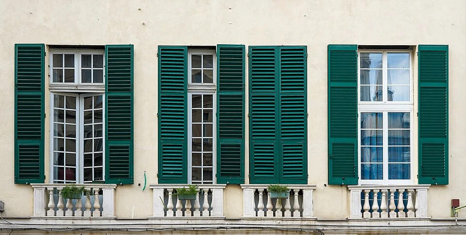

## What it is for

A classroom has blinds, yet it becomes uncomfortable on a sunny afternoon. The blinds reduce the glare reaching students, but sunlight has already passed through the glass. Another room has a handsome horizontal overhang that shades a high sun while admitting the low western sun responsible for its worst conditions. In both cases, the design has treated shading as a generic accessory rather than a relationship between sun, opening and use.

## The core idea

**External Solar Shading** intercepts unwanted sun before it reaches the glass. An overhang projects above an opening; a fin stands beside it; shutters and screens can cover more of its face. Choose the form for the direction of the sun and the hours the room is used. Keep useful daylight and views in the comparison, including times when shade is unnecessary.

## How it works

Identify when direct sun causes trouble and which windows it reaches. Draw views from above and a vertical cut through the room to compare the incoming angles with possible shades. Assess the remaining daylight and view, then decide how a fixed or movable device will be supported, operated, cleaned and maintained.

## Why it works

Direct sun can warm surfaces and contribute to overheating. It can also create visual discomfort or make a screen difficult to read. A device that improves one condition may not resolve the other. Internal blinds can be important for glare and privacy even where external shading controls solar input. Glazing properties, room loads, ventilation and cooling still influence the overall thermal result.

The position and size of the shade determine which rays reach the window. A shallow overhang may stop high midday sun yet let low afternoon sun pass underneath. Fins can intercept light arriving from the side. Draw these relationships in plan, a view from above, and in section, a vertical cut. A front view alone hides the depth and angles that make the shade work.

## Architectural examples

### Genoa — adjustable shutters outside the glass

The Genoa facade shows shutters in different positions on similar openings. Closed or partly closed, they can screen the glass; folded back, they reveal more of the window. This makes adjustable shade easy to understand. The design question includes whether occupants can reach and use the shutters, preserve a desired view and maintain the hardware over time.

[Photograph source](https://commons.wikimedia.org/wiki/File:Window_Shutters_Genoa_Italy_Sep23_A7C_06594.jpg) · [License](https://creativecommons.org/licenses/by-sa/4.0)

### A classroom facing the equator — illustrative scenario

In a hypothetical northern-temperate classroom facing roughly toward the equator, a carefully designed horizontal overhang may block high summer sun while allowing some lower winter sun. The exact geometry must be calculated for the site and the hours that matter. Nearby buildings and trees may change the result. A diagram showing a favorable noon condition is not proof of performance throughout the school day.

### A west-facing office — illustrative scenario

In a hypothetical west-facing office, low afternoon sun can pass beneath the same overhang. Vertical fins, an external screen, operable shading or a different glazing strategy may deserve comparison. Each has costs: fins can obstruct oblique views, screens may reduce daylight, and operable systems require controls and maintenance. The preferred answer depends on the actual room and occupants rather than a rule that one device belongs on every facade.

These examples explain why copying the proportions of a shaded building in another climate is risky. Latitude and hemisphere matter, but so do schedules and internal heat gains. A room occupied mainly in the evening may have a different critical exposure from one used in the morning. Use climate-based thermal and daylight assessment where the risk and project scale justify it, with assumptions made explicit.

## Design considerations

Fixed shading has few operating parts and can be robust, but it remains present when shade is unnecessary. Movable shading can respond to changing conditions while introducing motors, controls, wind limits and a failure state. A manually operated system needs to be reachable and understandable. Automatic control should allow appropriate occupant input rather than repeatedly fighting the person using the room.

Shading devices need secure support, drainage, cleaning access and an appropriate response to wind, snow or other local exposure. Fixings can affect thermal continuity and waterproofing. A balcony may shade the room below while creating other envelope junctions. Coordinate these consequences rather than assuming a multifunctional device is environmentally beneficial in every respect.

A useful comparison records conditions at the occupied task: the hours of direct sun, the view toward bright surfaces and the likely position of blinds or screens. Include a realistic operating schedule rather than assuming every device is perfectly deployed. In shared rooms, people may disagree about shade because they sit in different positions. Zoning the control or moving the task can sometimes resolve that conflict with less equipment. Review the result during the season that produced the complaint, rather than accepting a demonstration on a mild cloudy day.

Use qualified facade and environmental designers to establish actual performance and compliance. Avoid importing numerical savings from an unrelated project.

## Useful when

This pattern helps early in facade design, when window size and shading can be considered together, and during retrofit when solar exposure is a demonstrated source of discomfort. It is less useful as an isolated response where the main problem is equipment heat, inadequate ventilation or poor controls. Diagnose the load before adding a conspicuous facade device. A shaded room can still overheat for other reasons.

- Our glazed room overheats when the sun comes out.
- Can we stop solar heat before it enters the window?
- Would a horizontal overhang work on a west-facing window?
- We need daylight but not direct sun on the desks.
- How do we choose between fixed and movable shading?
- Our internal blinds control glare but the room still feels hot.
- Can shading help in winter as well as summer?
- The facade looks shaded in drawings but low sun still comes in.

## Common mistakes and limits

Common mistakes include excessive permanent shade, relying on plants that have not matured, and deciding how controls work only after occupants arrive. Screens may also affect fire access, escape openings or maintenance routes. The attractive closed position is only one operating state. Check the fully open position, a partly deployed state and the condition when the mechanism fails or is taken out of service.

## Related patterns

[[arch-south-facing-outdoors|South Facing Outdoors]] supplies seasonal site reasoning, [[arch-light-on-two-sides|Light on Two Sides of Every Room]] addresses useful light distribution, and [[arch-continuous-thermal-envelope|Continuous Thermal Envelope]] keeps the supporting construction and junctions part of the same design.

## Sources and provenance

Modern editorial synthesis, not a named pattern attributed to a single historical author. Patternverse editorial synthesis; source organizations credited in article. The explanations and diagrams here are independently authored.

- [U.S. Department of Energy: Energy 101, Daylighting](https://www.energy.gov/articles/energy-101-daylighting)
- [U.S. Department of Energy: Energy Savings from Window Attachments](https://basc.pnnl.gov/library/energy-savings-window-attachments)
