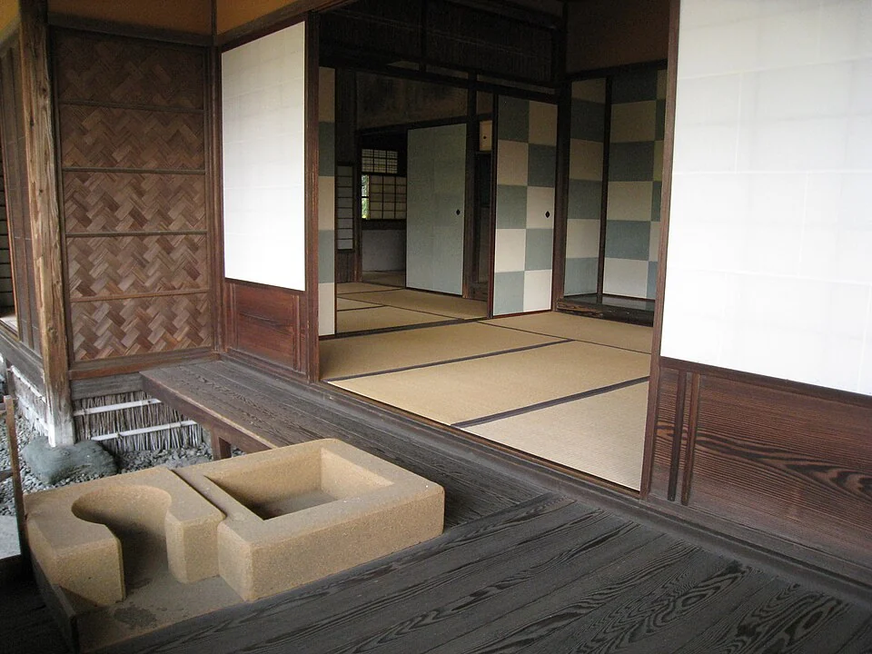

## What it is for

One room is too small for a gathering, yet opening the whole floor would remove the quiet place needed for work. The choice is often presented as permanent enclosure versus a completely open plan. A third possibility is a set of distinct rooms with deliberate, controllable connections. They can share light, movement or activity when useful and remain separate when activities conflict.

## The core idea

**Flexibly Linked Rooms** gives two useful rooms a connection that people can open or close. Each room needs its own access, light, furniture and purpose. A broad doorway or movable partition can then let them share an activity when needed. Flexibility lies in the useful arrangements available to people, including the everyday separated state and the occasional larger gathering.

## How it works

Design each room to function independently, including access, furniture, light and services. Place the connection where opening it creates a genuinely useful combined space. Test both states and the act of changing between them, including partition storage, operating effort and the acoustic separation actually required.

## Why it works

Opening a broad connection can let a shared table extend into the next room or allow someone to supervise an adjoining activity. Closing it changes the view and may separate incompatible uses. Sound behaves differently: a lightweight sliding screen can hide a desk while leaving a phone call audible. If two conversations must remain private, the partition, surrounding construction and doors need an acoustic design for that purpose.

The rooms need to work when separated. Check entrances, daylight, ventilation, furniture and services in each state. If closing the partition leaves one room accessible only through another private room, the advertised flexibility may be illusory. Similarly, a large opening has little value if furniture blocks its operation. Design the everyday arrangement and the occasional arrangement at the same level of seriousness.

## Architectural examples

### Katsura — rooms linked by sliding screens

At Katsura, wide framed openings join adjoining rooms while sliding panels allow the connection to change. The frames keep each room's proportions visible even when the panels are open. Study where the opening sits and how much of the neighboring room can be seen. A modern application also needs room for the panels and controls that its users can operate comfortably.

[Photograph source](https://commons.wikimedia.org/wiki/File:Katsura5.jpg) · [License](https://creativecommons.org/licenses/by/2.0)

### A neighborhood center — illustrative scenario

In a hypothetical neighborhood center, two rooms can host separate classes on weekdays and combine for a shared meal. Each has its own door from a common arrival space, and the connecting opening lies where a long table can cross it. Storage for the partition and spare furniture is included. The acoustic performance is selected for actual simultaneous uses rather than described vaguely as “flexible meeting space.”

### A home study — illustrative scenario

An illustrative example is a home with a study beside the living room. Opening a generous doorway allows the study to join family activity; closing it supports a confidential call. A second access from the hall prevents work visits from crossing the living room. The arrangement needs an honest assessment of speech privacy and ventilation, especially if the study may later become a bedroom. A room label cannot substitute for the requirements of that future use.

These scenarios illustrate a limit of open-plan enthusiasm. Removing boundaries can increase apparent spaciousness while reducing the number of things that can happen at once. The relevant measure is useful activity over time, not the largest unobstructed view in a photograph. Some households or organizations prefer stable rooms; a flexible connection should support their routines rather than create a duty to rearrange the building every day.

## Design considerations

A heavy partition requiring several trained staff may be appropriate for a major event hall, but it is a poor choice for a small room expected to change several times a day. Consider force, reach, storage, locking and the consequences of misuse. People need to know how the connection operates and who may change it. A simple hinged door may provide more dependable flexibility than an elaborate system no one wants to handle.

Explain the useful arrangements in the handover information—the records and instructions given to the people running the building. Identify which activities can happen at once, where furniture is stored and what must change when rooms combine. A later manager can then use the connection confidently instead of leaving it permanently closed because its operation was never explained.

For actual work, coordinate structure, fire safety, accessibility, acoustics and services with appropriate professionals. Full-size testing can be valuable where the operating force or furniture relationship is uncertain.

## Useful when

This pattern helps in homes, education, community buildings and workplaces with activities that vary in group size or privacy needs. It can be especially useful in renovations where retaining existing room structure saves resources. Before cutting a large opening, establish the wall's structural role and the effect on fire and acoustic separation. The desire for a more connected plan does not make every partition expendable.

- We need rooms that can work separately and together.
- An open plan gives us no quiet place during simultaneous activities.
- Can a large opening make two small rooms more useful?
- How do we adapt a home for changing work and family needs?
- Our hall is either one noisy space or several isolated rooms.
- Where should a movable partition actually go?
- Can connecting rooms reduce the need for more floor area?
- We need flexibility that people will really use.

## Common mistakes and limits

Common mistakes include making every room interchangeable, installing operable walls without storage, and forgetting power, lighting and environmental controls in the divided state. A combined room may need different lighting scenes and ventilation arrangements from two separate rooms. Controls should remain intelligible to ordinary users. A flexible building that depends on continual expert intervention can become rigid in practice.

There are also tradeoffs in furniture and identity. A room permanently prepared for every possible event may feel suitable for none. Preserve enough stable use and storage that people can settle into the space. Ask which changes are frequent, which are occasional and which are merely speculative. Design effort should follow the likely changes rather than a theoretical maximum number of configurations.

## Related patterns

[[arch-intimacy-gradient|Intimacy Gradient]] clarifies why separation matters, [[arch-loose-fit-layers|Loose-Fit Layers]] supports longer-term change, and [[arch-ceiling-height-variety|Ceiling Height Variety]] can distinguish areas even when an opening is left wide.

## Sources and provenance

Modern editorial synthesis, not a named pattern attributed to a single historical author. Patternverse editorial synthesis; source organizations credited in article. The explanations and diagrams here are independently authored.

- [Ching: Architecture, Form, Space, and Order (spatial relationships and organization)](https://www.wiley.com/en-us/architecture-form-space-and-order-5th-edition-p-9781119853374)
- [AIA Framework: Design for Change](https://www.aia.org/design-excellence/aia-framework-design-excellence)
- [Imperial Household Agency: Katsura Imperial Villa](https://kyoto-gosho.kunaicho.go.jp/en/katsura-rikyu)
