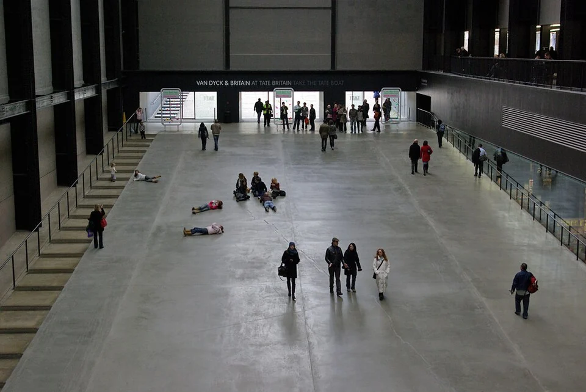
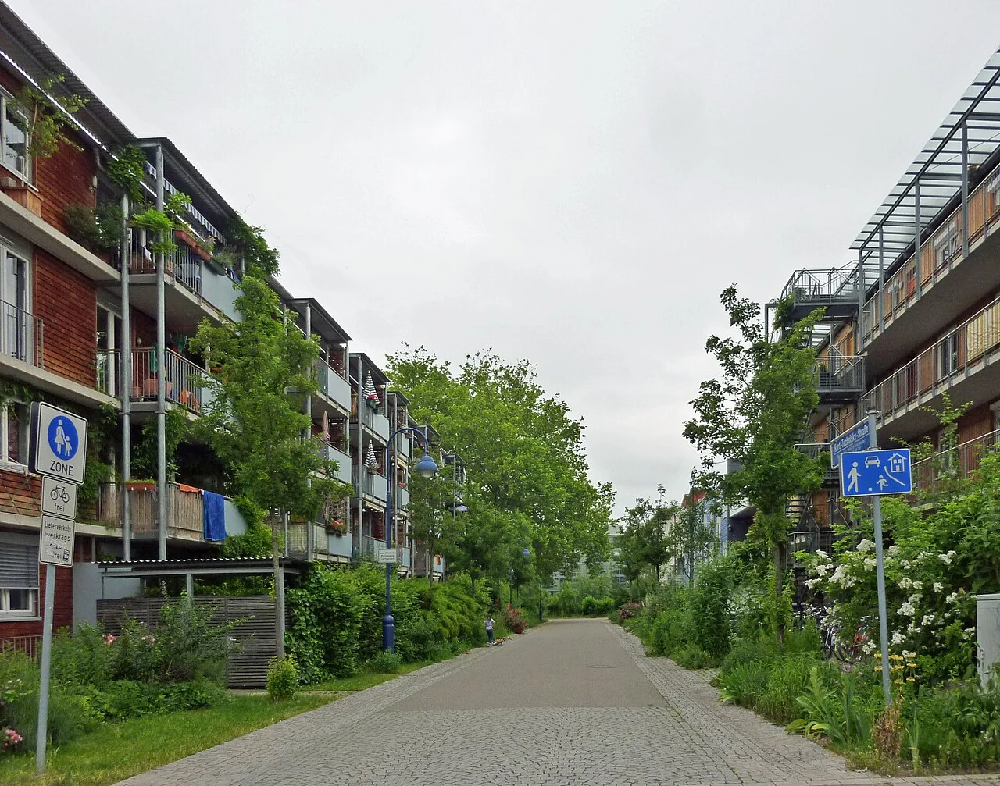

## What it is for

A wheelchair user reaches the front steps and finds a sign directing them around the building. The alternative path passes bins and a locked gate before reaching an intercom. Inside, the main lobby is generous and welcoming. The building has provided a technical alternative while distributing dignity and convenience unequally.

## The core idea

**Inclusive Arrival** considers the whole journey from the place someone arrives to the service they need inside. Finding the entrance, reading information, opening doors, waiting and getting help all matter. A level path addresses one need; the complete journey also has to work for people with different stamina, senses, communication needs and ways of moving.

## How it works

Follow each journey from arrival point to public service. Check the route, signs, door operation and waiting space together with users and access specialists. Include rain, darkness, security checks and locked doors. Where a door or intercom can fail, establish how someone gets help before that failure leaves them stranded.

## Why it works

A route works only if its links work together. A usable pavement can lead to an inaccessible gate; a gentle approach can end at a door with no maneuvering space; an automatic door can lead into an unmarked corridor. Evaluate the sequence with the actual operating conditions, including security, opening hours, rain, darkness and temporary obstructions. A successful detail cannot compensate for a failed journey.

People also arrive differently. Some walk from a bus stop, some use accessible parking, some come with a carer, child or mobility aid. Others need clear visual information, reduced sensory demand or a place to rest. These needs are neither identical nor mutually exclusive. Consult a range of users and access specialists rather than using one imagined wheelchair journey as a proxy for everyone.

## Architectural examples

### Tate Modern — a shared arrival route

At Tate Modern, the ramp leads into the main Turbine Hall, making arrival part of a shared spatial experience. The photograph shows visitors using the same broad approach to the principal space. It offers a useful relationship to consider in another building. Assessing access in detail would also require dimensions, surface information, door operation and the needs of people making that journey.

[Photograph source](https://commons.wikimedia.org/wiki/File:Tate_Modern_Turbine_Hall_entrance_ramp_-_geograph.org.uk_-_6712317.jpg) · [License](https://creativecommons.org/licenses/by-sa/2.0)

### A civic center — illustrative scenario

In an illustrative civic center, the same entrance is visible from the pavement, cycle parking and passenger drop-off. A step-free approach follows the general arrival route, with resting and waiting places beside the clear path. An entrance control gives a visible response as well as an audible one. Local access requirements and the building's security arrangements determine the detailed design of the route and controls.

### A historic community hall — illustrative scenario

A second hypothetical example concerns a listed community hall with a raised historic doorway. Several options are compared: adjusting the approach, adapting a nearby opening into an equally prominent public arrival, or making a more substantial internal change. The goal is not to preserve a ceremonial main door at any social cost. It is to find the most dignified feasible journey while addressing heritage, structure, access and operation together.

### Vauban, Freiburg: a pedestrian-realm comparison

[Photograph source](https://commons.wikimedia.org/wiki/File:Vauban_housing_courts.jpg) · [License](https://creativecommons.org/licenses/by/2.0)

In Freiburg's Vauban district, the housing-court photograph shows pedestrian routes, planted edges and entrances as parts of one everyday setting. It broadens the question beyond the door: what happens on the way there, and where could someone pause? Use that context when tracing arrival. Detailed access decisions still need on-site information about slopes, surfaces, controls and assistance.

## Design considerations

A visitor should know whether the entrance is open, what to do if it is not, and how to obtain help. An intercom that supplies only an audible response excludes some people. Small low-contrast lettering can make an otherwise clear route uncertain. Information should use consistent names across websites, appointment messages and signs. Technical access and clear communication support the same journey.

Inclusive design also involves tradeoffs. A security barrier, protected historic element or steep site may constrain a shared route. Make those constraints explicit, compare alternatives and involve the affected users. Equal dignity does not always mean identical geometry, but a different route should still be easy to understand, reliable and connected to the same public welcome. Explain how its operation will be maintained.

Keep the operating promises visible in handover and staff training. If a route depends on a powered door, an intercom or a particular gate remaining open, provide a dependable response when that component fails. A design that works only during ideal operation has left a predictable part of arrival unresolved.

The U.S. Access Board guides are useful primary references for the ADA context; they do not establish law in another jurisdiction. Have qualified professionals determine current local requirements for routes, doors, landings, signs and evacuation.

## Useful when

This pattern helps at briefing, site planning, building conversion and operational review. It also provides a practical way to investigate complaints: trace the actual arrival rather than arguing about whether a ramp exists. Observe where effort, embarrassment or uncertainty accumulates. Some remedies may be operational, such as changing locked-door policy or moving furniture; others need physical redesign.

- The accessible entrance is hidden around the back.
- How can everyone use the same welcoming arrival?
- Our ramp technically works but feels like a service route.
- People cannot hear the entrance intercom.
- The approach is step-free but the door is too difficult to use.
- Where should people rest or wait near the entrance?
- How do we plan arrival for different sensory and mobility needs?
- Can we improve an old entrance without treating access as an afterthought?

## Common mistakes and limits

Common mistakes include treating the accessible route as leftover space, assuming that a long detour is acceptable because it has no steps, and placing assistance beyond the first barrier. Another is relying on staff to compensate for a permanently difficult door without a dependable staffing arrangement. Assistance can be valuable, but it should not become an excuse for avoidable design failures.

## Related patterns

[[arch-main-entrance|Main Entrance]] makes the destination visible, [[arch-entrance-transition|Entrance Transition]] makes the threshold comfortable, and [[arch-circulation-as-orientation|Circulation as Orientation]] ensures that an inclusive arrival does not end at a confusing lobby.

## Sources and provenance

Modern editorial synthesis, not a named pattern attributed to a single historical author. Patternverse editorial synthesis; source organizations credited in article. The explanations and diagrams here are independently authored.

- [U.S. Access Board: Accessible Routes](https://www.access-board.gov/ada/guides/chapter-4-accessible-routes/)
- [U.S. Access Board: Entrances, Doors and Gates](https://www.access-board.gov/ada/guides/chapter-4-entrances-doors-and-gates/)
