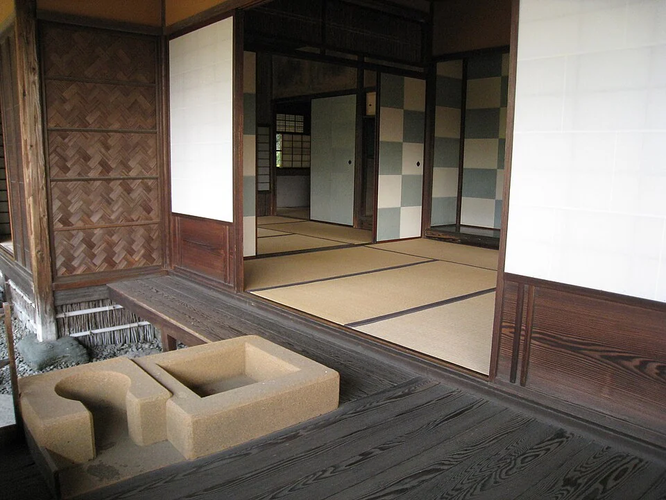

## What it is for

A visitor arriving for dinner walks past an open bedroom door, a working desk and a bathroom before reaching the shared table. Nobody has formally excluded them, but everyone becomes self-conscious. In another building, staff cross a public waiting room to reach a confidential meeting. The plan has made ordinary movement reveal more private life than the activity requires.

## The core idea

Alexander's **Intimacy Gradient** arranges a building so people can understand the move from public to more private places. A gradient is a change by degrees: entrance, shared room, quieter passage, private room. The useful sequence depends on the activities and people involved. Ask who needs privacy from whom and when, then give them understandable boundaries and choices rather than assigning every household the same plan.

## How it works

Identify who needs visual, acoustic or access privacy for each activity. Arrange arrival, shared places and quieter rooms in an understandable sequence, with direct routes where needed. Test visitors, residents and staff moving at different times so privacy does not depend on everyone following one assumed social routine.

## Why it works

Visual privacy, acoustic privacy and control of entry are different conditions. A translucent screen may stop a direct view while allowing every word through. A room with an access-controlled door may still expose its occupants through glazing. Distance can help some relationships while making assistance less available. Identify the actual concern before selecting a wall, curtain or corridor as the solution.

Clear boundaries let someone understand where to go before accidentally entering a private place. A shared room near the entrance gives guests a destination; a side passage can lead residents to bedrooms without crossing the gathering. Doors and screens let people adjust the connection. This leaves room for a quiet evening, a visit or a change in care needs within the same layout.

## Architectural examples

### Katsura — successive room thresholds

At Katsura, several framed openings keep adjoining rooms visually connected, and sliding screens can change that connection. The sequence makes successive thresholds easy to see. Use it to consider where a visitor might pause and how a screen changes exposure. A contemporary privacy arrangement should then follow the needs of its occupants, with sound separation and access considered alongside the view.

[Photograph source](https://commons.wikimedia.org/wiki/File:Katsura5.jpg) · [License](https://creativecommons.org/licenses/by/2.0)

### A shared home — illustrative scenario

In a hypothetical shared home, the kitchen and sitting room lie near the entrance, with bedrooms reached from a short side passage. Guests can join a meal without crossing sleeping territory. A resident who wants a quiet evening can reach a bedroom without being forced through the center of the gathering. The arrangement supports both encounter and withdrawal; it is not successful if all private rooms become remote and poorly lit.

### An advice center — illustrative scenario

In a hypothetical advice center, public reception leads to a waiting area, while consultation rooms sit beside a controlled staff route. Visitors should understand how to reach an appointment without wandering into administration. Staff should not have to carry sensitive material through a crowded public room. Acoustic design, appointments and staffing remain necessary. Spatial order cannot guarantee confidentiality when doors stay open and conversations travel through a common ceiling void.

These examples show why the same gradient can take different forms. A home may deliberately blur shared and private territory; a public institution may need explicit access boundaries. A family with caring responsibilities may prefer short visual connections between rooms. Discuss the relationships with the people concerned rather than importing an idealized domestic model from another era or social setting.

## Design considerations

Private rooms may need direct access for care, maintenance or emergency use. A gradient should not become a maze or an excuse to put accessible facilities at the end of a long route. Multiple connections can preserve privacy if their purpose is clear. A small shared lobby may allow several rooms to operate independently without making one room the passage to another.

Check different times of day as well as a single normal arrangement. A room that is private during office hours may become a public meeting place in the evening. Locking and lighting should support that change without trapping people or exposing unrelated activities.

Coordinate privacy with emergency escape, supervision and assistance. A controlled door should not leave someone unable to get out or obtain help. Discuss these routes with users, operators and the responsible designers. After occupation, notice where people add screens, avoid a room, whisper or leave doors open. Those actions can reveal a boundary that works differently from the one intended on the plan.

## Useful when

This pattern helps in homes, clinics, workplaces, schools and community buildings whenever users hesitate over access or activities repeatedly disturb one another. It is especially useful during briefing: disagreements about “open” and “private” often conceal different assumptions about noise, visibility or permission. Naming those dimensions can reveal a workable arrangement before the plan hardens.

- Guests have to pass bedrooms to reach our shared living room.
- Our clinic mixes waiting and confidential conversation.
- How can a shared house offer privacy without isolating people?
- Visitors cannot tell which areas they are allowed to enter.
- An open plan makes every conversation feel public.
- We need several degrees of privacy in a small building.
- How should public rooms relate to staff-only areas?
- Can a privacy gradient work without a long corridor?

## Common mistakes and limits

A common failure is to give the quietest and most protected spaces only to the most powerful users. Another is placing staff or care work in service zones with poor light while presenting public rooms as generous and open. Examine whose comfort the gradient protects. Public-facing employees may need respite as much as visitors need clear arrival. Privacy should be an acknowledged functional need rather than a reward for rank.

Over-separation has costs. Too many barriers can isolate people, hinder informal support and increase circulation. Some activities thrive with optional contact. Offer rooms with different conditions where feasible rather than demanding that one large open room accommodate every sensory and social preference. A door that can close may provide more useful flexibility than a fixed label of “collaborative space.”

## Related patterns

[[arch-entrance-transition|Entrance Transition]] begins the sequence, [[arch-refuge|Refuge]] offers smaller choices within it, and [[arch-flexibly-linked-rooms|Flexibly Linked Rooms]] allows the boundaries to change with use.

## Sources and provenance

Established named pattern. Christopher Alexander, Sara Ishikawa, Murray Silverstein, with Max Jacobson, Ingrid Fiksdahl-King and Shlomo Angel. The explanations and diagrams here are independently authored.

- [A Pattern Language, pattern 127; Alexander, Ishikawa, Silverstein and colleagues](https://www.patternlanguage.com/apl/aplsummary.htm)
- [Ching: Architecture, Form, Space, and Order (spatial relationships and organization)](https://www.wiley.com/en-us/architecture-form-space-and-order-5th-edition-p-9781119853374)
- [Imperial Household Agency: Katsura Imperial Villa](https://kyoto-gosho.kunaicho.go.jp/en/katsura-rikyu)
