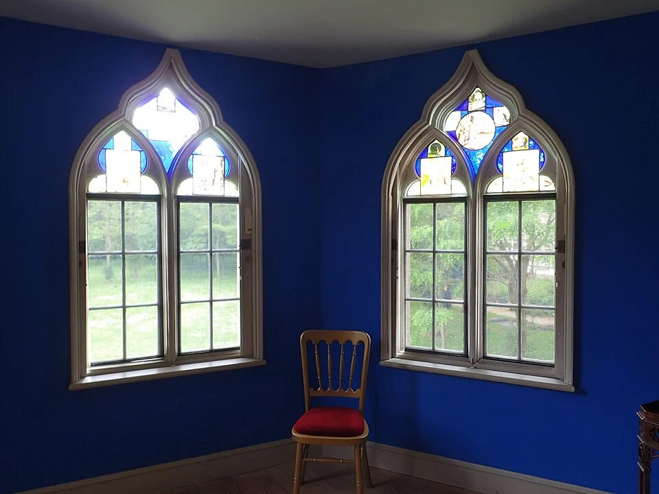
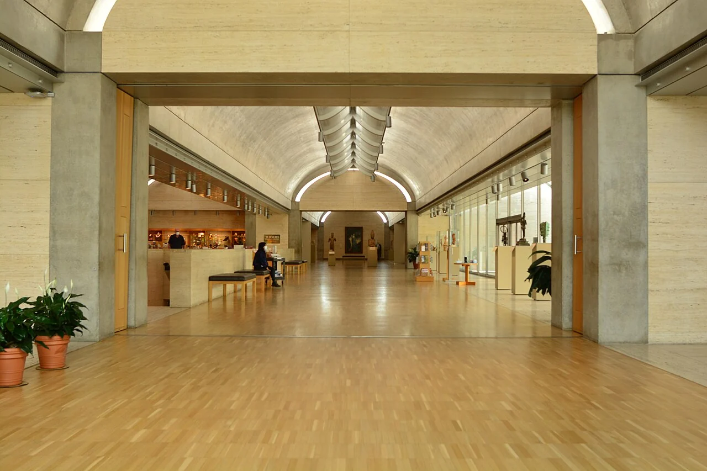

## What it is for

A room can have an enormous window and still feel difficult to use. The view is bright, the opposite wall is dark, and a face beside the window disappears into contrast. Adding more glass in the same wall may intensify the problem. Light from another direction can change the balance more than another square meter of glazing in the first opening.

## The core idea

Alexander's **Light on Two Sides of Every Room** asks how daylight from another direction could improve a room. A second source can illuminate surfaces left in shadow by the first. “Every” is a question to examine carefully: some rooms need darkness, and more exposed walls or glass have resource and comfort costs. Compare the quality and direction of light at the activity before deciding whether another opening is useful.

## How it works

Find opportunities for a room to reach more than one useful part of the sky. Compare opening positions and building depth, then check the task and view from occupied positions. Coordinate additional light directions with shading, privacy and envelope performance rather than treating window count as the target.

## Why it works

Daylight reaches a desk from the visible sky and by bouncing off walls and ceilings. How much a surface reflects is its reflectance: a pale finish usually returns more light than a dark one. A second opening may brighten a wall left in shadow by the first, reducing some contrasts. Its contribution still depends on the sky it sees, room depth, opening height and nearby obstructions.

A corner room offers the clearest opportunity. Openings in adjacent walls admit different portions of sky and can provide changing light through the day. Opposite openings may spread light through a shallow room. Rooflights can add another direction when an exterior wall is unavailable, although they introduce roof detailing, glare and maintenance questions. These are related strategies, not identical environmental outcomes.

## Architectural examples

### Strawberry Hill — windows around a corner

At Strawberry Hill, windows on adjoining walls admit daylight from two directions. The corner chair helps relate the openings to a place someone could use. Compare which surfaces each window can illuminate, then consider how sun and nearby obstructions change through the day. This is a literal two-sided window arrangement, alongside the Kimbell's different approach using light from above.

[Photograph source](https://commons.wikimedia.org/wiki/File:A_corner_room_at_Strawberry_Hill_House_-_geograph.org.uk_-_7777689.jpg) · [License](https://creativecommons.org/licenses/by-sa/2.0)

### The Kimbell Art Museum: a daylight comparison

Louis I. Kahn's Kimbell Art Museum is a useful comparison because its daylight is carefully mediated rather than admitted indiscriminately. The museum describes roof slots and reflectors that distribute light across its vaulted galleries, with additional light from courts and other openings. It is not a literal demonstration that every room has two side windows. It shows why the quality and direction of light matter more than the number of glazed walls.

[Photograph source](https://commons.wikimedia.org/wiki/File:Kimbell_Art_Museum_interior_01.jpg) · [License](https://creativecommons.org/licenses/by-sa/4.0)

At the Kimbell, look at how the luminous ceiling reveals the vaults and spreads light toward the gallery surfaces. The museum's account explains the roof slots and reflectors behind that effect. Artworks also need protection from damaging light, making control part of the design. The room suggests a useful question for other settings: which surfaces could distribute daylight toward the activity instead of leaving a bright opening beside a dark wall?

### A corner classroom — illustrative scenario

Consider this illustrative scenario: a small corner classroom with one west-facing window wall. A high opening on the adjacent north wall could brighten the teaching wall without enlarging the low western glass. External shading addresses late sun; adjustable internal blinds manage glare during projection. The teacher's view, pupil desk positions and neighboring buildings still need testing. A second opening solves a directional problem, while shading solves a different solar-control problem.

## Design considerations

Stand where a reader, receptionist or student will actually look. A window behind a screen may create reflections; one straight ahead can dominate the visual field. A room that photographs beautifully toward its brighter wall may be uncomfortable when used in the opposite direction. Useful daylight is an occupied condition, not a photograph of an empty room.

Evaluate representative sky conditions and relevant hours rather than selecting one attractive sun study. Climate-based daylight analysis can help compare schemes, but its assumptions about occupancy, blinds and furniture need to be explicit. Electric lighting remains necessary at night and during many daytime conditions. Daylight provision does not remove the need for accessible controls and a coherent lighting plan.

In renovation, an existing side window may be hidden behind a cupboard. Moving it can recover another direction of daylight with little construction. An internal glazed opening can provide borrowed light—light passed on from an adjoining room. That can help, but its source and limits differ from a direct view of the sky. Check privacy, sound and fire separation before cutting an opening between rooms.

## Useful when

This pattern helps when deep rooms or strong contrasts are becoming fixed into the plan. A shallow wing, a corner position or a modest courtyard may allow several useful light directions. Each carries costs. More perimeter can mean more facade, longer circulation and more exposed construction. A courtyard may compromise privacy. Dividing a building into thin fingers can spend land and resources for little additional benefit if the spaces between them are too narrow.

- The back of our room is gloomy even with a big window.
- How can we reduce the contrast between a bright window and a dark room?
- Could a second small window make this space more comfortable?
- Our corner room feels better than rooms along the corridor.
- I want daylight without glazing the whole wall.
- How can a deep floor plan get more useful daylight?
- Where should a reading desk go in a room with two windows?
- Will two glazed walls make the room overheat?

## Common mistakes and limits

Do not use the pattern to justify fully glazed corners without considering overheating, cold surfaces and structural junctions. Glazing close to a boundary may also raise fire and privacy requirements. Trees and nearby buildings change daylight over time. Coordinate the proposal with the envelope designer, lighting specialist and relevant local requirements; no opening shown here is a prescribed construction detail.

## Related patterns

[[arch-wings-of-light|Wings of Light]] addresses the building form that makes several directions possible. [[arch-external-solar-shading|External Solar Shading]] deals with unwanted direct sun. [[arch-window-place|Window Place]] asks whether someone can comfortably occupy the bright edge once the daylight arrangement is resolved.

## Sources and provenance

Established named pattern. Christopher Alexander, Sara Ishikawa, Murray Silverstein, with Max Jacobson, Ingrid Fiksdahl-King and Shlomo Angel. The explanations and diagrams here are independently authored.

- [A Pattern Language, pattern 159; Alexander, Ishikawa, Silverstein and colleagues](https://www.patternlanguage.com/apl/aplsummary.htm)
- [Kimbell Art Museum: The Louis I. Kahn Building](https://50.kimbellart.org/architecture/the-louis-i-kahn-building/)
- [Francis D. K. Ching: Architecture, Form, Space, and Order (publisher overview and contents)](https://www.wiley.com/en-us/architecture-form-space-and-order-5th-edition-p-9781119853374)
- [Strawberry Hill House: history](https://www.strawberryhillhouse.org.uk/the-house/history/)
