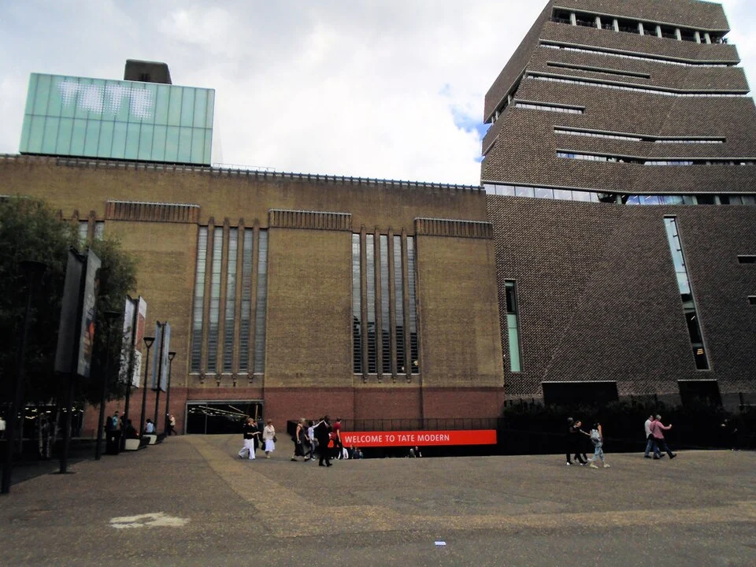

## What it is for

The building’s front is symmetrical and carefully proportioned. Unfortunately, the central doors are locked, the working entrance is around the side, and visitors arriving from the bus stop approach a service gate. People keep asking where to go. The building's public image and its ordinary operation tell different stories about arrival.

## The core idea

Alexander's **Main Entrance** makes the working public door recognizable along the routes people actually use. A canopy, recessed doorway, visible reception desk or clear sign can help. The entrance can sit to one side of the building and still do this well. Its position, appearance and opening arrangements need to agree, so visitors arriving from the pavement, bus stop or parking know where to go.

## How it works

Map the routes from pavement, transport, cycling and vehicle arrival to the working public door. Align shelter, signage, depth and visible reception with that destination. Review the approach in ordinary operation, including locked doors, deliveries, evening use and the step-free journey.

## Why it works

A front view of a building, called an elevation, may show a prominent doorway. A visitor sees something different while approaching from a bus stop, pavement corner or bicycle stand. Trace those journeys on the site plan and find where the right entrance first becomes recognizable. Include bad weather and darkness, when shelter and lighting can change which doorway appears to be the main one.

Recognition can come from several cues. A canopy indicates shelter; a recess gathers movement; glazing reveals a reception area; paving or planting may support direction. Each cue should agree with the others. If the largest canopy covers deliveries while the public door is visually recessive, people will reasonably follow the stronger signal. A sign can clarify the situation, but the underlying contradiction remains worth addressing.

## Architectural examples

### Tate Modern’s west ramp

Herzog & de Meuron describe the west ramp at Tate Modern as a major intervention that begins outside and leads into the Turbine Hall. It gives arrival a spatial form rather than relying only on a door applied to the old power station facade. The example shows that a main entrance can be a route into a building, not merely a prominent object seen frontally.

[Photograph source](https://commons.wikimedia.org/wiki/File:Tate_Modern_West_Entrance_-_geograph.org.uk_-_5505216.jpg) · [License](https://creativecommons.org/licenses/by-sa/2.0)

### A library in a former shop — illustrative scenario

An illustrative example is a village library occupying a converted shop. A modest canopy, a clear glazed door, visible help desk and an address readable from the pavement can make the entrance obvious. The design does not need the scale of a museum ramp. It needs an invitation consistent with the service and a route that remains clear when book deliveries or pushchairs arrive.

Tate Modern and a converted shop have different scales, but each needs approach, threshold and destination to agree. A museum may operate several public entrances; a small library may need one unmistakable door. Where an event changes the working entrance, explain that change before visitors commit to the wrong route. Information at the site entrance can save an unnecessary journey to a locked door.

## Design considerations

A grand stair and a hidden side ramp divide the arrival experience. A contemporary interpretation of this pattern should make the accessible route part of the main public invitation wherever feasible. A step-free approach should be understandable from the same arrival points and lead to the same public function. U.S. Access Board guidance provides a jurisdiction-specific example of accessible routes being located with general circulation; local requirements elsewhere must be checked independently.

Security does not have to erase legibility. Visitors can understand where to report while controlled doors remain beyond a clearly identified arrival point. Explain intercoms, waiting and assistance in a way that does not depend on hearing one buzzer or reaching one high control. A welcoming entrance acknowledges different users without promising unrestricted access to every part of the building.

Consider the return journey as well. People leaving after an evening event may encounter a different route, closed gates or an unfamiliar transport pickup point. Arrival information can help establish that relationship from the beginning. A main entrance is most useful when it belongs to a complete and dependable public journey.

Check the entrance with the people who will operate it: where does a delivery wait, can visitors open the door while someone passes, and how does rain leave the threshold? Coordinate those answers with access, security and emergency escape requirements. A trial walk with unfamiliar visitors can reveal the point where they first become certain of the route, or where another cue is needed.

## Useful when

This pattern helps when planning a new public building, converting an existing one, or resolving recurring confusion at a site with several doors. It can also guide simple operational changes. If the correct door is already clear but regularly locked, the issue may be opening policy and information rather than facade design. Diagnose that before commissioning unnecessary construction.

- People keep trying the wrong door.
- Our public entrance is hard to recognize from the street.
- Can we make arrival clear without a huge sign?
- The impressive front facade does not show where to enter.
- Visitors arriving by bus approach the back of the building.
- Which entrance should feel like the main one?
- We have several doors but nobody knows which is public.
- How can a small building make its doorway more welcoming?

## Common mistakes and limits

Common mistakes include treating a fire exit as a public entrance through visual emphasis, letting bins obscure the doorway, and installing reflective glazing that hides the intended reception cue. Night lighting may make the wrong door more prominent. Check the working building with signs, furniture, deliveries and people present. An empty architectural photograph is an incomplete test of a public entrance.

## Related patterns

[[arch-entrance-transition|Entrance Transition]] develops the threshold itself, [[arch-circulation-as-orientation|Circulation as Orientation]] continues the journey inside, and [[arch-inclusive-arrival|Inclusive Arrival]] checks the experience across different bodies, senses and arrival modes.

## Sources and provenance

Established named pattern. Christopher Alexander, Sara Ishikawa, Murray Silverstein, with Max Jacobson, Ingrid Fiksdahl-King and Shlomo Angel. The explanations and diagrams here are independently authored.

- [A Pattern Language, pattern 110; Alexander, Ishikawa, Silverstein and colleagues](https://www.patternlanguage.com/apl/aplsummary.htm)
- [Herzog & de Meuron: 126 Tate Modern, The Ramp](https://www.herzogdemeuron.com/projects/126-tate-modern/)
- [U.S. Access Board: Accessible Routes](https://www.access-board.gov/ada/guides/chapter-4-accessible-routes/)
