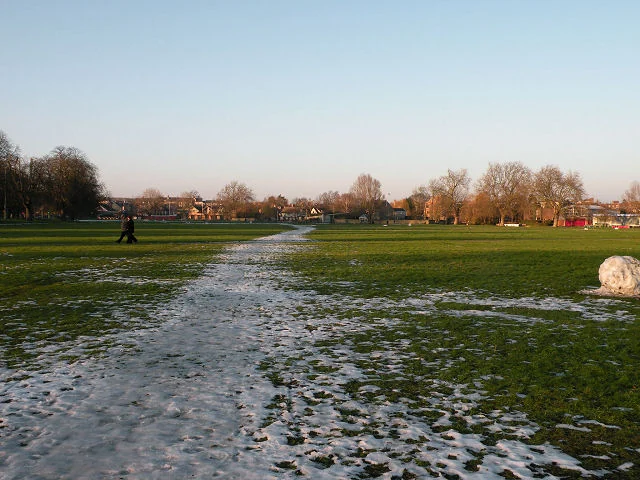

## What it is for

The brief asks for a larger waiting room. During a visit, half the existing seats are empty while visitors crowd near reception because they cannot hear their names called from farther away. More floor area might reproduce the same problem at greater cost. The request describes a real frustration, but its architectural interpretation is still uncertain.

## The core idea

**Observe Before Briefing** uses everyday experience to clarify what a design needs to achieve. A brief sets out the project's requirements; an accommodation schedule lists its rooms and areas. Before fixing either, compare what people say they need with what happens in use. Observation, conversation and technical surveys reveal different things. Together they can show why the apparent solution, such as a larger waiting room, may need reconsidering.

## How it works

Observe activities, routes and workarounds at relevant times, with appropriate consent. Ask users and operators about the conditions behind them. Keep observations separate from explanations, compare possible responses and return the findings for correction before turning them into requirements and measures of success.

## Why it works

A chair in a corridor, a wedged door or a handwritten sign may reveal a need the formal arrangement misses. First record what happens, then ask why. A wedged door could reflect poor ventilation, awkward hardware or a need to see into another room. Each explanation suggests a different response. Where a workaround compromises safety, have it addressed promptly while investigating the need behind it.

Observe different periods and users. A quiet midmorning visit may miss a school arrival, evening event or cleaning shift. Caretakers, reception staff, delivery workers and occasional visitors often know constraints absent from the manager's brief. Include people with different mobility, sensory and communication needs, and provide ways to contribute without requiring everyone to attend one crowded public meeting.

## Architectural examples

### A desire line — behavior leaving a trace

A desire line is a worn route made by repeated walking. In the Cambridge photograph, the trace gives an observer a place to begin: where are people going, when is the route used and who finds it difficult? Return at relevant times and ask users about it. Those findings can establish whether the design needs a path, a better connection or a different response.

[Photograph source](https://commons.wikimedia.org/wiki/File:Winter_Desire_Lines_(2)_-_geograph.org.uk_-_1633237.jpg) · [License](https://creativecommons.org/licenses/by-sa/2.0)

### A community clinic — illustrative scenario

In a hypothetical community clinic, the initial request is for more waiting seats. Observation and interviews reveal that people need reliable appointment information, room for companions and a quieter alternative to the main queue. The revised brief may still require additional area, but it now defines why and where. It can be evaluated against an experience rather than merely the number of chairs purchased.

### A school staff workspace — illustrative scenario

In a hypothetical school, teachers request a new staff workspace because the existing room is rarely used. A study finds that its location requires crossing busy pupil circulation and offers no acoustic privacy for calls. A different location or access arrangement may be more consequential than a larger desk count. The design team compares adaptation and new construction against those clarified needs rather than treating an unused room as proof that staff do not need one.

The clinic and school scenarios show how a request can change after its cause becomes clearer. The result may be altered information, a different route or a larger room. Record the reason for that choice and the experience it is meant to improve. This gives the design a useful test later, while leaving room for further investigation when several explanations still fit the evidence.

## Design considerations

A route map shows where people moved during a particular observation period. It does not prove why they chose that route or what they would prefer. Pair it with interviews, access review and relevant environmental measurements. A low-use room may be uncomfortable, hard to book, culturally unwelcoming or simply unnecessary at that time. Several explanations may remain plausible until more evidence is collected.

Obtain appropriate consent and organizational permission, especially in homes, schools, healthcare or other sensitive settings. Avoid collecting unnecessary personal information, photographing confidential material or treating people as obstacles in a circulation model. Explain the purpose and how findings will be used. Participation should not create pressure to disclose private experiences publicly. Aggregate patterns where individual identification is unnecessary.

Return a concise account of the findings to the people who contributed. They can correct misunderstandings before an interpretation becomes a design requirement. Where users disagree, preserve that difference rather than forcing an artificial consensus. The brief may need several settings or operating modes because people have incompatible but legitimate needs. Document which decision was made, whose needs it serves and what remains unresolved. This makes participation consequential and gives later review a clear point of reference.

The resulting brief should name activities, relationships, access, comfort and operational needs alongside area and cost. It should also identify unresolved questions.

## Useful when

This pattern helps at project initiation, feasibility and renovation, especially when a brief is dominated by inherited room labels or a single influential person's request. It can also reveal how a site works beyond the building boundary. A difficult crossing or missing bus connection may shape arrival more than the entrance lobby itself. Keep the scale of inquiry appropriate to the problem.

- We have a room schedule but do not understand how people actually use the building.
- How do we write a better architectural brief?
- Staff keep improvising around the existing layout.
- Which users should we speak to before designing an extension?
- The client wants more space but the present rooms are often empty.
- How can observation reveal access problems?
- We need to understand a place without intruding on private activities.
- How do we turn user complaints into spatial requirements?

## Common mistakes and limits

Common mistakes include treating one visit as representative, confusing a manager's preference with a shared need, and translating every complaint directly into a new room. Another is gathering extensive consultation and then losing the reasoning when the design changes. Keep a concise evidence record with the requirement, its source, uncertainty and the way success might be checked. Revisit it at meaningful design decisions.

## Related patterns

[[arch-site-repair|Site Repair]] uses that evidence on the ground, [[arch-intimacy-gradient|Intimacy Gradient]] organizes privacy relationships, and [[arch-post-occupancy-evaluation|Post-Occupancy Evaluation]] returns after occupation to compare what was intended with what people actually experience.

## Sources and provenance

Modern editorial synthesis, not a named pattern attributed to a single historical author. Patternverse editorial synthesis; source organizations credited in article. The explanations and diagrams here are independently authored.

- [RIBA: Plan for Use Guide](https://www.riba.org/work/insights-and-resources/plan-for-use-guide/)
- [Christopher Alexander and CES Archive: user participation context](https://christopher-alexander-ces-archive.org/)
