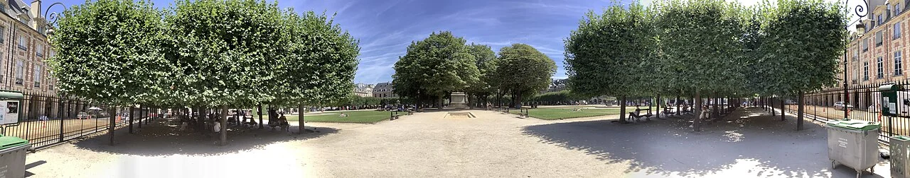
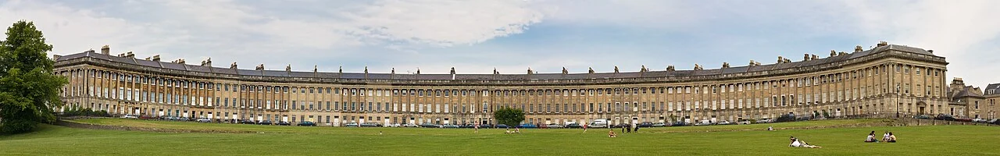

## What it is for

Several buildings stand in a large paved area. There is open space everywhere, yet no obvious place to meet a friend or sit for ten minutes. Every edge seems to belong to a road, a service yard or an inaccessible facade. Across town, a much smaller square feels like a place as soon as you enter it. Its shape and edges give you something to inhabit.

## The core idea

Alexander's **Positive Outdoor Space** asks designers to give the space between buildings a clear shape and purpose. Here, “positive” means recognizable as a place in its own right: a court, lawn, square or sitting pocket. Buildings and planting help define it. The right degree of enclosure depends on what happens there; an open landscape can have a clear identity without becoming a walled square.

## How it works

Draw the outdoor place as a shape in its own right. Use buildings, planting or smaller edges to establish a readable boundary, then locate entrances, passing routes and places to stay. Keep the necessary openings clear and test whether the intended activities can actually occupy the resulting space.

## Why it works

People locate themselves through edges, routes, landmarks and nearby activities. A coherent outdoor shape can make a destination easier to recognize and give sitting places a relationship to the whole. Buildings may define it, but so can trees, a change in ground level, a wall or a row of columns. A useful boundary need not be continuous or visually solid.

A figure-ground drawing helps reveal the relationship: buildings are shown as solid shapes and the spaces between them as another color. Look at the outdoor shape as carefully as the building shapes. Does it suggest a place to meet, cross or sit? Then test those activities. A neatly outlined square still needs entrances, shelter and usable edges before its shape becomes useful in everyday life.

## Architectural examples

### Place des Vosges, Paris

At Place des Vosges in Paris, the repeated building line and covered edge frame a planted center. The space is easy to recognize as a whole, with different conditions at its middle and perimeter. That relationship gives a concrete example of shaping outdoor space. Its formal garden and historic setting also show why the activities and management of a place matter alongside its outline.

[Photograph source](https://commons.wikimedia.org/wiki/File:Panorama_in_the_Place_des_Vosges_2.jpg) · [License](https://creativecommons.org/licenses/by-sa/4.0)

### Royal Crescent, Bath

Royal Crescent in Bath shows how a single curved frontage can give a broad lawn a definite edge. It remains open toward the wider landscape instead of closing into a four-sided court. This offers another way to organize an outdoor place. In either example, check ownership, permitted activities and accessible routes when judging who can use the space and how welcoming it is.

[Photograph source](https://commons.wikimedia.org/wiki/File:Royal_Crescent_in_Bath,_England_-_July_2006.jpg) · [License](https://creativecommons.org/licenses/by/2.5)

### A housing forecourt — illustrative scenario

For a more modest hypothetical case, imagine three apartment entrances opening toward a paved forecourt. Moving a bin store and arranging a low planted edge could define a sitting pocket while leaving the main path direct. The improvement depends on clear pedestrian space and a reason to stay. Adding a circle of decorative paving alone would give the plan a shape without changing the way anyone can use it.

## Design considerations

A sheltered court, a busy square and a large park need different boundaries. Too much enclosure can feel hidden or difficult to leave; too little can leave people exposed to weather and traffic. Preserve visible entries and understandable routes. Consider what a seated person sees, where an unfamiliar visitor would exit, and whether someone with sensory or mobility needs can choose a comfortable place.

An outdoor room should support activities without forcing incompatible uses together. A route to a station may need to remain direct; a children's play area needs its own supervision and safety considerations. Put movement beside places to pause where possible, while keeping connections visible. A square that can only be crossed by weaving through café chairs does not become public simply because its perimeter is elegant.

The boundary changes the weather people experience. Tall walls can reduce daylight or alter wind; trees need soil and time to grow; changes in level need drainage and accessible routes. Study these consequences with the relevant specialists. A court that looks sheltered in plan may still be windy at its entrance or shaded at the hours people want to sit there.

## Useful when

This pattern helps at the start of site planning, when the arrangement of several buildings determines what remains between them. It also helps repair awkward forecourts, school grounds and communal gardens. Sometimes a small useful place within a large loose area is more credible than trying to make the whole expanse feel like one room. The design can offer both a defined meeting place and open ground for other activities.

- The space between our buildings feels like leftover land.
- Why does one small square feel better than a much larger plaza?
- How can we make an outdoor meeting place feel defined?
- Our development has plenty of open space but nowhere people stay.
- Can we shape a public space without enclosing every side?
- Where should seating go in an irregular courtyard?
- How do we distinguish a useful square from a traffic island?
- The lawn around our building is hard to use.

## Common mistakes and limits

Common mistakes include fixing an arbitrary geometric outline before understanding the site, fencing every edge, and allowing private terraces to consume all usable frontage. A formal boundary can become a social barrier when people are unsure whether entry is allowed. Signage, accessible routes, ordinary seating and management policies can make the intended invitation clearer. Observe who stays and who keeps moving, rather than judging success only by visitor numbers.

## Related patterns

[[arch-building-edge|Building Edge]] explains how the perimeter can support occupation. [[arch-courtyards-which-live|Courtyards Which Live]] applies similar reasoning within a building arrangement. [[arch-main-entrance|Main Entrance]] makes arrival into the space legible. Together they show why a recognizable outdoor shape is a useful beginning rather than a complete theory of public life.

## Sources and provenance

Established named pattern. Christopher Alexander, Sara Ishikawa, Murray Silverstein, with Max Jacobson, Ingrid Fiksdahl-King and Shlomo Angel. The explanations and diagrams here are independently authored.

- [A Pattern Language, pattern 106; Alexander, Ishikawa, Silverstein and colleagues](https://www.patternlanguage.com/apl/aplsummary.htm)
- [City of Paris: Place des Vosges historical context](https://cdn.paris.fr/paris/2019/07/24/882e442f24e493816577ad093764f4e6.pdf)
