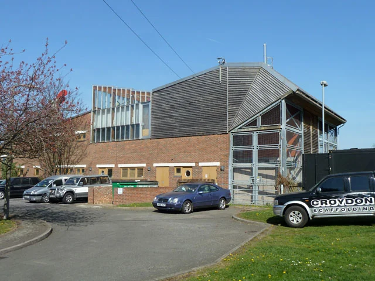
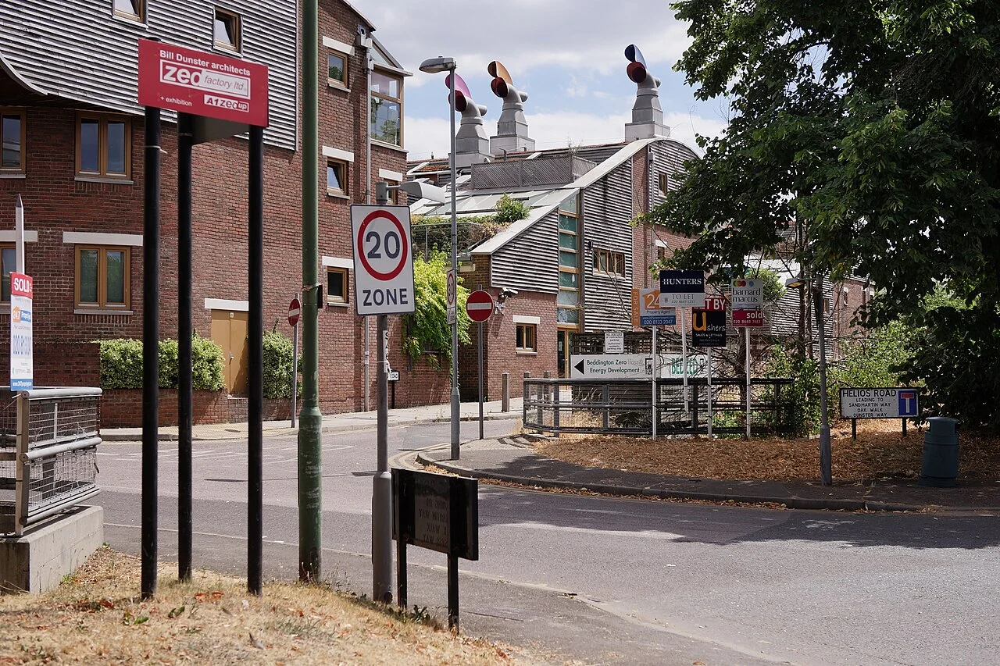

## What it is for

The new building has opened, the photographs are complete and the design team has moved on. A few months later, occupants prop open doors, cover windows with paper and avoid a supposedly desirable shared room. Energy use differs from the forecast. These are not merely postscript complaints. They are evidence about whether the building delivers the service people expected.

## The core idea

**Post-Occupancy Evaluation** returns to a building after people move in and asks whether it works as intended. Compare their experience and the building's measured performance with the brief, then assign improvements and check the result. The review can be small or extensive. Its value comes from connecting evidence to action, with someone responsible for following through rather than leaving findings in an unread report.

## How it works

Agree what success will look like and who will review it before handover, when the finished building and its instructions pass to the operators. After people move in, combine feedback with relevant measurements and records. Investigate differences, assign changes and check them under comparable conditions. Keep the circumstances with the findings so future projects can judge which lessons transfer.

## Why it works

Predicted and actual energy use may differ because of weather, occupancy, operating hours, equipment or construction performance. Establish those conditions before interpreting the gap. A comfortable building occupied longer than expected is not directly comparable with the original short-hours model. Conversely, explaining every problem as occupant behavior can conceal poor controls or a design that demanded unrealistic operation.

User experience reveals other outcomes: arrival, privacy, acoustics, comfort, maintenance and whether rooms support their intended activities. Measurements can help examine causes, while interviews and observation show how problems affect people. Neither is sufficient alone. A temperature reading in an empty room may miss the glare or noise that causes people to avoid it. A complaint identifies a problem worth investigating, not necessarily its technical explanation.

## Architectural examples

### A school’s afternoon comfort — illustrative scenario

In a hypothetical school, teachers report afternoon discomfort in one wing. The evaluation compares room conditions, occupancy, solar exposure, controls and window operation across relevant days. It may reveal unsuitable shading, a control issue or several interacting causes. The response is assigned and checked during comparable conditions. The process avoids jumping from “people are hot” directly to either a new cooling system or an instruction to open windows.

### A community center’s shared room — illustrative scenario

In a hypothetical community center, the shared room is little used. Interviews, booking records and observation show that its access route conflicts with an evening security arrangement. Environmental measurements alone would not reveal that barrier. Revising the operating arrangement may be more useful than replacing furniture. After the change, check whether the room serves its intended users and whether another problem has been created elsewhere.

### BedZED: published follow-up reporting

Bioregional's published follow-up on BedZED provides a documented example of returning to an occupied development. Read the housing and power-house photographs as context for that reporting. The reports provide the performance evidence and its conditions. When evaluating another building, establish its own use, weather, operating hours and data quality before comparing figures or applying a lesson from BedZED.

[Photograph source](https://commons.wikimedia.org/wiki/File:Power_house,_BedZed_estate_(geograph_4136025).jpg) · [License](https://creativecommons.org/licenses/by-sa/2.0)

[Photograph source](https://commons.wikimedia.org/wiki/File:BedZED_-_geograph.org.uk_-_5853022.jpg) · [License](https://creativecommons.org/licenses/by-sa/2.0)

## Design considerations

Specify what will be reviewed, when, by whom and with what access to data. Include the budget and the person responsible for corrective action. Some issues can be addressed during early fine-tuning; seasonal conditions may require a later return. Building operators need understandable handover information and a route for reporting problems. Evaluation becomes much harder if the project team disappears without any agreed follow-up arrangement.

Collect only the information needed for the question, obtain appropriate permission and protect confidential responses. A small team's comments can identify individuals even without names. Avoid using an environmental study as covert staff monitoring. Explain how results will be shared and separate personal testimony from public reporting where necessary. Respectful evaluation is part of the quality of the building service.

Make lessons portable without losing context. A finding about a shaded classroom in one climate should not become a universal rule that all similar rooms need the same device. Record the occupancy, exposure, controls and intervention alongside the outcome. Future teams can then judge whether the lesson transfers. A concise account of a failed assumption may be more valuable than a polished success story, especially when it explains the limits of the evidence and the conditions that made an improvement work.

RIBA's Plan for Use connects the brief, delivery and later feedback. Commissioning complements that review: it checks installed systems and their controls against the intended operation. Evaluation after occupation can reveal how they work with real schedules and users over time. Involve qualified specialists where investigating a finding requires technical measurement, diagnosis or a safety decision.

## Useful when

This pattern helps in new buildings, major refurbishments and existing facilities with persistent complaints. It can also improve the next brief by identifying which assumptions were wrong. The aim is learning and better operation, not assigning blame through a superficial ranking. People are more likely to contribute useful evidence when the purpose and limits are clear.

- The building is finished but does it work as intended?
- Occupants complain even though the design met its targets.
- How do we learn from a building after handover?
- What should we measure besides energy use?
- Can we investigate overheating without blaming users?
- Who should act on feedback from a new building?
- Our evaluation report did not lead to any changes.
- How do we compare predicted performance with actual use fairly?

## Common mistakes and limits

Common mistakes include measuring only what is easy, surveying once during an unusual week, and producing a long recommendation list without priorities. Distinguish urgent defects from optional improvements, identify dependencies and verify completed actions. If a control change improves one room while creating another problem, the loop needs another turn. Learning requires keeping the result open to evidence rather than defending the first explanation.

## Related patterns

[[arch-observe-before-briefing|Observe Before Briefing]] supplies the next project's evidence, [[arch-continuous-thermal-envelope|Continuous Thermal Envelope]] provides one technical inquiry, and [[arch-compare-spatial-alternatives|Compare Spatial Alternatives]] helps select improvements rather than assuming the most expensive remedy is necessary.

## Sources and provenance

Modern editorial synthesis, not a named pattern attributed to a single historical author. Patternverse editorial synthesis; source organizations credited in article. The explanations and diagrams here are independently authored.

- [RIBA: Plan for Use Guide](https://www.riba.org/work/insights-and-resources/plan-for-use-guide/)
- [Bioregional and Peabody: BedZED Seven Years On (2009)](https://www.bioregional.com/uploads/downloads/BedZED-7-years-on_Bioregional_Peabody_2009.pdf)
- [WBDG: Building Commissioning (additional reference)](https://www.wbdg.org/resources/building-commissioning)
