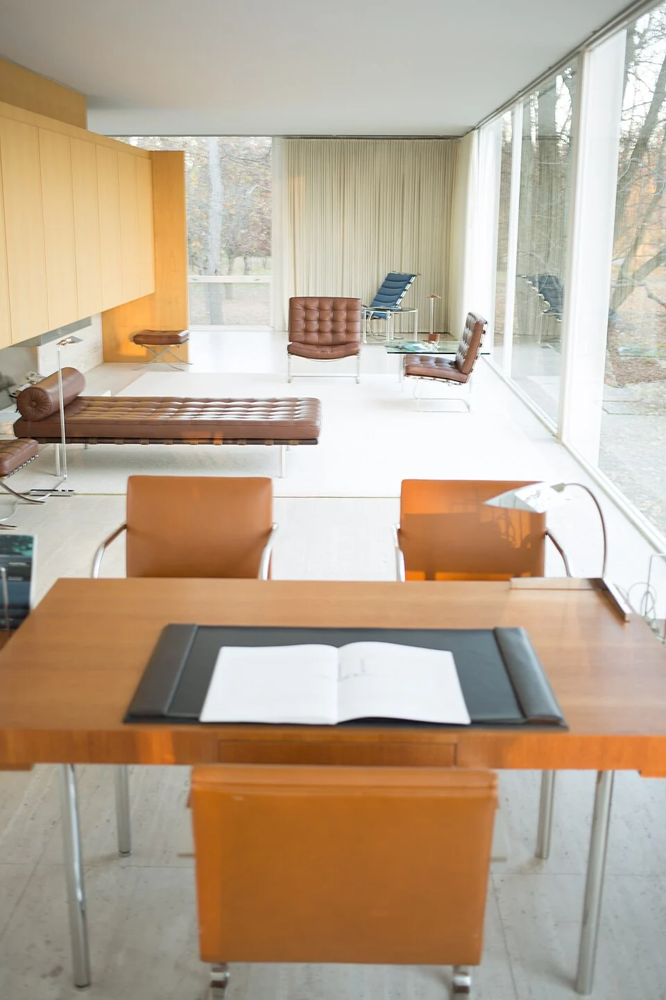

## What it is for

A waiting room has a large window, but the chairs face a blank internal wall. People twist sideways to see who is arriving and whether the weather has changed. In another room, the view is expansive but the only available seat is exposed to glare and constant passing movement. Visibility exists in both cases, yet neither provides a comfortable place from which to use it.

## The core idea

**Prospect**, in Browning, Ryan and Clancy's biophilic design framework, means a useful outlook from a place someone occupies. Biophilic design considers relationships with nature and environmental experience. Here the focus is practical: seeing an entrance, the wider room or the landscape while seated. Different people want different degrees of openness. The pattern suggests a choice worth testing, with comfort and privacy considered alongside the view.

## How it works

Identify what information or outlook is useful from a place to pause. Align seating and openings with that view, checking seated and standing eye levels, glare and obstructions. Offer different degrees of exposure and protection so gaining an outlook does not require accepting an uncomfortable or overly visible position.

## Why it works

An outlook can reveal movement, weather, distance and possible destinations. In a public building, seeing an entrance or garden may help someone remain oriented while seated. Across a landscape, a view can connect a small occupied place with a larger setting. The usefulness depends on what is visible, from where and for how long. A large glazed area facing a service wall may offer little meaningful prospect.

Check the view from the position someone will actually use. A sill may sit below a standing person's eye level but block a seated reader's outlook. Planting, screens and neighboring furniture can change it again. Glass may also reflect the room instead of revealing the view when the light changes. Compare seated and standing positions before deciding how large or low the opening needs to be.

## Architectural examples

### Farnsworth House — outlook from an occupied room

At Farnsworth House, everyday furniture sits beside broad views of trees and ground. The landscape remains visible from inside, connecting a small place to sit with a larger setting. This makes outlook easy to understand as an occupied relationship. The same openness raises questions about glare, seasonal comfort and privacy, so a contemporary room needs to consider how users control their exposure.

[Photograph source](https://commons.wikimedia.org/wiki/File:Farnsworth_House_by_Mies_Van_Der_Rohe_-_interior-3.jpg) · [License](https://creativecommons.org/licenses/by-sa/3.0)

### A health-center waiting room — illustrative scenario

In a hypothetical health-center waiting room, seats facing a planted court allow visitors to notice daylight and movement without staring directly at other patients. Some seats retain a view toward reception so people can follow the appointment process. Others offer more withdrawal. The arrangement should not force everyone to remain visible to passersby, and the garden view does not replace clear information about waiting and assistance.

### A hillside terrace — illustrative scenario

In a hypothetical hillside community building, a sheltered terrace offers a broad view over the landscape. A low visual obstruction might improve the view from a standing position while blocking it from a seated one. Adjusting the relationship between seat, protective edge barrier and ground can make the prospect more widely available. Safety and protective barriers must be resolved by qualified designers; an unobstructed view is not a reason to weaken protection at an edge.

### The British Museum’s Great Court

The British Museum's Great Court offers an indoor comparison. Its central Reading Room and visible surrounding walls help people see where they are while moving or pausing. Prospect can therefore concern nearby destinations as well as a distant landscape. The useful question is what the view tells a person and whether they have a comfortable position from which to use that information.

## Design considerations

A seat can offer a broad view while leaving the sitter uncomfortable because others approach from behind. Pairing outlook with a protected side may be more useful than maximizing openness in every direction. Some people prefer to see the room; others prefer to look away from it. Offer different relationships where feasible rather than describing one arrangement as universally restorative.

Biophilic design guidance draws on a range of research, but a named pattern is not a clinical prescription. Do not promise reduced stress or improved productivity from a single seat orientation. The quality of the environment, individual preference and the rest of the building matter. Use observation and user feedback to assess whether the place is comfortable and useful for its intended occupants.

Visibility should not be confused with surveillance. A view across a shared room can support orientation while also making some occupants feel watched. Discuss that experience with users, particularly in institutional settings where they may have little choice about where to wait. Screening one direction while preserving another can improve the balance. More visibility is a design variable to evaluate, not a universal measure of social safety.

Coordinate glazing, shading, safety, access and landscape growth with the relevant professionals. Check the view as trees mature and as furniture changes.

## Useful when

This pattern helps in waiting areas, libraries, communal rooms, workplaces and public landscapes where people need to pause and understand their surroundings. It can also inform simple furniture changes. Turning a chair or moving an opaque screen may recover a meaningful view without additional glazing. Start by checking what existing openings already make possible before proposing a larger facade intervention.

- I want somewhere to sit with a useful view across the space.
- Our waiting area faces a wall and people feel disconnected.
- How can a view help people understand a place?
- Can we offer an outlook without exposing everyone to glare?
- Where should seats go beside a shared garden?
- An open view is attractive but there is nowhere comfortable to pause.
- How do we avoid confusing a distant view with good wayfinding?
- Will more glazing always make the room feel better?

## Common mistakes and limits

Common mistakes include maximizing glass at the expense of thermal comfort, creating glare on screens, and framing a view into someone else's private room. An attractive distant outlook can also distract from poor local conditions such as noise, unpleasant odors or an inaccessible approach. Treat prospect as one relationship within a complete occupied setting, with privacy and environmental control considered alongside visibility.

## Related patterns

[[arch-refuge|Refuge]] supplies an optional protected position, [[arch-window-place|Window Place]] makes occupation at an opening practical, and [[arch-circulation-as-orientation|Circulation as Orientation]] turns useful visibility into a coherent route through the building.

## Sources and provenance

Established named pattern. William Browning, Catherine Ryan and Joseph Clancy. The explanations and diagrams here are independently authored.

- [Browning, Ryan and Clancy: 14 Patterns of Biophilic Design, pattern 11](https://www.terrapinbrightgreen.com/reports/14-patterns/)
- [British Museum: The Great Court](https://www.britishmuseum.org/about-us/british-museum-story/architecture/great-court)
- [National Trust for Historic Preservation: Farnsworth House lower terrace restoration](https://edithfarnsworthhouse.org/wp-content/uploads/Farnsworth_LowerTerrace_200323.pdf.pdf)
