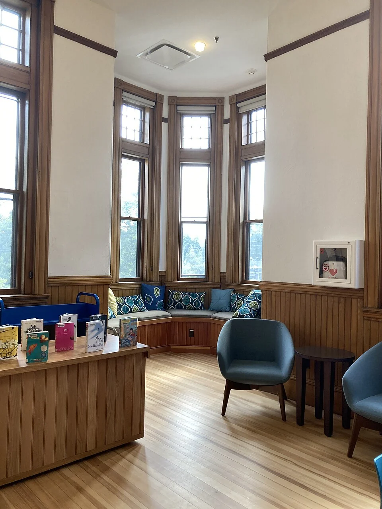
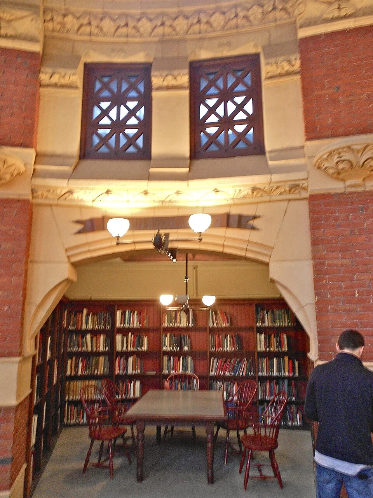

## What it is for

A person chooses the seat against the wall even though another has a better view. From that position they can see the room without wondering who is approaching from behind. Someone else chooses the open center because the enclosed corner feels confining. A useful design can accommodate both preferences rather than declaring one instinct correct.

## The core idea

**Refuge**, in Browning, Ryan and Clancy's biophilic framework, offers a place with some protection from surrounding activity. A wall behind a chair, a side screen or a canopy can reduce exposure while preserving a view out. The wider framework considers relationships with nature and environmental experience. In this guide, refuge is a choice of setting: people differ in how much enclosure feels comfortable, and some will prefer an open seat.

## How it works

Provide a range of open, partially protected and more enclosed positions. Give protected seats a clear approach and way out, with a deliberate view toward or away from activity. Check the full occupied condition and let users help assess the degree of enclosure rather than assigning one preferred setting to everyone.

## Why it works

A protected back or side can make a seat's relationship to the room easier to understand. There are fewer directions from which someone can approach, while the sitter can still see nearby activity. That may make the position appealing for reading or waiting. It is the option and the sense of control that matter; a deep booth can feel comfortable to one person and restrictive to another.

Refuge is therefore most useful as part of a range. Provide open seats, partially screened places and stronger separation where feasible. A clear route out matters as much as the enclosing surface. People should not have to climb over furniture, cross someone else's personal space or enter a dark recess to obtain a quieter setting. The protected place should remain dignified and convenient.

## Architectural examples

### Two library edges — places with protected sides

The two library photographs show different kinds of protected edge. Randall Library places chairs in a small windowed corner; Furness Library frames a reading area through an arch. Each gives a smaller place a recognizable boundary within the library. Compare the view out, approach and neighboring activity when deciding what degree of enclosure would be useful elsewhere.

[Photograph source](https://commons.wikimedia.org/wiki/File:Randall_Library_Stow_Massachusetts.jpg) · [License](https://creativecommons.org/licenses/by/4.0)

[Photograph source](https://commons.wikimedia.org/wiki/File:Furness_Lib_nook_UPenn.JPG) · [License](http://creativecommons.org/publicdomain/zero/1.0/deed.en)

### A public library — illustrative scenario

In a hypothetical public library, a seat beside a short wall projecting into the room looks toward the reading room. It offers a protected side without hiding the reader from staff or blocking circulation. Nearby open tables serve people who prefer a broad shared setting. The return wall does not provide speech privacy, so confidential calls still belong in an appropriately designed room.

### A health-center waiting area — illustrative scenario

In a hypothetical health-center waiting area, several seats have their backs against a wall and a view toward reception, while a smaller screened area allows more withdrawal. Appointment information remains available from both places. The screened seats should not become a stigmatized corner for “difficult” patients. Choice belongs to the visitor where operationally feasible, and staff should not assume the most enclosed place is automatically the most calming.

A secure room or a sensory respite room has a more specific purpose than a partly protected seat. Sensory respite means relief from demanding light, sound or activity; it may need stronger environmental and acoustic control. Agree the actual service and supervision requirements with users and specialists. Calling a seating pocket “refuge” should leave those needs visible rather than implying that partial enclosure meets them all.

## Design considerations

Refuge often works with prospect: a protected position can retain awareness of nearby activity. Too much visual closure may remove the very information that makes a place comfortable. Too little may leave the person exposed. Test the relationship from the seat, including views at different eye levels, door approaches and the movement of people using the adjacent route.

Noise, glare, air quality and temperature can undermine a visually protected place. A booth beside a loud appliance is not a meaningful respite. A canopy may create intimacy while concentrating noise or making the seat too dark for reading. Evaluate the complete occupied condition, including ventilation and cleaning. Interior photographs rarely reveal these less visible factors.

Access and equality matter. If the only protected seat requires climbing onto a platform or squeezing into a fixed narrow booth, the choice is not broadly available. Offer a comparable relationship through ordinary accessible seating and clear approaches. Include people who use mobility aids, people accompanied by carers and those who need to remain near children or other companions.

In a review, describe the setting in ordinary terms before naming the pattern. Ask about the view, room for belongings, joining a companion and the ease of leaving. A screen may help reading while making a conversation awkward. Different answers help establish which choices the room should offer. Keep those preferences separate from diagnosis, and assess the proposed changes with the people expected to use them.

Coordinate fire, access, safeguarding and operational requirements with the responsible professionals. Discuss the desired degree of privacy with users and review the result after occupation.

## Useful when

This pattern helps in libraries, workplaces, communal rooms, schools and public waiting areas where a single open arrangement fails some users. It can also guide a modest furniture change. Moving a chair against a stable edge may supply a useful choice without building a new enclosure. Observe actual preferences and ask users before investing in elaborate pods or fixed booths.

- I need a place to pause without feeling watched from every direction.
- Our open room has nowhere to withdraw briefly.
- How can a waiting area offer more choice about exposure?
- Can a protected back make a seat more comfortable?
- We need quieter places without isolating people entirely.
- Our booths feel trapped rather than reassuring.
- How do we balance withdrawal with supervision?
- Is a small enclosed corner always better for concentration?

## Common mistakes and limits

Common mistakes include making all desirable seats enclosed, hiding public pockets from appropriate supervision, and using deep recesses that feel difficult to leave. Another is borrowing strong health claims from the language of biophilia without identifying the evidence or its limits. A design pattern can suggest an arrangement worth testing; it cannot promise recovery, concentration or productivity for every occupant.

## Related patterns

[[arch-prospect|Prospect]] supplies outward awareness, [[arch-alcoves|Alcoves]] gives a common architectural form for partial withdrawal, and [[arch-intimacy-gradient|Intimacy Gradient]] organizes stronger privacy relationships across the building.

## Sources and provenance

Established named pattern. William Browning, Catherine Ryan and Joseph Clancy. The explanations and diagrams here are independently authored.

- [Browning, Ryan and Clancy: 14 Patterns of Biophilic Design, pattern 12](https://www.terrapinbrightgreen.com/reports/14-patterns/)
- [University of Pennsylvania: Fisher Fine Arts Library](https://facilities.upenn.edu/maps/locations/fisher-fine-arts-library-anne-and-jerome)
