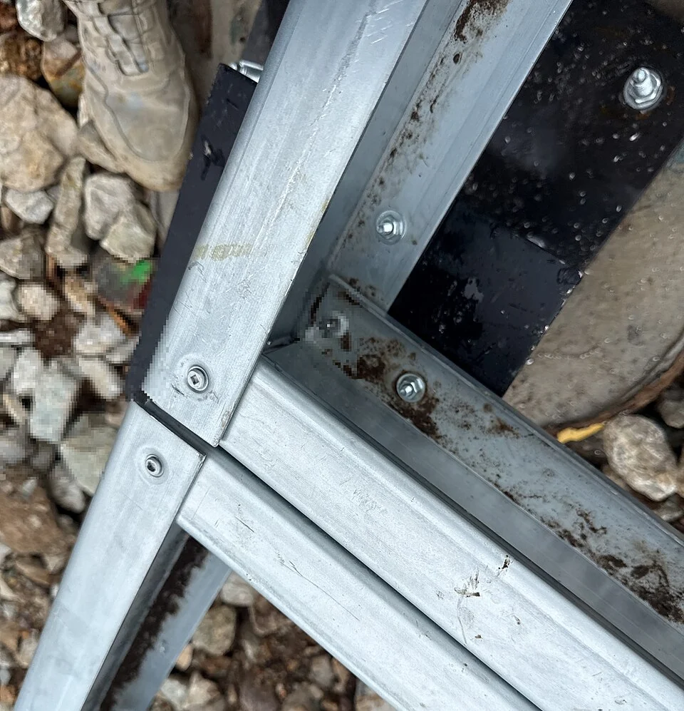

## What it is for

A modest weather seal has failed, but replacing it requires removing a large fixed panel, cutting a finished lining and disturbing the adjacent window. The small component had a shorter expected life than the construction trapping it. The detail was easy to assemble once and difficult to care for thereafter.

## The core idea

**Repairable Connections** lets people inspect and replace worn parts while keeping sound neighboring work. Start with the part likely to need attention, such as a seal, panel or piece of equipment, and follow the complete repair. Workers need access, tools, replacement parts and a safe sequence. A visible bolt helps only if it can be reached and the assembly supported while it is removed.

## How it works

Select a likely worn or damaged component and draw its replacement sequence. Identify access, tools, temporary support and the parts that must remain protected. Check replacement availability and document the connection so future workers can inspect and repair it without unnecessarily dismantling sound neighboring work.

## Why it works

A construction detail usually explains how parts go together. Add the question of how one will come out. Which component is likely to fail first? What has to be removed to reach it? Can the remaining assembly stay safe and weather-protected during the work? A detail that answers those questions can preserve more material and reduce disruption when maintenance becomes necessary.

Different parts change for different reasons. Seals weather, finishes wear, equipment becomes obsolete and structural components may remain useful much longer. Connecting them as an inseparable package can force early replacement of durable material. Separation is not always technically or economically preferable, but it should be considered deliberately rather than lost through an unexamined adhesive or concealed fixing.

## Architectural examples

### A bolted floor connection — a visible joining method

The bolted floor detail exposes how two members join. It gives a concrete place to begin a repair review: identify the fasteners, the space for tools and the parts supported by the connection. Then follow the sequence through later finishes. A joint visible during construction may be concealed in use, so the finished access arrangement belongs in the same design decision.

[Photograph source](https://commons.wikimedia.org/wiki/File:Steel_floor_joist_bolted_connection_detail,_Stone_County_Missouri,_2026-05-05.jpg) · [License](https://creativecommons.org/licenses/by/4.0)

### The Salk Institute’s window-wall conservation

The Getty Conservation Institute's project at Louis I. Kahn's Salk Institute is a real example of investigation leading to selective conservation of teak window-wall assemblies. The project combined research, inspection and trial treatments rather than accepting total replacement as inevitable. It demonstrates the value of understanding components and deterioration before deciding what must be removed.

[Photograph source](https://commons.wikimedia.org/wiki/File:Salk_Institute_Highsmith.jpg)

The Salk photograph places timber window-wall assemblies beside the concrete structure, giving context to Getty's conservation account. The documented investigation and trial treatments explain how selective work could retain useful material. Read the photograph and project evidence together: one shows the assembled building, while the other describes the diagnosis and intervention. The repair decision depends on understanding the deterioration and the parts still doing their job.

### A replaceable cladding panel — illustrative scenario

Consider a ventilated cladding panel expected to need occasional replacement. Accessible fixings and a documented removal order may allow one damaged panel to be changed while retaining adjacent work. The design still needs safe access, appropriate supports and compatible replacement stock. If removal requires a crane through an inaccessible courtyard, the detail's nominal reversibility may have little practical value.

## Design considerations

Maintenance workers need space to stand, handle tools and move equipment. Check the largest likely replacement part against the access hatch and the whole removal route. Include lifting and temporary protection where required. Cleaning and inspection may happen more often than replacement, so those tasks deserve the same attention. The detail should give workers a safe position from which to do the ordinary work.

As-built information records what was actually installed, including changes from the original drawings. Keep the materials, fixings, access points and removal order where future operators can find them. A connection can become effectively permanent when nobody understands its release or can obtain its special tool. Standard parts and clear records can make a future repair more dependable than a clever fitting supported by only one supplier.

Consider the supply chain for the repair as well as physical access. Can a local craftsperson make a replacement, can a standard part be substituted safely, or does the assembly depend on one custom-made element? Keeping a small stock may be reasonable for some components, while a documented adaptable interface is better for others. A replaceable part that cannot be sourced can still force extensive waste. Record acceptable alternatives without assuming future products will have identical performance.

Record the expected failure mode and inspection interval as a hypothesis that can be revised with experience. If a component fails repeatedly, replacing it in kind may preserve a flawed detail. Investigate water entry, movement or use before repeating the same repair. Maintenance evidence can improve the building as well as extend its life.

Use qualified advice for structural connections, work at height, hazardous materials, fire performance and waterproofing. These diagrams are not dismantling instructions.

## Useful when

This pattern helps in facade, roof, services, joinery and landscape details where parts have different exposure or replacement cycles. It is especially useful during design review and changes to specified products. A visually similar replacement product may change the repair sequence completely. Review that consequence before accepting it as an equivalent component.

- A small failed component would require tearing out a whole wall.
- How do we make building details easier to maintain?
- Our fixings disappear behind permanent finishes.
- Can we replace a worn part without damaging sound construction?
- What should a detail show about future repair access?
- The sealant joint is impossible to inspect or reach.
- How can conservation keep original material rather than replace everything?
- Is a visible fixing always the most repairable choice?

## Common mistakes and limits

Common mistakes include making everything exposed in the name of honesty, ignoring corrosion or incompatible materials, and assuming mechanical fixing always beats bonding. Some bonded assemblies have legitimate structural, acoustic or environmental functions. The task is to understand their service and replacement consequences, not to apply a universal ban. A technically inappropriate reversible joint is not good repair design.

## Related patterns

[[arch-drained-ventilated-rainscreen|Drained and Ventilated Rainscreen]] supplies a common maintenance context, [[arch-design-for-disassembly|Design for Disassembly]] extends removal to future recovery, and [[arch-loose-fit-layers|Shearing Layers]] explains why different replacement times should influence the original connection.

## Sources and provenance

Modern editorial synthesis, not a named pattern attributed to a single historical author. Patternverse editorial synthesis; source organizations credited in article. The explanations and diagrams here are independently authored.

- [Getty Conservation Institute: Salk Institute Conservation Project](https://www.getty.edu/projects/salk-institute-conservation/)
- [U.S. EPA: Designing for Adaptability, Disassembly and Reuse](https://www.epa.gov/smm/best-practices-reducing-reusing-and-recycling-construction-and-demolition-materials)
