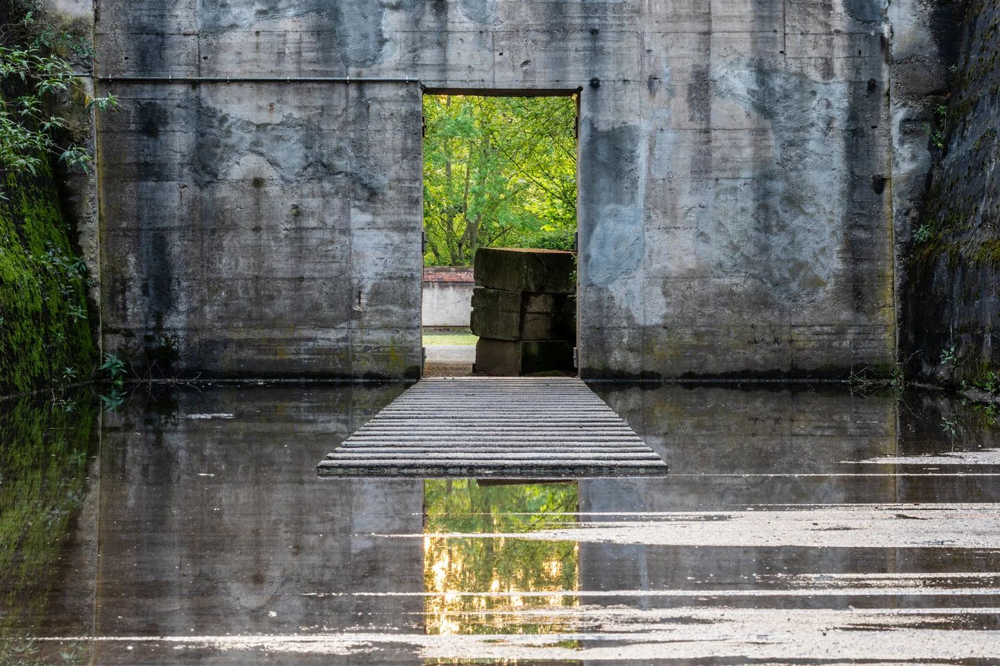
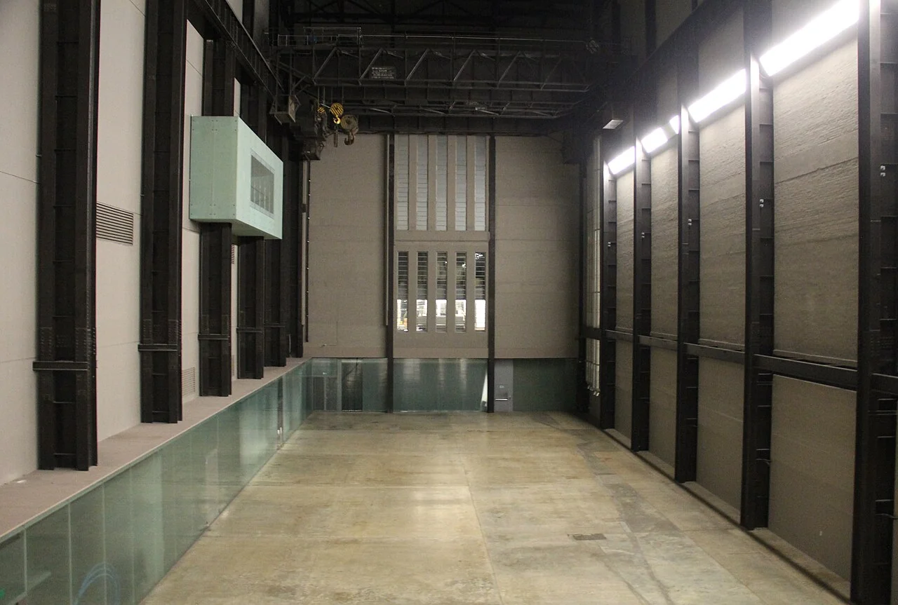

## What it is for

A building is called obsolete because its heating fails, its entrance excludes some visitors, and its rooms no longer fit the organization. Those are serious problems. They do not yet establish that the structure, location and whole building have lost their value. Before commissioning a replacement, separate the failures from the things still doing useful work.

## The core idea

**Reuse Before Replacement** compares continued use, repair, adaptation and selective addition before treating demolition as the starting point. Establish what service people need and which parts of the building still provide it. A failed heating system, awkward entrance and sound frame need different responses. Compare ways to meet the real needs while retaining useful material, spaces and neighborhood relationships, including replacement where the evidence justifies it.

## How it works

State the activities and capacity required, then investigate the existing building's strengths and failures. Compare repair, targeted alteration, continued use and replacement on the same basis. Include access, comfort, safety, disruption and the resources needed over time. Record unknown conditions that could alter the choice, along with the investigation needed to resolve them.

## Why it works

Existing construction represents material already extracted, transported and assembled. Reusing a sound part can avoid some new production and disposal. A building also holds established routes, neighborhood relationships and social memories. These values differ: preserving a familiar facade does not necessarily retain much structure, and retaining a structure does not automatically preserve an affordable community use.

Energy used during occupation matters alongside the work of constructing or altering the building. A whole-life comparison follows both over an agreed period, including maintenance, replacement parts and eventual disposal. Use consistent assumptions about the service, energy supply and length of use. A sound old structure may need extensive upgrades; a proposed efficient building still requires new materials. The comparison needs to account for both consequences.

## Architectural examples

### Duisburg-Nord — retaining an industrial enclosure

At Duisburg-Nord, retained ore-bunker walls give the adapted landscape a series of enclosures. The new crossing and water sit within that inherited structure. This offers a smaller-scale comparison with Tate Modern's hall: useful spatial capacity can exist in walls and ground as well as complete rooms. Investigations of condition and contamination determine how such remains can safely join a new use.

[Photograph source](https://commons.wikimedia.org/wiki/File:Duisburg,_Landschaftspark_Duisburg-Nord,_Erzbunker_--_2024_--_4214.jpg) · [License](https://creativecommons.org/licenses/by-sa/4.0)

### Tate Modern, London

Herzog & de Meuron's conversion of Bankside Power Station into Tate Modern retained a major industrial structure while establishing new public routes and gallery uses. Their project account describes selective interventions, including the west ramp into the Turbine Hall. The hall's scale became a public spatial asset rather than an awkward remainder to conceal. The earlier power station was designed by Giles Gilbert Scott.

[Photograph source](https://commons.wikimedia.org/wiki/File:The_Tate_Modern_Turbine_Hall_-_2012-12-28.jpg) · [License](https://creativecommons.org/licenses/by/2.0)

Tate Modern shows how the existing height and span of an industrial hall can become useful for a different public program. Another power station may have a different structure, location or viable use. To assess a proposed conversion, identify which capacity transfers and what needs to change. Any claimed carbon benefit then needs a defined alternative and quantities, alongside the spatial and cultural reasons for keeping the building.

### A municipal office conversion — illustrative scenario

Consider a municipal office with a sound concrete frame and an inaccessible split-level entrance. A conversion study keeps the frame, changes a small area of floor, inserts a lift in a suitable bay and upgrades the enclosure. A replacement option may offer a simpler plan, but it must justify the additional construction and disruption. The retained option must demonstrate adequate access, fire safety, daylight and useful capacity rather than winning solely because it keeps more material.

## Design considerations

A measured survey reveals dimensions; condition and structural investigations reveal different things. Establish how loads reach the ground, where construction has deteriorated, and whether contamination, moisture, services or heritage constraints affect the options. A neat old plan may not describe what was actually built. Hidden defects can change costs and sequencing, so carry explicit uncertainty and contingency rather than a false promise of cheap reuse.

Ask who can stay during the work, where temporary access will go, and how noise, dust and shutdowns will affect occupants. Retention with prolonged displacement may have social costs that a carbon spreadsheet does not show. Conversely, the claim that demolition is necessary for accessibility should be tested through actual design options. Some buildings can be improved substantially; others face severe geometric or structural limits.

The options need to deliver comparable useful accommodation. A small retrofit and a much larger replacement cannot be compared simply by their total energy or total carbon. State the area, occupancy, quality of service, time horizon and boundary of assessment. Test whether sharing space, changing schedules or adapting the brief can avoid construction altogether. That possibility is easily missed once a new building image becomes the project's public identity.

## Useful when

This pattern is particularly useful when a building is being acquired, its possibilities explored and its requirements agreed, before demolition, contracts or heritage decisions fix a path. It can also guide maintenance: stopping water ingress may preserve options that disappear after years of neglect. The smallest repair can therefore be a strategic act, provided the underlying defect is understood.

- Is this old building really beyond saving?
- How do we compare refurbishment with demolition and rebuilding?
- We need more useful space but the existing structure seems sound.
- Could an empty industrial building accommodate a new public use?
- How can we preserve local character without keeping every failing detail?
- What should a survey establish before we decide to demolish?
- Will a new efficient building always have lower carbon impacts?
- Can we improve accessibility in a building worth keeping?

## Common mistakes and limits

Reuse becomes a mistake when unsafe construction is romanticized, hazardous materials are ignored, or a retained shell forces a deeply dysfunctional use. Demolition may be justified by evidence. Engage structural, access, fire, conservation and environmental specialists as appropriate, and document what the decision depends on. A design guide cannot determine the condition of a particular building.

## Related patterns

[[arch-site-repair|Site Repair]] expands the assessment to the ground and neighborhood. [[arch-loose-fit-layers|Loose-Fit Layers]] helps the conversion remain adaptable. [[arch-post-occupancy-evaluation|Post-Occupancy Evaluation]] checks whether the adapted building actually delivers the comfort and usefulness promised by its new brief.

## Sources and provenance

Modern editorial synthesis, not a named pattern attributed to a single historical author. Patternverse editorial synthesis; source organizations credited in article. The explanations and diagrams here are independently authored.

- [Herzog & de Meuron: 126 Tate Modern](https://www.herzogdemeuron.com/projects/126-tate-modern/)
- [AIA Framework: Design for Resources and Design for Change](https://www.aia.org/design-excellence/aia-framework-design-excellence)
- [RIBA Sustainable Outcomes Guide (2019), whole-life approach](https://www.riba.org/media/b2lgzeoo/riba-sustainable-outcomes-guide-2019-pdf.pdf)
