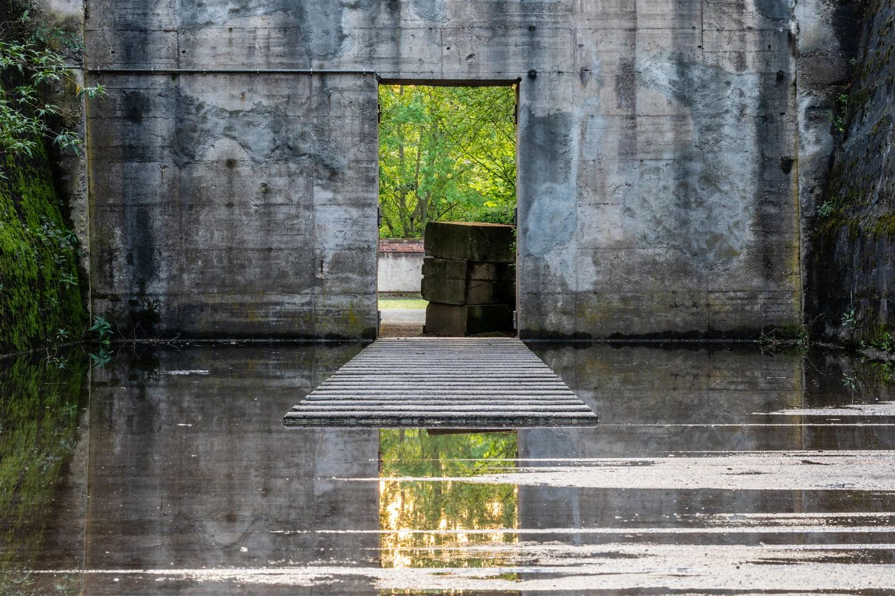
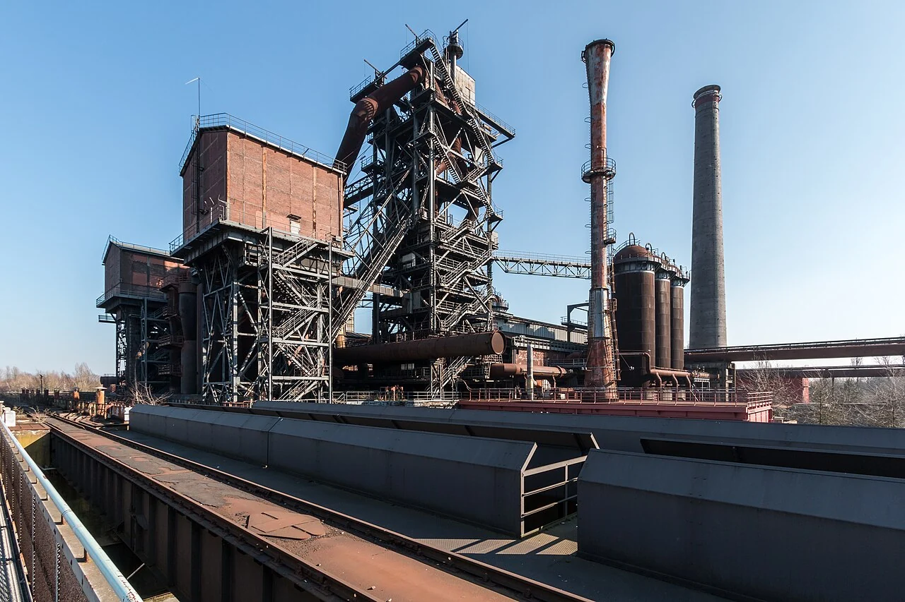

## What it is for

The first sketch puts the new building on the sunniest patch of grass. It is easy to draw there: no awkward walls, no utilities to move, no damaged paving to investigate. Unfortunately, that patch is also where children play, a mature tree shades the afternoon, and neighbors already meet. The scheme has found the simplest construction site by occupying the site's most successful place.

## The core idea

**Site Repair**, named by Alexander and his coauthors, starts with what the site already does well. Keep those places working, and look for damaged or disconnected ground that new work could improve. This changes the choice of footprint—the area the building covers on the ground. A convenient construction site may be the wrong place if it takes away the garden, route or shelter people already value.

## How it works

Map valued places, everyday routes and damaged ground before choosing where to build. Compare what each location would keep, disturb and reconnect. Then follow the effects into neighboring ground and through the construction work. A kitchen extension might improve the garden while blocking the delivery route; both consequences belong in the decision.

## Why it works

A site contains relationships that a boundary survey cannot fully describe. Water follows low ground, people take shortcuts, roots extend beyond tree trunks, and a seemingly untidy strip may support habitat. A paved yard can be ecologically poor yet essential for deliveries. A beautiful lawn can be little used because people are forbidden to cross it. Establish what each part does, who values it and how that changes over time.

Keeping a useful path or mature planting can save the work of recreating it elsewhere. An addition might also shelter an exposed seat or reconnect an isolated entrance. These benefits depend on its position and design. Sometimes removing a barrier, reducing parking or maintaining what is already there will repair the place more effectively than adding a building. Compare those options while the project is still easy to change.

## Architectural examples

### Landschaftspark Duisburg-Nord

At Landschaftspark Duisburg-Nord, Latz + Partner used surviving industrial structures to help organize a new public landscape. The photographs show old walls and steelwork giving shape to paths, water and open ground. The buildings and landscape can be understood together. For another site, the useful question is which remains could support a new activity, and which would need containment, adaptation or removal before people could safely use the place.

[Photograph source](https://commons.wikimedia.org/wiki/File:Duisburg,_Landschaftspark_Duisburg-Nord,_Erzbunker_--_2024_--_4214.jpg) · [License](https://creativecommons.org/licenses/by-sa/4.0)

[Photograph source](https://commons.wikimedia.org/wiki/File:Duisburg,_Landschaftspark_Duisburg-Nord,_Hochofen_2_--_2016_--_1115.jpg) · [License](https://creativecommons.org/licenses/by-sa/4.0)

Reusing an industrial site also means investigating contaminated soil, unstable structures and protected habitats. The working history matters to people who lived or worked nearby, and their experience can influence what is kept and how it is explained. These are part of deciding whether a repair is worthwhile. An attractive photograph shows the resulting spaces; the investigations and management needed to sustain them require their own evidence.

### A community hall extension — illustrative scenario

An illustrative example is a community hall needing a small kitchen extension. One option consumes its established garden. Another occupies an underused service corner, consolidates bins, and opens a sheltered garden door. The second option may require more careful utility coordination, but it preserves the social and environmental value already present. Test actual servicing and root conditions before declaring it the better scheme.

## Design considerations

Building at the least attractive edge can still harm the surroundings. It might block a neighbor's daylight, cover a drainage route or displace deliveries onto a busy pavement. The site boundary defines ownership, not the reach of consequences. Record nearby windows, crossings, habitat connections, flood pathways and everyday arrival routes. Include people whose needs are easy to miss in a developer's aerial photograph.

A proposal may improve a site eventually while damaging it during construction. Protect roots, manage temporary water flows, keep essential routes open and plan how retained walls and other construction will be supported. Establish who will maintain the repaired area after handover. A rain garden that becomes compacted storage is not a completed repair simply because it appeared correctly on the landscape drawing.

Bring in the expertise the ground requires: a tree specialist for roots, an ecologist for habitats, and ground, drainage or conservation specialists where those conditions matter. Record what is known and what still needs investigation. If an extension depends on keeping a mature tree, for example, establish how its roots and the foundations could coexist before fixing the position or budget. Revisit the design when the findings arrive.

## Useful when

This pattern is especially useful during feasibility, when a footprint, access point or construction compound can still move. Its logic also applies to small projects: place a shed where it improves storage without blocking the usable garden; locate a bicycle shelter so it repairs a confusing arrival rather than narrowing the accessible route. The scale changes, but the inquiry remains recognizable.

- Where should we put an extension without destroying the best part of the site?
- Our site has a damaged corner and a much-loved garden.
- Can new construction improve an existing neighborhood?
- How do we decide what to keep before drawing a building?
- The easiest building location would remove mature trees.
- We want to improve a former industrial site without erasing its history.
- What should a site survey include beyond the property boundary?
- How do we avoid making a greenfield site worse?

## Common mistakes and limits

Common mistakes are assuming previously developed land has little ecological value, selecting a footprint before surveying, and treating mature landscape as interchangeable decoration. Another is overstating restoration: a thin planted strip cannot replace the habitat or cultural meaning of a large established place. Describe losses honestly, including those that mitigation cannot fully replace. A good comparison can reveal that building less is the most credible improvement.

## Related patterns

[[arch-observe-before-briefing|Observe Before Briefing]] supplies the evidence of existing use. [[arch-water-sensitive-landscape|Water-Sensitive Landscape]] follows the site's water relationships. [[arch-reuse-before-replacement|Reuse Before Replacement]] extends the same care to existing buildings: establish what remains valuable before choosing what to remove.

## Sources and provenance

Established named pattern. Christopher Alexander, Sara Ishikawa, Murray Silverstein, with Max Jacobson, Ingrid Fiksdahl-King and Shlomo Angel. The explanations and diagrams here are independently authored.

- [A Pattern Language, pattern 104; Alexander, Ishikawa, Silverstein and colleagues](https://www.patternlanguage.com/apl/aplsummary.htm)
- [Latz + Partner: Landschaftspark Duisburg-Nord](https://www.latzundpartner.de/en/projekte/postindustrielle-landschaften/landschaftspark-duisburg-nord-de/)
- [Christopher Alexander and CES Archive](https://christopher-alexander-ces-archive.org/)
