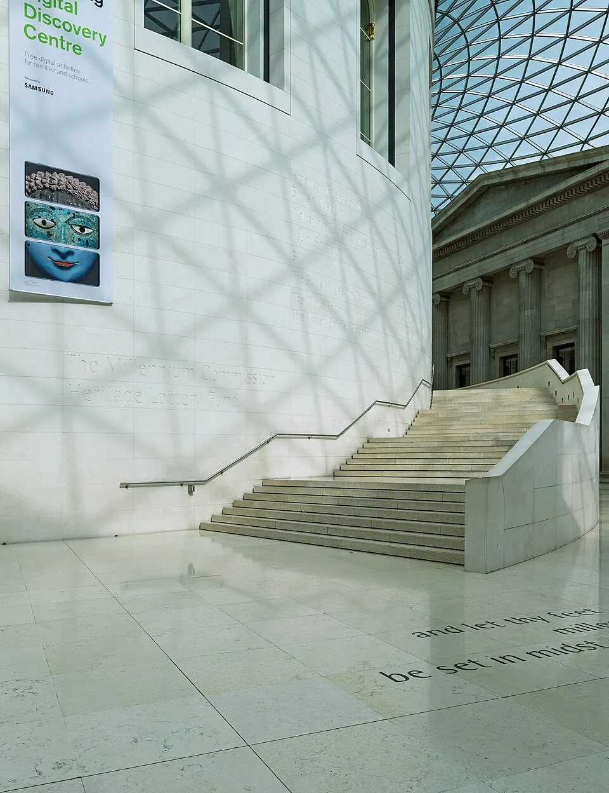
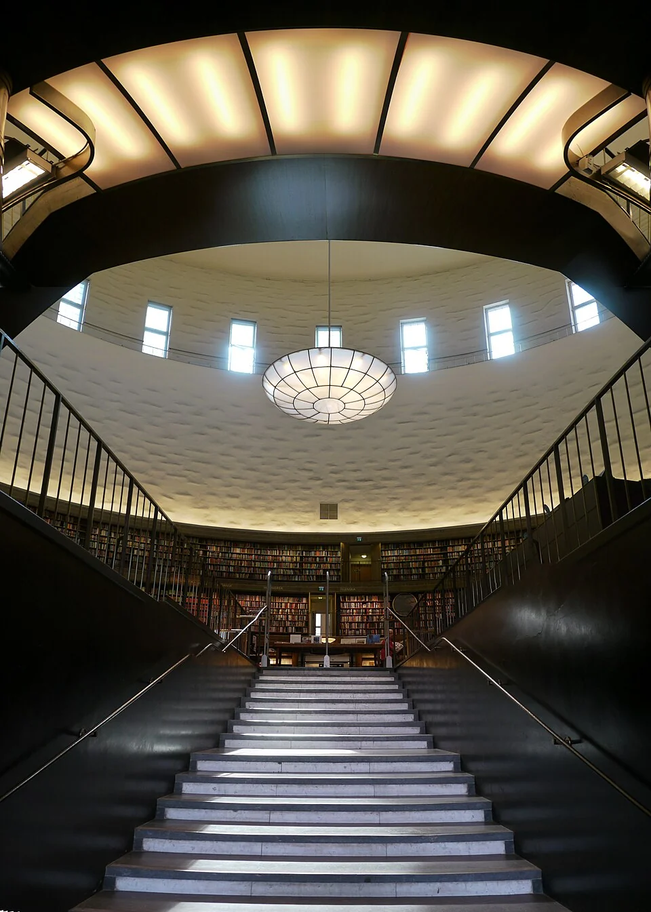

## What it is for

A staircase is hidden behind an unmarked door while the shared hall has no sense of the floors above. In another building, the stair is the main social attraction, but people sitting on its treads obstruct everyone trying to pass. Both situations reveal a relationship worth designing: vertical movement can participate in public life, but it still has to work as movement.

## The core idea

Alexander's **Staircase as a Stage** makes movement between floors visible within shared space. Someone climbing can see the room below, and a landing can connect activities at different levels. Here, “stage” means participation in the building's life. A lift route should reach an equally useful destination and view, so this shared experience remains available to people who cannot or prefer not to use stairs.

## How it works

Place a stair where its movement and landings can relate to shared activity. Connect the lift route to the same meaningful destination and views. If people need somewhere to gather, design that place beside the circulation rather than assuming the stair itself can safely perform every social role.

## Why it works

Climbing a stair changes a person's view gradually. From a landing—the level area between flights—someone can look back toward a hall and understand how the floors connect. Seeing the stair and its destination can also make the next part of a journey clear. Its position, lighting and surroundings determine whether that movement helps people understand the building or interrupts a nearby activity.

These benefits depend on proportion, light, acoustics and the relationship to nearby uses. A stair passing close to quiet work may cause repeated disturbance. A dramatic void can transmit sound between levels. The desire to make movement visible does not resolve privacy or environmental separation. Treat the stair as part of the spatial organization, with the same attention given to rooms and thresholds.

## Architectural examples

### The British Museum — a stair within the shared room

The British Museum's Great Court stair stays visible beside the Reading Room as it rises. The central form gives movement a steady background and helps reveal the upper destination. Its position connects the stair with the larger room. Study that relationship alongside the museum's other routes to understand how different journeys meet the shared space.

[Photograph source](https://commons.wikimedia.org/wiki/File:Staircase_at_Queen_Elizabeth_II_Great_Court,_British_Museum,_London,_UK_julesvernex2.jpg) · [License](https://creativecommons.org/licenses/by-sa/4.0)

### Stockholm Public Library’s entrance sequence

At Stockholm Public Library, the entrance stair leads through a darker, narrower passage into the bright central book hall. Asplund's changing enclosure makes arrival memorable; the library's own architectural account describes the sequence. It is useful to study what changes in the view and overhead space. A contemporary building also needs to offer an equally clear, dignified journey through its lift or other step-free route.

[Photograph source](https://commons.wikimedia.org/wiki/File:Trapp_stockholm_folkebibl.jpg) · [License](https://creativecommons.org/licenses/by-sa/3.0)

### A community center — illustrative scenario

Imagine a community center with a visible stair beside a shared hall. The lift opens onto the same upper landing and view, rather than into a service passage. A separate sitting terrace beside the stair allows informal conversation without occupying the required route. Someone using the lift remains part of the shared spatial experience. That equivalence needs to be drawn and tested, not assumed from the presence of a lift symbol.

### A school landing — illustrative scenario

Another illustrative scenario is a school where pupils naturally gather at a broad landing. Instead of simply prohibiting the behavior, the design team creates a nearby supervised sitting pocket while preserving the circulation and escape arrangement. The pattern's social insight becomes useful only when it is reconciled with the movement that must remain dependable. Everyday behavior is evidence for design, not permission to ignore safe operation.

## Design considerations

A stair's treads are the surfaces people step on; landings provide level places between flights; guards protect open edges. These elements have movement and safety requirements that differ from a seating terrace. If a project wants both gathering and circulation, design distinct spaces for them. Obtain appropriate advice on crowds, guarding and emergency escape before treating a broad stair as a place for an audience.

A social stair can create pressure to be seen. Some people prefer a quieter route, particularly in a workplace or school where movement is constantly observed. Offer appropriate choices without relegating them to poor-quality service space. Shared life works better when participation is available rather than compulsory. A building should not require someone to perform sociability simply to reach another floor.

Observe landings during busy periods, not only when the building is empty. Bags, waiting groups and cleaning equipment can change the practical width of a route. If informal use repeatedly conflicts with movement, reconsider the adjacent space and its management rather than assuming the original drawing proves that everyday operation is satisfactory.

For actual design, coordinate structural behavior, fire strategy, guarding, acoustics, accessibility and maintenance with qualified professionals. The conceptual sections here omit construction dimensions deliberately.

## Useful when

This pattern helps in civic buildings, libraries, schools and workplaces where vertical circulation can clarify shared life. It may be less appropriate where quietness, security, smoke separation or a small constrained footprint requires enclosed stairs. An enclosed stair can still be understandable, well lit and pleasant. Visibility is one design option, not a universal hierarchy of good and bad circulation.

- Our main stair is hidden and nobody uses it.
- Can a stair contribute to a shared hall?
- People gather on the stairs and block movement.
- How can a visible stair work alongside an equally good lift route?
- We want vertical circulation to feel connected to the building.
- Should a stair become seating for informal events?
- Our stair landing has a good view but nowhere safe to pause.
- How do we avoid making a dramatic stair an obstacle?

## Common mistakes and limits

Common mistakes include placing the lift far from the attractive route, introducing unexpected steps into an otherwise level hall, and relying on contrast-free sculptural geometry that makes tread edges hard to read. Glare can also reduce legibility. Consider people with limited vision, balance, stamina or confidence. Handrails, lighting and predictable geometry are integral to the experience rather than technical compromises applied afterward.

## Related patterns

[[arch-circulation-as-orientation|Circulation as Orientation]] develops the stair's wayfinding role, [[arch-inclusive-arrival|Inclusive Arrival]] keeps alternative movement dignified, and [[arch-common-areas-at-the-heart|Common Areas at the Heart]] gives the shared landing a purpose beyond architectural display.

## Sources and provenance

Established named pattern. Christopher Alexander, Sara Ishikawa, Murray Silverstein, with Max Jacobson, Ingrid Fiksdahl-King and Shlomo Angel. The explanations and diagrams here are independently authored.

- [A Pattern Language, pattern 133; Alexander, Ishikawa, Silverstein and colleagues](https://www.patternlanguage.com/apl/aplsummary.htm)
- [Stockholms stadsbibliotek: Asplund architecture and entrance sequence](https://biblioteket.stockholm.se/om-stadsbiblioteket-av-gunnar-asplund)
- [U.S. Access Board: Accessible Routes](https://www.access-board.gov/ada/guides/chapter-4-accessible-routes/)
