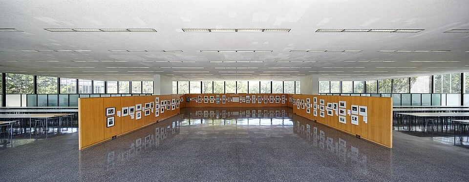

## What it is for

A column lands in the doorway, another divides a small meeting room, and the facade's repeated windows do not align with either. Each system has a rational spacing in its own drawing. Together they make an awkward building. The structural grid arrived too late to participate in the organization of everyday space.

## The core idea

**Structural Bay Rhythm** coordinates the building's supports with its useful spaces. A bay is the space between supports, such as columns or walls; a grid sets out their positions. Repeated bays can help rooms, routes and windows fit together. Choose that pattern while testing ordinary furnished rooms and likely changes, with deliberate exceptions where a larger activity needs them. The aim is an understandable framework that supports real uses over time.

## How it works

Draw support positions, rooms and window divisions together. Test furniture, doors and service routes in more than one plausible arrangement. The span—the distance a structure crosses between supports—affects its depth, material and cost. Compare those consequences with the clear space an activity needs before fixing the grid or choosing a structural system.

## Why it works

Columns, walls and spans often remain longer than partitions or equipment. Their arrangement therefore shapes the range of future changes. A support placed in a critical route may remain a constraint through several renovations. A well-chosen bay can accommodate several room arrangements without moving the structure. This is a practical form of flexibility, grounded in actual dimensions and service needs rather than an empty open-plan image.

Span also affects structural depth, loading, vibration, material and cost. Fewer columns can make a clear space, but long spans may demand deeper or heavier construction. More frequent supports can reduce some structural demands while constraining activities. There is no universal optimum. Compare the system with the uses it must support and the environmental consequences of providing more capacity than the brief reasonably needs.

## Architectural examples

### Crown Hall — perimeter rhythm and an open interior

Crown Hall's open interior and repeated perimeter divisions offer a comparison with the Fagus exterior. Low elements organize activity within a larger room, while the facade gives a visible order around its edge. The two photographs help a reader notice repetition at different scales. Structural drawings are needed to establish which divisions carry loads and what changes the building can support.

[Photograph source](https://commons.wikimedia.org/wiki/File:Interior_Crown_Hall_(Primera_planta).jpg) · [License](https://creativecommons.org/licenses/by-sa/4.0)

### The Fagus Factory, Alfeld

The Fagus Factory in Alfeld, designed by Walter Gropius and Adolf Meyer, offers a real example of a facade organized through repeated glazing and framing relationships. The photograph helps distinguish the visual rhythm of an industrial envelope from a simple solid wall. It does not reveal enough to calculate the building's structural spans or establish how easily any current internal arrangement can change.

[Photograph source](https://commons.wikimedia.org/wiki/File:WikiLoveMonuments_UMZ_Fagus_Front_2022.jpg) · [License](https://creativecommons.org/licenses/by-sa/4.0)

### A school wing — illustrative scenario

Consider a modest school wing. A structural grid can be tested against ordinary classrooms, a pair of smaller seminar rooms and a larger shared room. If every proposed division places a column in a doorway or forces circulation through a teaching space, the grid is not usefully flexible. Adjust the structural and planning modules together before the structure or room layout is fixed in an order or contract.

### A workshop bay — illustrative scenario

Another illustrative scenario is a workshop whose largest equipment determines a clear working zone. Here a regular grid may need one deliberate exception. Make that exception legible in structure and services rather than distorting every neighboring room to preserve a perfect diagram. Repetition is valuable partly because it makes consequential variations easier to recognize and coordinate.

## Design considerations

A window module is a repeated size or spacing. Several window modules and possible partition positions can fit within one structural bay, so their patterns need to coordinate without being identical. Check where a future dividing wall would meet the facade: a column-free floor can still be hard to divide if the new wall cuts across glazing, lacks sound separation or cannot receive services.

For each option, draw at least one ordinary furnished room and one likely alternative at the same scale. Check where a door can move, whether a window can serve both arrangements and how a service route reaches each zone. This small comparison often exposes a grid that looked flexible only because the first drawing omitted furniture and openings. Keep the structural engineer involved while alternatives remain easy to change.

Keep future scenarios plausible. Designing for every imaginable use can produce excess structural capacity and unnecessary material. A few credible changes, discussed with the client and operators, are more useful than an unsupported claim of universal adaptability. Record which changes are easy, which require services work and which would need structural intervention. That distinction helps future teams use the building intelligently.

Structural design, fire resistance, robustness, seismic behavior where relevant and connection detailing require qualified engineering. The grids here show relationships only; they prescribe neither spans nor member sizes.

## Useful when

This pattern helps at early design, especially for schools, housing, workplaces and industrial buildings with repeated spaces. It can also inform feasibility for conversion: map the existing grid before assigning rooms and identify which functions fit naturally. Working with a sound frame may be more resource-efficient than demanding an ideal new grid, provided the resulting spaces meet real needs.

- Our columns keep landing in the middle of useful rooms.
- How can the structural grid support several future layouts?
- Should window spacing follow the structural bays?
- We want repetition without a monotonous building.
- A large open span seems flexible but may use more material.
- How do we coordinate room sizes with structure early?
- The facade module and the floor plan do not agree.
- Can one repeated bay accommodate different activities?

## Common mistakes and limits

Common mistakes include choosing a grid from a manufacturer's convenience alone, maximizing spans as a symbol of flexibility, and treating every column as an architectural feature regardless of where it falls. A rhythm that reads beautifully in elevation may create poor desk positions or dark internal rooms. Test the occupied plan and coordinated section, including furniture, doors and services.

## Related patterns

[[arch-loose-fit-layers|Shearing Layers]] separates durable structure from faster-changing systems, [[arch-wings-of-light|Wings of Light]] tests the daylight implications of depth, and [[arch-repairable-connections|Repairable Connections]] keeps the framework's vulnerable interfaces maintainable.

## Sources and provenance

Modern editorial synthesis, not a named pattern attributed to a single historical author. Patternverse editorial synthesis; source organizations credited in article. The explanations and diagrams here are independently authored.

- [UNESCO: Fagus Factory in Alfeld](https://whc.unesco.org/en/list/1368/)
- [Ching: Architecture, Form, Space, and Order (grid, structure, rhythm and proportion)](https://www.wiley.com/en-us/architecture-form-space-and-order-5th-edition-p-9781119853374)
- [Illinois Institute of Technology: S.R. Crown Hall building history](https://buildinghistory.iit.edu/buildings/crown)
