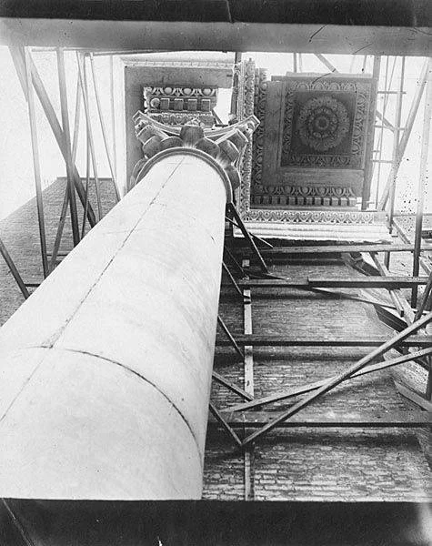
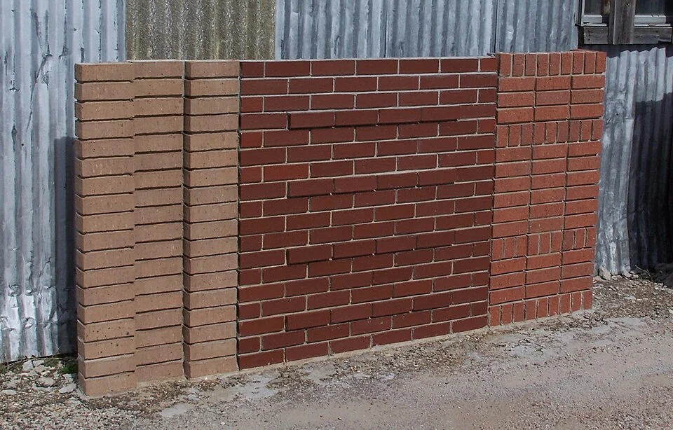

## What it is for

A reception desk looks generous in a rendering. At full scale, staff cannot comfortably reach the printer, a visitor using a wheelchair faces the wrong side of the conversation, and a queue blocks the entrance door. These are expensive discoveries after fabrication and useful discoveries while the desk is still cardboard.

## The core idea

**Test at Full Scale** uses a mock-up—a temporary, life-size version of part of a design—to answer a question before construction makes changes expensive. It applies the wider idea of learning through prototypes to buildings. Life size is particularly useful for reach, movement, furniture and assembly. The mock-up needs to reproduce the conditions that matter to the question; a cardboard desk can reveal a reach problem while leaving structural or acoustic performance to other tests.

## How it works

Choose the question and decide what finding would change the design. Build enough detail to examine it, and involve the people who will use, operate or install that part. Record what happens, change the proposal and repeat the relevant part if needed. A useful trial ends with a decision and an updated drawing.

## Why it works

Start with “What do we need to learn?” To test whether a door hits a chair, floor tape and movable furniture may be enough. To test whether rain gets through a window junction, actual materials and a controlled method may be necessary. This is the choice of fidelity: how closely the model reproduces the relevant features of the finished work. Spend effort on the conditions that affect the answer. A realistic-looking facade color sample will tell little about leakage if it contains none of the joints being tested.

Agree in advance how observations could change the design. Staff might need to reach a printer without leaving a visitor, or two people might need to pass while a cupboard is open. Record the activity, participants and test conditions with the findings. A few participants can reveal a conflict; include a range of needs and explain which situations remain untested when deciding what to do next.

## Architectural examples

### Two real mock-ups — geometry and materials

The photographs show two different kinds of question made tangible. At Olympia, a full-size plaster column and ceiling assembly lets a team inspect the overhead proportions. In the brick panel, real materials and joints can be compared side by side. A reception trial would need people and tasks as well as geometry. The form of the mock-up follows the decision it is intended to inform.

[Photograph source](https://commons.wikimedia.org/wiki/File:Plaster_mockup_of_Corinthian_column_and_portico_ceiling_for_Legislative_Building,_Washington_State_Capitol_group,_Olympia,_1926_(WASTATE_1936).jpg) · [License](https://creativecommons.org/publicdomain/mark/1.0/)

[Photograph source](https://commons.wikimedia.org/wiki/File:BrickMockUpPanel.JPG) · [License](https://creativecommons.org/publicdomain/mark/1.0/)

### A clinic reception desk — illustrative scenario

In a hypothetical clinic, a temporary reception arrangement lets staff and visitors test conversation, reach, queuing and document privacy. Participants include people with different mobility and communication needs. The test may lead to moving a monitor, changing the accessible counter relationship or revising the queue. It should not require participants to disclose personal medical information to make the scenario realistic.

### The Salk Institute’s conservation mock-ups

At the Salk Institute, Getty's documented conservation project used on-site trials while developing treatments for the teak window walls. Investigation, trial and refinement preceded wider work. This is a useful example of matching a test to a particular building and material problem. Its findings belong to those conditions: another timber assembly or climate would need its own assessment before adopting the treatment.

### A classroom layout — illustrative scenario

A third hypothetical example is a school classroom marked out in an existing hall. Tables, storage and a door swing can be moved while teachers and pupils examine simultaneous activities. Tape cannot reproduce daylight, acoustics or the feeling of every wall. Use it to answer spatial questions it can represent, and identify the other studies still needed. Cheap does not mean comprehensive, but a limited test can be highly informative.

## Design considerations

Installers can reveal an impossible fixing sequence or a tool-access problem that a design review misses. Cleaners and maintenance staff may identify unreachable surfaces. Operators can demonstrate what happens when a room changes between uses. Include those perspectives before deciding that a detail is complete. A mock-up should expose practical difficulty, not merely confirm the designer's preferred arrangement.

A mock-up also needs an end point. Decide what will be retained as evidence, which drawing changes are approved and whether another trial is justified. Reuse or recover the temporary materials where feasible. If the test reveals a new question, record it rather than continually expanding the same exercise. A focused trial can remain small and still change a consequential decision, provided the team accepts inconvenient findings instead of treating the constructed sample as a commitment to proceed unchanged.

## Useful when

This pattern helps before bespoke joinery, repeated rooms, facade installation and consequential access decisions. It is especially useful when a small uncertainty will be multiplied many times. It may be less useful where the question is already resolved by appropriate analysis or where a mock-up cannot reproduce the relevant loading or exposure. Select the test because it can change a decision, not because it produces an appealing project photograph.

- The room looks fine on the plan but we cannot judge how it will feel.
- Should we mock up this entrance before building it?
- How can users test a reception desk before fabrication?
- We are about to repeat an uncertain facade detail many times.
- What should a full-size architectural mock-up actually test?
- Can tape and cardboard reveal a layout problem?
- How do we avoid treating a visual mock-up as a performance test?
- We need evidence before committing to expensive fixed joinery.

## Common mistakes and limits

Common mistakes include coaching people toward the intended route, testing without everyday objects, and treating one successful demonstration as proof of performance. A clean desk with no bags, paperwork or companions can hide ordinary conflicts. Where safe and appropriate, test several realistic states, including simultaneous use. Record discomfort or difficulty without blaming the participant for failing to use the design correctly.

Structural strength, fire resistance, weather tightness and acoustic performance need appropriate methods, equipment and specialist oversight. An informal layout trial answers different questions, although it can reveal an awkward interface before formal testing begins. Keep the records clear about what was tested, under which conditions and what remains unresolved. Carry the findings into the drawing; if a later change affects the original question, check that part again before approving it for construction.

## Related patterns

[[prefer-the-smallest-useful-experiment|Prefer the Smallest Useful Experiment]] provides the general decision principle already present in Patternverse. This guide adds the bodily and construction-specific conditions of buildings. [[arch-compare-spatial-alternatives|Compare Spatial Alternatives]] selects what deserves testing, while [[arch-repairable-connections|Repairable Connections]] makes future access and removal part of the questions asked at full scale.

## Sources and provenance

Modern editorial synthesis, not a named pattern attributed to a single historical author. Patternverse editorial synthesis; source organizations credited in article. The explanations and diagrams here are independently authored.

- [Getty Conservation Institute: Salk Institute Conservation Project, trial mock-ups](https://www.getty.edu/projects/salk-institute-conservation/)
- [RIBA: Plan for Use Guide](https://www.riba.org/work/insights-and-resources/plan-for-use-guide/)
