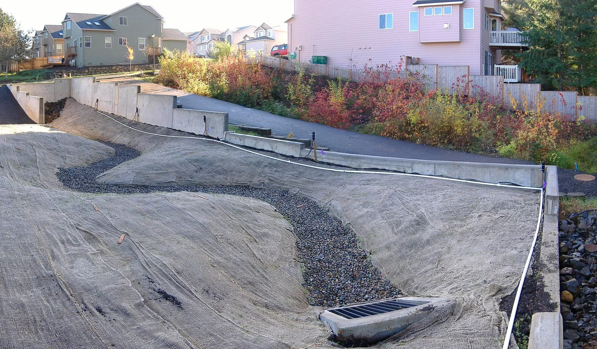
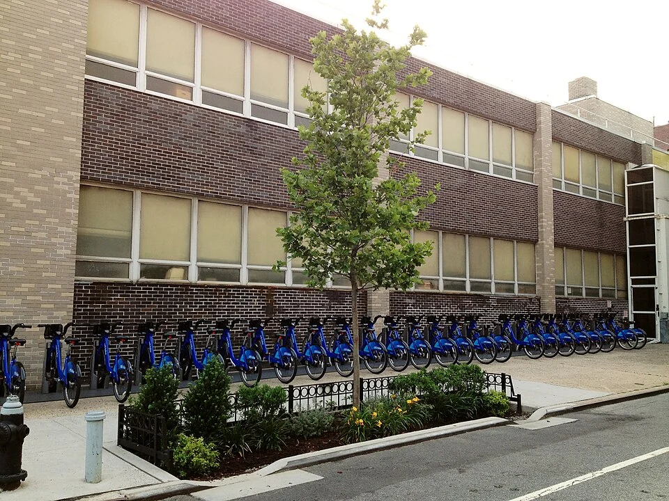

## What it is for

After a storm, water pools at the entrance while the planting nearby remains dry beneath a dense crust of soil. The site has both a drainage problem and a landscape problem because those systems were designed separately. Roof pipes, slopes in the paving and planting beds meet only at the edge of their drawings. Rain exposes the missing connections.

## The core idea

**Water-Sensitive Landscape** connects planting and drainage around the journey rainwater takes. Water running off roofs and paving is called runoff. The design can slow it, store it, treat some pollutants and carry excess water to a safe outlet. A planted basin is one possible part; soil conditions, building foundations and maintenance determine which approach is suitable.

## How it works

Follow rain from the roof or paved surface to its eventual outlet. Show where it can wait during ordinary rainfall and where it goes when that storage fills. Investigate the ground before choosing infiltration—letting water soak into the soil—or controlled discharge to another drainage route. Coordinate the levels with building entrances, planting and accessible paths.

## Why it works

Water follows levels and available openings, not the intended labels on a plan. Trace roof runoff, hard-surface runoff and water entering from neighboring ground. Then consider ordinary rainfall, a saturated period and an event larger than the designed storage can hold. The extreme condition is especially revealing: if a basin fills, where will the next volume go, and what lies along that route?

Slowing runoff can spread the flow over time instead of sending a large rush toward a drain. Soil and planting may also remove some pollutants, depending on the design. First establish what is in the water and ground. Soaking water into contaminated soil can move pollutants; doing so near foundations or unstable slopes can cause damage. A lined basin or one with a drain beneath it may be more appropriate.

## Architectural examples

### Bioswales in construction and use

A bioswale is a shallow planted channel that receives runoff. The first photograph shows an excavated basin with an established planted bed beyond it, making the shape of the ground easy to see. The Brooklyn example shows a planted drainage space beside an ordinary street. Together they help explain how water storage and planting can fit among buildings, paths and daily activities.

[Photograph source](https://commons.wikimedia.org/wiki/File:Bioswale.jpg) · [License](https://creativecommons.org/publicdomain/mark/1.0/)

[Photograph source](https://commons.wikimedia.org/wiki/File:Right_of_Way_Bioswale_with_Citibikes.jpg) · [License](https://creativecommons.org/licenses/by-sa/4.0)

### A school roof catchment — illustrative scenario

In a hypothetical primary school retrofit, one roof currently discharges onto a path. A revised scheme takes that runoff through a visible channel to a planted basin away from the building. A bridge or flush crossing keeps the accessible route clear. The basin has a defined overflow to an approved drainage route, and a maintenance plan identifies sediment removal and plant care. Each part has a job that can be inspected.

### A courtyard over a basement — illustrative scenario

An illustrative example is an urban housing courtyard above a basement. A deep infiltrating garden is impossible because there is a waterproofed structure below. Shallow planted storage and controlled discharge may still be feasible, but the load, waterproofing, root protection and outlets need coordination. Calling it a rain garden does not resolve those technical questions. The useful change is to integrate storage and planting with the real construction below.

The school and basement-courtyard scenarios use similar-looking planted spaces for different conditions. Ground-level soil may allow water to soak away; a garden above occupied rooms must protect the structure beneath it. The drainage and structural designers need to establish the capacity, load and overflow route for each. The appearance of planting alone cannot tell which system is underneath.

## Design considerations

A landscape system that depends on maintenance needs somewhere for that work to happen. Provide access to inlets, outlets and sediment collection points without requiring people to walk across fragile planting. Make blockages visible. If litter gathers at one inlet, a caretaker should be able to remove it safely. A concealed outlet beneath fixed seating can turn a minor blockage into an expensive repair.

The surface intended to carry occasional overflow may also be a daily route. Check crossing points, slip risks, standing water, edges and the needs of people who cannot readily step around puddles. Open water or deep changes in level bring additional safety and supervision questions. A planted feature should not conceal an unexpected drop beside a route. Accessibility and water management need to be designed together from the beginning.

Use locally applicable rainfall assumptions, discharge permissions, soil investigations and drainage requirements. Avoid exporting a numerical standard from another climate. The RIBA guide's sustainable water outcome provides a broad reason to consider the whole cycle; this article's detailed examples are independent synthesis, not a claim that the guide prescribes their dimensions.

## Useful when

This pattern helps at site planning, courtyard renovation, roof replacement and public-space renewal. It is particularly useful when drainage infrastructure is under pressure or where residents want more planted ground. It can also reveal opportunities to reduce unnecessary paving before adding storage. Reducing the runoff source may be simpler and more robust than creating a larger device to manage it later.

- Rainwater runs straight off our site and floods the entrance.
- Can planting help manage runoff from a roof?
- Where should excess water go when a rain garden fills?
- We want a greener courtyard without creating damp walls.
- How do we make drainage visible and understandable?
- Our paved schoolyard becomes a puddle after storms.
- Can we reduce runoff without relying entirely on underground pipes?
- What maintenance does a planted drainage area need?

## Common mistakes and limits

Common mistakes include assuming all green surfaces absorb water well, specifying plants without checking inundation and drought cycles, and using an ordinary sunny-day photograph as evidence that drainage works. Compaction, silt and seasonal vegetation changes can alter performance. Observe the site during rain and record what actually happens. A dry-weather inspection alone cannot establish where water goes.

## Related patterns

[[arch-site-repair|Site Repair]] protects valued ground, [[arch-building-edge|Building Edge]] coordinates thresholds, and [[arch-post-occupancy-evaluation|Post-Occupancy Evaluation]] closes the loop with evidence after storms.

## Sources and provenance

Modern editorial synthesis, not a named pattern attributed to a single historical author. Patternverse editorial synthesis; source organizations credited in article. The explanations and diagrams here are independently authored.

- [RIBA Sustainable Outcomes Guide (2019): Sustainable Water Cycle](https://www.riba.org/media/b2lgzeoo/riba-sustainable-outcomes-guide-2019-pdf.pdf)
- [AIA Framework: Design for Water](https://www.aia.org/design-excellence/aia-framework-design-excellence)
