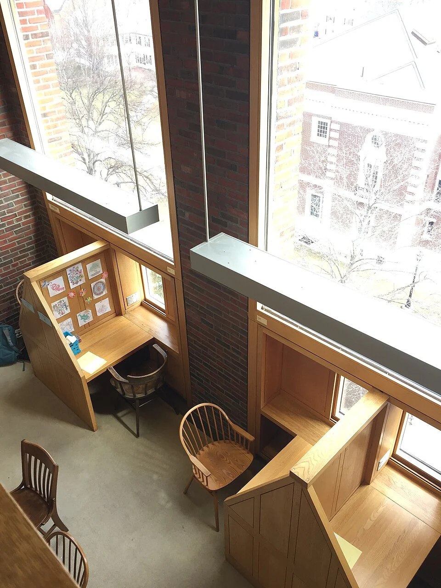
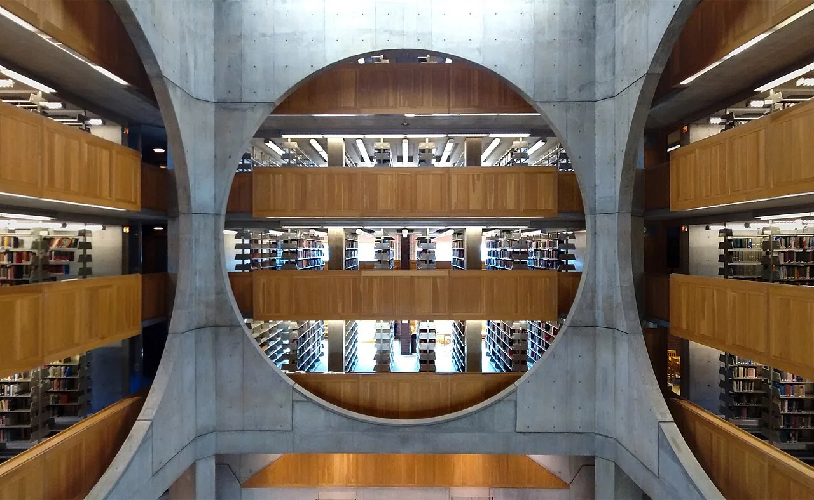

## What it is for

In a large room, people repeatedly carry a chair toward the same window. The view is pleasant and daylight reaches the book, but the chair blocks a doorway and the sill is too high to use as a surface. The behavior identifies a promising place. The architecture has not yet made that place comfortable or practical.

## The core idea

Alexander's **Window Place** makes a useful place to sit or work beside a window. A chair, desk, bay or small recess can bring daylight, a view and some enclosure together. Start with the person and task: can they approach comfortably, see out, use a surface and stay there in different weather? A wide sill becomes a place only when those relationships work together.

## How it works

Choose the view and task, then place a seat or work surface beside the opening. Check the approach, eye level and window controls together. Glazing means the glass in the opening; its temperature and shading affect comfort at close range. Provide comparable views for people using different chairs or mobility aids, with room to approach and stay.

## Why it works

The attraction combines several relationships. Daylight can make a task pleasant, a view provides information beyond the room, and the surrounding wall may offer a protected side. A person can be connected to the larger space while directing attention outward. These benefits are conditional. A view toward a blank wall or a seat exposed to glare may not support the same experience.

The place needs dimensions appropriate to its use and users, but no single seat dimension suits everyone. Some people need a supportive chair with arms; others prefer a bench or a standing surface. Provide a clear approach and room to transfer or position a mobility aid where relevant. An elegant built-in ledge should not become the only desirable place if many users cannot comfortably occupy it.

## Architectural examples

### Phillips Exeter Academy Library

At Louis I. Kahn's Phillips Exeter Academy Library, individual study places were part of the building's design. These are carrels: small desks with screens giving each reader some enclosure. The Academy's design history emphasizes their importance during development. The photograph shows desks and chairs directly beside tall windows, making the relationship between a reader, an outward view and the surrounding wall easy to understand.

[Photograph source](https://commons.wikimedia.org/wiki/File:Exeter_Library_Carrels_01.jpg) · [License](https://creativecommons.org/licenses/by-sa/4.0)

[Photograph source](https://commons.wikimedia.org/wiki/File:Phillips-Exeter-Academy-Library-Interior-Exeter-New-Hampshire-Apr-2014-a.jpg) · [License](https://creativecommons.org/licenses/by-sa/4.0)

The carrel photograph makes the desk, enclosure and adjacent glazing visible; the central-hall view places that edge within the larger collective interior. Neither is a measured furniture survey. The diagrams explain a generic window place rather than reconstructing Exeter's fittings.

### A public-library window bay — illustrative scenario

Consider a public library renovating a deep window bay. A freestanding supportive chair, a small reachable table and a suitable task light may work better than a fixed upholstered bench. The choice leaves room for a wheelchair beside the same view and allows maintenance access to the window. A popular architectural feature becomes a choice of usable positions rather than one prescribed posture.

## Design considerations

A room can have a comfortable average temperature while the window seat feels cold or overheated. Cold glass, falling cool air, direct sun and nearby heating or cooling outlets affect someone sitting close to the edge. The wall and roof construction—the building envelope—also matters beneath a built-in seat. Coordinate the furniture with these conditions and leave a way to inspect concealed areas for moisture or damage.

Privacy can work in both directions. A ground-floor seat may expose the occupant to passersby, while a window onto a shared court can overlook someone else's private room. Adjust orientation, screening and the position of the place rather than assuming maximum transparency is desirable. A window place should support attention without making the occupant feel continuously observed.

Test the proposal at full scale where posture, reach or a constrained bay is uncertain. Keep the window maintainable and obtain appropriate advice on glazing safety, guarding, access and thermal detailing. Observe the completed place through different seasons and times of day. If people avoid it in winter, the problem may be the envelope rather than the seating arrangement.

## Useful when

This pattern helps in homes, libraries, schools, workplaces and waiting areas where people already seek the edge or where a view remains unused. It is particularly valuable in a small room because a good place can improve usefulness without increasing overall area. It is less suitable where privacy, conservation or safety requires the opening to remain unoccupied. Identify the actual constraints before making a window seat the room's signature feature.

- There is a lovely window but nowhere comfortable to sit beside it.
- How do I design a useful window seat?
- Our brightest corner is also the coldest place in the room.
- Can a window become a reading place without blocking circulation?
- Where should a desk go near a window?
- People keep moving chairs toward the same view.
- The window ledge looks inviting but is too shallow to use.
- How do we make a sunny edge comfortable in summer?

## Common mistakes and limits

Common mistakes include placing the user's eyes directly toward a dazzling opening, using a seat as a step beside unsafe glazing, and blocking window operation with fixed furniture. A desk may need to sit perpendicular to the window rather than face it. Blinds and external shading have different roles; neither should be specified without considering how someone seated there can use the controls.

## Related patterns

[[arch-light-on-two-sides|Light on Two Sides of Every Room]] addresses the room's overall light balance. [[arch-refuge|Refuge]] explains optional protection within a larger space. [[arch-external-solar-shading|External Solar Shading]] makes a bright edge usable when direct sun would otherwise dominate it.

## Sources and provenance

Established named pattern. Christopher Alexander, Sara Ishikawa, Murray Silverstein, with Max Jacobson, Ingrid Fiksdahl-King and Shlomo Angel. The explanations and diagrams here are independently authored.

- [A Pattern Language, pattern 180; Alexander, Ishikawa, Silverstein and colleagues](https://www.patternlanguage.com/apl/aplsummary.htm)
- [Phillips Exeter Academy: How do I love the library?](https://exeter.edu/how-do-i-love-the-library-archivist-counts-the-ways/)
