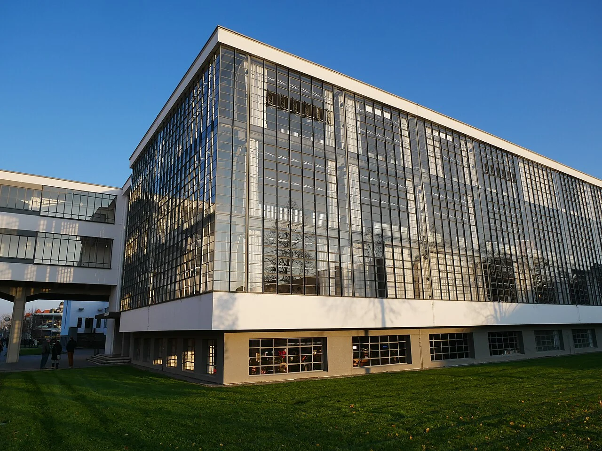

## What it is for

The early plan fits the rooms efficiently into one deep rectangle. When rooms are assigned, the outside edge fills quickly and a large central area remains dependent on artificial light. Adding bigger windows to the outer wall cannot give every enclosed inner room a useful relationship to the sky. The difficulty is now a question of building form.

## The core idea

Alexander's **Wings of Light** brings occupied rooms closer to the outside by arranging a building in shallower parts, or wings. More rooms can then reach an exterior wall for daylight and views. The choice concerns massing—the arrangement of the building's main volumes. Compare what the extra edges offer with their cost in materials, travel distance and land, giving each wing a clear purpose.

## How it works

Compare the deep plan with shallow wings and a mixture of the two. Put rooms that need daylight beside useful exterior walls, then draw the gardens, gaps and connections between them. Check the rooms and outside spaces together. A classroom beside a narrow shaded gap may gain little from being close to an external wall.

## Why it works

Daylight diminishes and changes character as it travels into a room. Its usefulness depends on opening geometry, obstructions, how much light the room surfaces reflect and the task. A shallower plan can improve access to exterior walls, but there is no universal depth that produces good daylight everywhere. A room looking into a narrow shaded gap may gain little from its nominal perimeter position.

Wings also create outside spaces between them. Those spaces can become gardens, courts or arrival routes, or merely leftover service strips. Their width, orientation and connections are part of the same decision as the internal room depth. Drawing attractive fingers in plan without considering the spaces between them moves the problem outdoors rather than resolving it.

## Architectural examples

### The Salk Institute — a massing comparison

At the Salk Institute, two long building ranges stand beside an open courtyard. The photograph makes the relationship between separate volumes and open sky easy to see. It is a building-form comparison: the dimensions and layout inside each range would be needed to assess the daylight reaching particular rooms. Start with the visible relationship, then investigate that room-level question.

; CC BY-SA 4.0.")

[Photograph source](https://commons.wikimedia.org/wiki/File:Salk_Institute_courtyard_looking_west_to_the_Pacific.jpg) · [License](https://creativecommons.org/licenses/by-sa/4.0)

### The Bauhaus Building, Dessau

At Walter Gropius's Bauhaus Building in Dessau, the workshop wing, vocational school wing, bridge and studio building have distinct forms and connections. The foundation's account explains how they relate to different functions. This helps a reader connect the list of activities—a building's program—with its overall shape. The glazed workshop facade is one part of that composition, with its own environmental questions.

[Photograph source](https://commons.wikimedia.org/wiki/File:Fassade_des_Bauhausgeb%C3%A4des,_Dessau_2019.jpg) · [License](https://creativecommons.org/licenses/by-sa/4.0)

### A school wing arrangement — illustrative scenario

An illustrative example is a small school comparing a deep central block with two classroom wings around a shared garden. The wings place more teaching rooms along useful external faces. The central block offers shorter internal routes and a more compact enclosure. Neither wins by diagram alone. Compare the actual room uses, seasonal shading, supervision, accessibility, site constraints and construction costs.

### A hybrid arrangement — illustrative scenario

A hybrid arrangement can keep a compact shared hall while using shallower wings for teaching or workrooms needing daylight. Storage and other suitable activities can use deeper zones. Start with the accommodation schedule—the list of rooms, their sizes and uses—and ask which spaces really need an exterior edge. That can achieve the desired light without giving every room the same form or spreading the building unnecessarily.

## Design considerations

For comparable floor area, a more articulated plan often creates more external wall and more corners. That can raise material quantities, thermal losses or gains, maintenance and detailing complexity. Roof junctions and long routes may also increase. A building that looks environmentally gentle in an aerial diagram is not automatically lower in whole-life impact. Quantify the consequences rather than relying on the symbolism of a light-filled plan.

Walk the plan from arrival to the farthest ordinary destination. Does the massing create excessive travel? Are the routes sheltered, understandable and available to everyone? A network of wings can create pleasant choice or confusing repetition. It can also consume land needed for outdoor activity. The desire for shallow rooms should not quietly erase the site's best garden or a valued public route.

Review the proposal with occupants as well as technical consultants. A room can receive more daylight yet lose a valued view or become harder to supervise. Keeping a short record of these consequences makes the final choice easier to explain and helps later teams understand why the building took its particular form.

Use daylight, thermal and circulation analysis appropriate to the project, with specialist advice where needed. The diagrams here deliberately omit construction dimensions.

## Useful when

This pattern helps during feasibility and early design, when building depth is still adjustable. It is especially relevant to homes, schools, workplaces and other uses with many occupied rooms. It may be less useful where a deep controlled environment is intentional, such as some galleries, production spaces or performance venues. Such uses still need humane staff areas and appropriate environmental design, but not necessarily side windows in every space.

- Too many rooms in our plan are far from an exterior wall.
- Could a narrower building improve daylight?
- Should we divide a deep building into wings?
- Our courtyard barely brings light to the rooms around it.
- How do we balance more daylight with more facade?
- The floor plan has a dark central zone.
- Can a school use several shallow wings without wasting circulation space?
- Does a thin building always use less energy?

## Common mistakes and limits

Common mistakes include making gaps too narrow, assuming all orientations behave alike, and solving daylight by unlimited glazing. Another is adding wings during a late design stage without updating structure, fire strategy or services. Building form has many linked consequences, so a late change can invalidate earlier assumptions. Compare alternatives at the same level of detail before presenting one as the obvious environmental answer.

## Related patterns

[[arch-light-on-two-sides|Light on Two Sides of Every Room]] explores the room-level opportunity created by multiple edges. [[arch-compact-building-form|Compact Building Form]] tests the resource and envelope cost. [[arch-courtyards-which-live|Courtyards Which Live]] asks whether the outdoor space between wings becomes a useful place in its own right.

## Sources and provenance

Established named pattern. Christopher Alexander, Sara Ishikawa, Murray Silverstein, with Max Jacobson, Ingrid Fiksdahl-King and Shlomo Angel. The explanations and diagrams here are independently authored.

- [A Pattern Language, pattern 107; Alexander, Ishikawa, Silverstein and colleagues](https://www.patternlanguage.com/apl/aplsummary.htm)
- [Bauhaus Dessau Foundation: Bauhaus Building](https://bauhaus-dessau.de/en/venues/bauhaus-building/)
- [Ching: Architecture, Form, Space, and Order (publisher overview and contents)](https://www.wiley.com/en-us/architecture-form-space-and-order-5th-edition-p-9781119853374)
