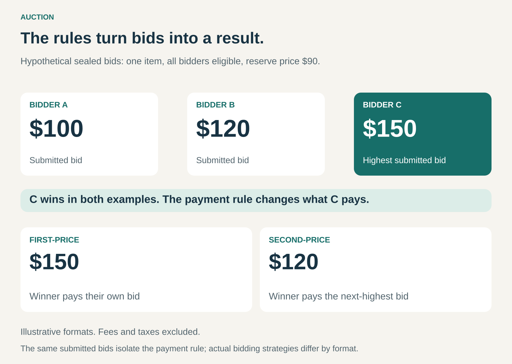

## What it is for

A seller has a rare collectible but does not know what buyers would pay. A business needs to allocate limited capacity among competing customers. An advertising platform has several advertisers interested in the same opportunity.

Setting a fixed price means making a judgment before seeing how those buyers compete.

Auction creates a structured way to gather bids, allocate an offering, and determine the price under defined rules. It is especially useful when availability is limited, valuations differ, and several credible participants want the same thing.

## The core idea

**Let participants compete through bids, then use explicit rules to determine allocation and payment.**

The familiar version is an auctioneer accepting progressively higher bids until one buyer remains. But auctions can also use confidential bids, descending prices, automated bidding, or rules that combine price with other considerations.

An auction can allocate one object, many identical units, a contract, or a brief opportunity to display an advertisement.

Two decisions sit at its centre:

- **Who wins?** The allocation rule determines which eligible participant receives the offering.
- **What do they pay?** The payment rule determines the amount owed.

These decisions need not produce the same number. The participant submitting the highest bid may win while paying an amount determined by competing bids.

Auction is therefore a pricing and allocation mechanism. A business can combine it with selling its own products, operating a marketplace, or brokering transactions for others.

## How it works

An auction begins by defining the offering and the conditions of participation.

Participants need to understand what they are bidding for, who is eligible, when bidding closes, how ties are resolved, and what winning commits them to do.

The format then shapes how competition unfolds.

**Ascending auction.** Participants submit increasingly high bids. In the standard version, the highest eligible bidder wins and pays their final bid, subject to any reserve.

**Descending auction.** The seller starts at a high price and lowers it until a participant accepts. In the standard single-item version, that participant wins at the accepted price.

**Sealed-bid auction.** Participants submit bids without seeing competing submissions. In a first-price version, the highest bidder pays their own bid. In a standard second-price version, the highest bidder pays the next-highest bid, subject to applicable reserve rules. [Royal Swedish Academy of Sciences: auction formats](https://www.nobelprize.org/uploads/2020/09/advanced-economicsciencesprize2020.pdf)

Procurement auctions can reverse the direction of competition: suppliers compete to fulfil a buyer’s requirement. Eligibility, quality, and delivery conditions can accompany the price competition.

A **reserve price** sets a minimum acceptable sale price. If the bidding does not meet it, the item may remain unsold.

The graphic holds submitted bids constant to isolate the payment rule. Actual bidding behaviour can differ between formats, so it does not establish that one format always produces higher revenue.

## Why it works

An auction brings competing valuations into a common process.

A fixed-price seller must judge whether a price is too high or too low. An auction invites participants to express what they are prepared to offer under its rules.

Competition can help a seller capture demand that would otherwise remain hidden. It can also provide a repeatable way to allocate scarce opportunities without negotiating separately with every interested party.

For buyers, the process can provide access to offerings that are difficult to price or obtain through ordinary retail channels.

The outcome depends on participation and design. One hesitant bidder creates little competitive pressure. Many bidders with poor information can produce disputed or unsustainable outcomes.

An auction reveals the result of a particular competition under particular rules. It does not establish an offering’s permanent or objectively correct value.

## Famous examples

### Sotheby’s: competitive bidding for distinctive objects

Sotheby’s uses auctions to sell art, jewellery, watches, and other collectible objects. Its buyer guidance describes participation through live and online channels, including advance bidding.

The auction establishes a hammer price, but the buyer’s payable amount also includes a buyer’s premium and, where applicable, other charges. [Sotheby’s guide for buyers](https://help.sothebys.com/en/support/solutions/articles/44002518078-guide-for-buyers-global)

The pattern is useful because individual objects can attract substantially different valuations. Bringing interested collectors into the same bidding process allows that competition to affect the outcome.

It also demonstrates an important economic distinction: the announced bid, the buyer’s total payment, and the seller’s proceeds can be different amounts.

### eBay: automated competition between buyers

For its auction listings, eBay lets buyers enter the maximum amount they are willing to bid. Its automatic bidding system then bids in increments on their behalf, up to that limit.

A participant therefore does not necessarily pay the maximum they entered. The resulting price depends on competing bids, bid increments, and applicable listing conditions. [eBay automatic bidding](https://www.ebay.com/help/buying/bidding/how-bidding-works?id=4014)

Some listings also have a reserve. Being the highest bidder does not secure the item if that reserve remains unmet. [eBay reserve prices](https://www.ebay.com/help/buying/bidding/reserve-prices-work?id=4018)

The example shows how software can conduct bidding without requiring every buyer to remain present throughout the auction.

### Google Ads: auctions that consider more than the monetary bid

Google uses auctions to determine which search advertisements are eligible to appear and how they rank.

Its Ad Rank calculations consider the bid alongside factors such as auction-time ad quality, thresholds, competition, search context, and the expected effect of advertising assets. A higher monetary bid alone does not guarantee the highest position. [Google Ads: Ad Rank](https://support.google.com/google-ads/answer/1722122?hl=en)

This extends the pattern beyond selling a physical object. The offering is an advertising opportunity, and the auction incorporates the platform’s interest in displaying relevant, useful advertisements.

It also illustrates why an auction’s actual rules matter more than a generic description such as “highest bidder wins.”

## The economics

An auction operator can earn revenue through seller commissions, buyer premiums, listing charges, participation fees, or related services.

A business auctioning its own inventory receives sale proceeds and bears the associated product and selling costs.

Consider a hypothetical intermediary using the graphic’s first-price outcome:

- The winning price is $150.
- The buyer pays an additional $15 premium, bringing their payment to $165.
- A $10 seller fee is deducted from the winning price, leaving the seller $140.
- The operator receives $25 in combined fees before operating costs.

These are illustrative charges, not the rates of any example company. Taxes, shipping, and other charges are excluded.

The operator’s costs can include attracting bidders, preparing listings, verifying eligibility, conducting sales, collecting payment, and resolving disputes. Unsold offerings can incur substantial costs too.

A high transaction value does not automatically create a profitable auction business.

## Useful when

- **Valuations differ substantially.** Different participants have different uses, preferences, or expectations.
- **Supply is limited.** Several parties compete for an object, quantity, contract, or opportunity.
- **A fixed price is difficult to establish.** Comparable transactions are scarce or conditions change quickly.
- **Enough credible bidders can be reached.** Competition justifies the cost of organizing the process.
- **The offering can be described clearly.** Participants understand what winning provides and requires.

## Common mistakes and limits

**Assuming an auction guarantees a high price.** Weak participation can produce a disappointing result. A reserve can prevent an unacceptable sale, while increasing the possibility of no sale.

**Confusing winning with getting good value.** When bidders estimate a shared but uncertain value, the winner may be the participant who overestimated it most. This is the classic winner’s curse. [Royal Swedish Academy of Sciences: auction uncertainty](https://www.nobelprize.org/uploads/2020/09/popular-economicsciencesprize2020.pdf)

**Ignoring total payment.** Premiums, taxes, transport, and other charges can materially change the buyer’s cost.

**Treating all formats as interchangeable.** Visibility of bids, payment rules, closing procedures, and reserves influence participation and bidding behaviour.

**Neglecting integrity.** Fake bids, collusion, misleading descriptions, and failure to pay undermine confidence in the process.

**Using bidding where participation costs exceed the benefit.** Familiar, readily available products may be easier to sell through a clear fixed price.

## Related patterns

[[marketplace|Marketplace]] organizes exchange between buyers and sellers. Auction supplies one possible method for allocating listings and setting prices.

[[brokerage|Brokerage / Matchmaking]] helps suitable counterparties find and reach an agreement. A broker can organize an auction among interested parties.

[[dynamic-pricing|Dynamic Pricing]] changes prices as conditions change. Auction specifically uses bids and allocation rules to produce an outcome.

[[consignment|Consignment]] separates ownership from selling responsibility. An auction house can sell consigned property while the owner receives proceeds after agreed deductions.
