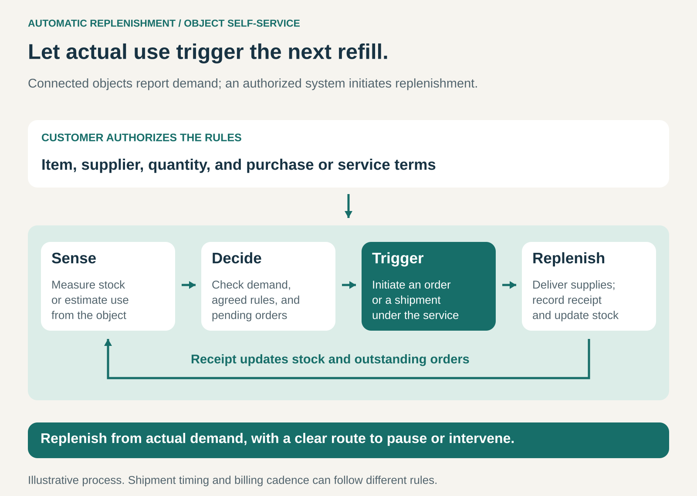

## What it is for

Keep recurring supplies available without requiring someone to notice a shortage, find the correct item, and place another order.

A printer needs ink. A production workstation needs fasteners. The individual purchase may be small, yet running out can interrupt something much more valuable.

Automatic Replenishment is useful when consumption can be measured or estimated reliably and replacement supplies are sufficiently standardized.

The product or container reports its condition, and an authorized system initiates replenishment when needed.

## The core idea

**Let actual consumption or remaining stock trigger replenishment under rules agreed in advance.**

Business Model Navigator calls this **Object Self-Service**: connected objects supply information that enables systems to generate orders automatically. [Business Model Navigator: Object Self-Service](https://ri.businessmodelnavigator.com/pattern?id=58)

The object does not need to perform every part of the transaction itself. A sensor may report stock levels to a service that checks the rules, selects the appropriate supply, and initiates an order or shipment.

The customer establishes permission and preferences beforehand. Routine replenishment then proceeds without a fresh manual order each time.

This differs from a fixed delivery schedule. Supplies arrive in response to measured or estimated need. It also goes beyond a low-stock reminder, which still leaves the customer responsible for ordering.

## How it works

**1. Establish the replenishment arrangement.**

The customer enrolls an eligible device or storage location and agrees to the relevant terms.

The arrangement identifies compatible supplies, the supplier, quantities or service entitlements, delivery details, and payment arrangements. It should also explain notifications, cancellation options, and how to pause replenishment.

Some systems purchase each refill separately. Others dispatch supplies within an existing service plan.

**2. Detect stock or consumption.**

The system needs a useful signal.

A printer can report estimated ink levels. A scale can detect changes in a parts bin’s weight. A camera can estimate how much material remains.

Measurement need not be perfect, but it must be accurate enough for the replenishment decision. The system also needs to recognize unreliable or missing data.

**3. Trigger early enough for delivery.**

Waiting until supplies are empty defeats the purpose.

For example, suppose a workstation uses ten units per day, delivery normally takes five days, and the business wants a twenty-unit buffer. A simple illustrative reorder point would be seventy units: fifty for expected consumption during delivery plus twenty as a buffer.

Actual settings need to account for demand variation, delivery uncertainty, and stock already on order.

**4. Fulfil and reconcile the replenishment.**

The supplier processes the requirement and delivers the supplies.

The system then needs to recognize delivery, update stock information, and clear the outstanding order. Otherwise, repeated low-stock signals can create duplicate shipments.

Physical work can remain: someone may still unpack a delivery, refill a bin, or install a cartridge. The automated part is recognizing demand and initiating replenishment.

## Why it works

**It removes repetitive purchasing work.** Customers spend less time checking supplies, identifying compatible items, and ordering them.

**It connects demand information to action.** A shortage signal can enter the fulfilment process without waiting for someone to notice and respond.

**It can reduce avoidable interruptions.** Replenishment begins while enough supply remains to cover the expected delivery period.

**It can adapt better than a calendar.** When consumption changes, shipment timing can change with it.

**It creates a continuing supplier relationship.** The supplier receives recurring demand through an established connection to the customer’s operation.

These benefits depend on measurement, connectivity, and fulfilment working together. Automatic ordering cannot compensate for unavailable stock or consistently late deliveries.

## Famous examples

### HP Instant Ink — replenishment within a printing service

With HP Instant Ink, eligible enrolled printers report when ink is running low, allowing HP to send replacement cartridges. Replacement shipments follow printing needs rather than a fixed monthly delivery schedule. HP’s monthly plans are based on pages printed and include ink delivery. [HP Instant Ink](https://instantink.hpconnected.com/us/en/l/v2)

This illustrates an important distinction between billing and fulfilment: a customer can pay monthly while receiving supplies only when the system determines they are needed.

The service depends on an eligible connected printer and an active account with current billing information. [HP Instant Ink requirements](https://support.hp.com/gb-en/document/ish_3259778-1993151-16)

### Brother Auto Reordering — individual purchases triggered by the printer

Brother’s Refresh Auto Reordering monitors ink or toner levels and automatically orders replacements when supplies run low. Customers are billed when cartridges ship. The service sends an email before an automatic shipment and provides a twenty-four-hour cancellation window. [Brother Auto Reordering](https://www.brother-usa.com/supplies/ez-auto-reordering)

This demonstrates that automatic replenishment does not require a subscription fee.

It also shows how customer control can remain part of an automated process: the system initiates the purchase, while the customer has an opportunity to intervene.

### Würth — industrial parts that signal their own replenishment needs

Würth’s iSCALE system uses weighing sensors to monitor parts held in containers. When stock falls below a defined threshold, the system automatically triggers a reorder through Würth’s inventory-management system. Its iBin approach uses optical monitoring to detect remaining quantities and trigger replenishment. [Würth’s connected supply systems](https://www.wurthindustry.uk/web/en/wuerthindustrie/cteile_management/one_touch_supply_chain.php), [Würth iBin](https://www.wurth-industrie.fr/web/en/wif/gestion_pieces_c/reapprovisionnement_kanban/gestion_kanban/approvisionnement_connecte/systeme_ibin.php)

Here, the pattern supports production materials such as small components rather than household consumables.

The value lies partly in reducing the administrative effort surrounding inexpensive items whose absence can interrupt work.

## The economics

Automatic replenishment can earn revenue through ordinary product sales, a replenishment fee, or a broader service plan.

Its economics still depend on the cost of supplying the customer.

Consider a hypothetical refill purchase:

| Item                                                     | Amount |
| -------------------------------------------------------- | -----: |
| Customer payment                                         |    $40 |
| Product cost                                             |   −$25 |
| Fulfilment and delivery                                  |    −$6 |
| Variable connectivity, processing, and support costs     |    −$2 |
| Contribution before customer acquisition and fixed costs | **$7** |

Frequent small shipments, incorrect orders, and support incidents can consume that contribution.

For the customer, potential benefits include less purchasing effort and fewer emergency shortages. Lower inventory is possible in some settings, but the required buffer still depends on consumption and delivery reliability.

The provider also bears costs for device integration, software, monitoring, and maintaining the service. Recurring orders alone do not establish profitability.

## Useful when

- **Consumption recurs.** Supplies are repeatedly used and replaced.
- **Demand can be observed.** Stock levels, weight, usage counts, or other signals provide a useful estimate.
- **Replacements are predictable.** Compatibility and acceptable quantities can be established beforehand.
- **Running out is disruptive.** The inconvenience exceeds the value of manually reviewing every purchase.
- **Fulfilment is dependable.** Supplies can usually arrive within the period covered by remaining stock.

## Common mistakes and limits

**Confusing reminders with replenishment.** A notification helps identify demand but still requires someone to complete the purchase.

**Ignoring supplies already on their way.** Repeated signals can generate duplicate orders unless the system tracks outstanding shipments.

**Treating estimates as exact measurements.** Sensor errors, misplaced items, or unusual usage can produce incorrect demand signals.

**Triggering too late.** A low-stock threshold needs to reflect delivery time and uncertainty, not simply the moment a warning becomes visible.

**Ignoring stock outside the device.** A printer may report low ink while an unused replacement cartridge is already in the cupboard.

**Making customer intervention difficult.** Customers need understandable ways to pause, change, or stop the arrangement.

**Overlooking dependency on the supplier.** Compatible consumables, account requirements, and service-specific components can make switching less convenient. Those conditions affect the customer’s overall assessment.

The pattern is less suitable when preferences change frequently, consumption is difficult to measure, or each purchase requires substantial judgment.

## Related patterns

- [[subscription|Subscription:]] can fund automatic replenishment, while shipment timing follows demand independently of the billing schedule.
- [[product-as-point-of-sale|Product as Point of Sale:]] lets customers purchase through a product or its interface. Automatic Replenishment delegates the routine ordering trigger to the connected system.
- [[demand-driven-production|Demand-Driven Production / From Push to Pull:]] uses actual demand to initiate upstream work. Replenishment signals can provide one source of that demand information.
- [[managed-service|Managed Service:]] can incorporate replenishment within a broader responsibility for keeping an operation supplied and functioning.
