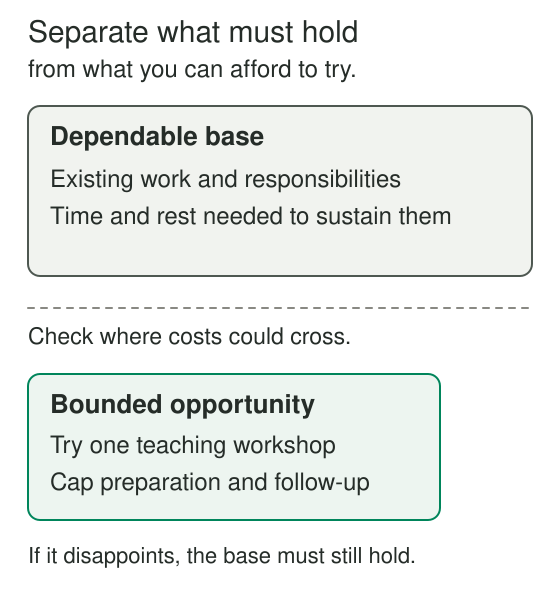

You want to explore a different direction, but the prospect seems to demand everything at once: leaving reliable work, finding a new audience, and depending on an untested idea to support you. Staying where you are protects the familiar arrangement. Making the leap puts several important things at risk together.

The Barbell Strategy asks whether you can separate those exposures. Protect a dependable base, and reserve a bounded share of resources for opportunities whose outcomes are highly uncertain but could be disproportionately valuable. The experimental part can fail without consuming what the protected part is meant to provide.

**Protect what must hold; leave room for something unexpectedly good.**

## Two different attitudes toward uncertainty

The barbell name comes from placing weight at two ends. In Taleb's framework, one end is strongly conservative and the other accepts substantial uncertainty. The important feature is the separation of these attitudes within an overall arrangement.

[Geman, Geman, and Taleb's author-hosted manuscript, Tail Risk Constraints and Maximum Entropy](https://www.fooledbyrandomness.com/barbell.pdf), describes a portfolio combining maximal conservatism in one portion with high risk in another. Its mathematical analysis concerns financial portfolios under specified assumptions. The everyday applications here use the structure as a practical analogy; the paper does not establish that this arrangement improves every career or personal decision.

Applied to a life choice, the conservative side concerns what you need to preserve: enough dependable income, time for existing responsibilities, a workable routine, or resources you cannot afford to lose. The exploratory side concerns a limited exposure to an uncertain possibility: a new kind of work, an unusual creative project, or an unfamiliar approach that might open further opportunities.

A modest experiment is not automatically a barbell. The distinctive questions are what protects the base, how the exploratory loss is contained, and what makes the potential gain worth that exposure. An activity with a predictable benefit can be worthwhile without fitting this particular strategy.

## Why the separation matters

An uncertain project can disappoint for many reasons that are difficult to forecast. A barbell arrangement tries to make some of those forecasts less consequential. If the project attracts no interest, the loss remains within a limit you considered workable beforehand.

That protection may also make exploration easier to sustain. A new idea need not immediately satisfy every requirement of the established arrangement. It can remain a real experiment rather than being forced to provide a living before anyone knows whether it has value.

Both points depend on actual boundaries. A side project that quietly consumes sleep, creates obligations, or undermines dependable work can spread losses into the supposedly protected base. Calling an activity small does not establish that its consequences are small.

## A teaching pilot with a dependable base

Nora enjoys explaining practical skills and wonders whether teaching could become part of her working life. She initially imagines leaving her job and creating a full course. That would make demand, teaching enjoyment, preparation time, and income uncertain together.

Instead, she keeps her current work and existing commitments while arranging one short workshop through a local group. She sets a limit of one Saturday morning for delivery and a separate, modest preparation allowance. She uses materials she already has and promises no continuing program. The group knows this is a pilot and agrees on its scope.

The workshop might lead to repeat invitations, useful contacts, or a different understanding of work she enjoys. It might also reveal that preparing and teaching the subject is less appealing than she expected. Those outcomes remain uncertain. The arrangement gives her access to them while limiting what depends on the result.

The base still needs examination. If her ordinary week is already exhausting, a Saturday workshop may borrow from recovery she needs. The barbell only fits if the pilot's full cost, including preparation and recovery, is compatible with preserving that base.

## Creative work with different expectations

Idris writes dependable material for established clients. He also wants to develop an unusual illustrated essay whose audience is uncertain. Trying to turn every client assignment into an artistic experiment could make his reliable work less reliable. Requiring the essay to earn its keep immediately could stop the experiment before it takes shape.

He gives the two kinds of work different expectations. Client commitments retain their agreed scope and quality. The essay receives a limited block of discretionary time and a clear review point. If it reaches no audience, he loses that bounded effort. If it finds readers or develops a distinctive technique, the benefit may extend beyond the original piece.

The arrangement has opportunity costs: the time might have supported rest or another project. The barbell makes those costs more explicit; it does not make them disappear. Idris can also decide that ordinary creative enjoyment is sufficient reason to continue, while recognizing that this is a different justification from seeking uncertain upside.

## When the apparent protection fails

A common failure is treating the base as inherently safe. A job may be vulnerable to the same disruption as the project beside it. Two activities may depend on the same platform, person, or scarce evening hours. Separate labels can conceal shared exposure.

Another failure is counting only the visible stake. A project with little spending can still create a demanding commitment. An inexpensive prototype can carry responsibilities to other people. An experiment can expand through repeated extensions until its original limit no longer describes it.

There is also no universal allocation such as a fixed percentage of time or money. The appropriate boundary depends on what must be protected, how losses could spread, and the resources available. If essential needs already consume what you have, exploration may need to wait or take a form that adds very little demand.

The strategy is useful when a meaningful base can be protected and a genuinely promising uncertainty can be approached with contained losses. It is a poor fit for indivisible commitments, situations where people could bear unbounded consequences, or opportunities whose costs cannot be contained. This article offers a way to examine an arrangement, not a recommendation of financial products or portfolio proportions.

## Connections and practice

[[prefer-the-smallest-useful-experiment|Prefer the Smallest Useful Experiment]] helps identify a trial that produces useful information. The Barbell Strategy asks how that trial or opportunity sits alongside the rest of your life and what remains protected if it fails.

[[separate-reversible-from-irreversible-decisions|Separate Reversible from Irreversible Decisions]] examines what changing course would cost. [[build-a-web-of-goals|Build a Web of Goals]] explores how activities can support several purposes, while also making shared dependencies worth inspecting.

The optional reflection, [[protect-a-base-and-bound-an-experiment|Protect a Base and Bound an Experiment]], helps describe what must hold, what could be tried, and where costs might cross the intended boundary.
