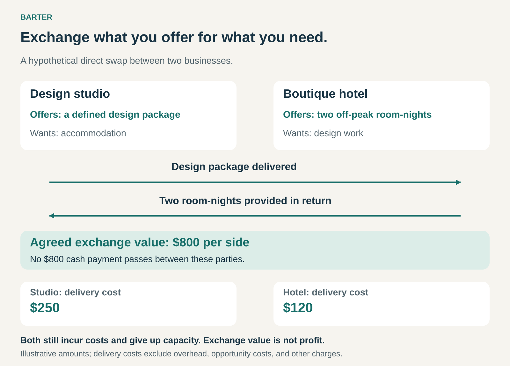

## What it is for

Exchange goods, services, or other agreed benefits instead of settling entirely in cash. Barter helps businesses turn available resources into something they need, preserve cash, and make transactions possible when conventional payment is difficult.

A hotel has empty rooms but needs design work. A design studio needs accommodation but wants to conserve its cash. Each possesses something useful to the other.

They can agree on an exchange: a defined design package for two nights at the hotel.

The opportunity comes from differences in circumstances. Providing the rooms may cost the hotel relatively little during a quiet period. The design studio may have available time. Each can obtain something valuable by supplying something it can provide more economically.

## The core idea

Accept useful value as payment.

The simplest form is a direct exchange between two parties. Each supplies an agreed product or service in return for the other’s contribution.

Commercial arrangements can take several forms:

- **Direct barter:** two parties exchange goods or services with each other.
- **Part cash, part barter:** noncash consideration covers part of a purchase, with money settling the balance.
- **Organized barter:** participants earn trade credits by supplying one member and spend them with another.
- **Countertrade:** linked transactions connect purchases with reciprocal goods or other commitments, sometimes involving intermediaries and subsequent cash sales.

Organized barter extends the direct-swap model. A ledger and trading network help participants exchange without finding someone who simultaneously wants exactly what they offer.

The central question is practical:

> Can what we supply obtain something we would otherwise need to purchase?

## How the exchange works

In this hypothetical exchange, the parties assign an $800 value to each side. No $800 cash payment passes between them.

That valuation helps define the bargain. It does not establish either party’s profit or cash savings.

The studio still incurs delivery costs and commits time. The hotel still provides cleaning, utilities, service, and room availability. Both also give up the opportunity to use those resources elsewhere.

The arrangement becomes attractive when the benefit received exceeds the real cost of supplying the other side, including those alternatives.

## Why it works

Barter can connect resources that would otherwise remain underused.

An empty room cannot be stored for next month. Unsold inventory may lose value. Available professional capacity may produce little benefit if no suitable cash customer arrives.

Another business may value those resources highly and possess something useful in return.

Direct barter nevertheless faces a matching problem: both parties must want the other’s offering, accept its quality, and agree on timing and quantity.

A network reduces that constraint. A restaurant might provide catering to one member, earn trade credits, and later obtain printing from another. The printer does not need to want catering from that restaurant.

The network makes matching easier, but introduces another dependency: participants must be able to spend their balances on worthwhile purchases.

## Famous examples and commercial applications

## PepsiCo: concentrate exchanged for Soviet vodka

PepsiCo describes its landmark Soviet agreement as providing soft-drink concentrate in exchange for Stolichnaya vodka. The arrangement supported the establishment of Pepsi production in the Soviet Union during the 1970s. [PepsiCo’s account of its Soviet market entry](https://www.pepsico.com/newsroom/press-releases/2009/pepsico-and-pepsi-bottling-group-to-invest-1-billion-in-russia-50-years-after-russians-had-their-first-taste-of-pepsi-cola).

A US government report explains that vodka sales in the United States were linked to concentrate purchases: the foreign currency generated through the vodka sales funded Pepsi concentrate. [US government report on trade with communist countries](https://www.govinfo.gov/content/pkg/CPRT-96HPRT43590/pdf/CPRT-96HPRT43590.pdf).

This was organized countertrade, with resale and money involved along the chain. Its lesson is broader than a simple swap: a seller can accept commercially useful goods and arrange their conversion into purchasing power.

## Active International: surplus inventory helps fund advertising

Active International describes a transaction involving an Australian consumer-goods company with excess inventory, dated products, and surplus raw materials.

Active issued trade credits for the inventory. The client committed to purchasing media through Active using a combination of cash and trade credits, while the products were directed into specified resale channels. [Active International’s inventory-to-media case study](https://activeinternational.ca/insights/success-stories/optimising-asset-value-through-trade/).

This illustrates corporate barter through an intermediary. The business exchanges inventory for a restricted means of funding another expense.

The trade credit’s usefulness depends on the advertising obtained, the additional cash required, and the contractual terms. Its stated value alone does not demonstrate an equivalent cash saving.

## Bartercard: selling to one member and buying from another

Bartercard’s Australian network records trade dollars when members supply goods or services. Members can then spend those balances with other participating businesses; they do not have to buy from the business that purchased from them. [Bartercard’s explanation of its trading system](https://bartercard.com.au/how-bartercard-works/).

This separates the earning and spending sides of the exchange.

A business can potentially turn available capacity into purchases across the network. The relevant question is whether suitable suppliers, availability, quality, and prices make those purchases worthwhile.

A growing balance is useful only when it can obtain things the business actually needs.

## The economics

The correct comparison is between realistic alternatives.

Suppose the hotel in the graphic expects its rooms to remain empty. Providing them may involve a modest additional cost. If a cash-paying guest would otherwise book those rooms, the exchange also sacrifices that potential contribution.

The same applies to the studio. Spare time and time that would otherwise serve a paying client have different economic consequences.

The received benefit also needs scrutiny. An $800 advertising package is not necessarily worth $800 to a business that would never have purchased it. A useful comparison considers what equivalent, suitable advertising would cost through another channel.

For organized barter, fees, required cash contributions, purchasing restrictions, and the time needed to spend credits affect the result.

Barter can preserve cash. It does not remove the need to generate cash for expenses that cannot be settled through the arrangement.

## Useful when

This pattern is especially useful when:

- **Resources are underused:** spare capacity or surplus inventory has limited alternative demand.
- **The return benefit meets a real need:** the business would otherwise consider purchasing it.
- **Cash is constrained:** an exchange can preserve money for other commitments.
- **Delivery can be specified:** both sides can agree on scope, quality, timing, and acceptance.
- **A suitable network exists:** participants can earn and spend within a useful range of suppliers.

It becomes less attractive when scarce capacity is displaced, matching takes excessive effort, or the business accumulates balances it cannot spend.

## Common mistakes and limits

**Confusing exchange value with economic benefit.** Assigning both sides a high price does not create additional value. Real delivery costs and realistic alternatives still matter.

**Accepting something merely because it is available.** Unnecessary purchases remain unnecessary when paid for with services or trade credits.

**Leaving the scope vague.** “Some design help” and “a hotel stay” invite disagreement. Deliverables, revisions, eligible dates, and cancellation terms need definition.

**Overlooking delivery risk.** One party may perform first and depend on later fulfillment. Timing and remedies matter even when no cash changes hands.

**Assuming credits behave like cash.** Their purchasing power depends on eligible suppliers, availability, restrictions, and the network’s continued operation.

**Calling every reciprocal benefit barter.** A genuine exchange requires an agreed contribution from each side. Speculative publicity or an informal promise of future favors may provide a weak basis for payment.

## Related patterns

- [[credits|Credits:]] can record value earned and spent within an organized barter network.
- [[dynamic-pricing|Dynamic Pricing:]] also responds to underused or scarce capacity; barter changes what is accepted in settlement.
- [[outright-sale|Outright Sale:]] describes a transfer of ownership. Barter can settle that sale through goods or services rather than cash.
