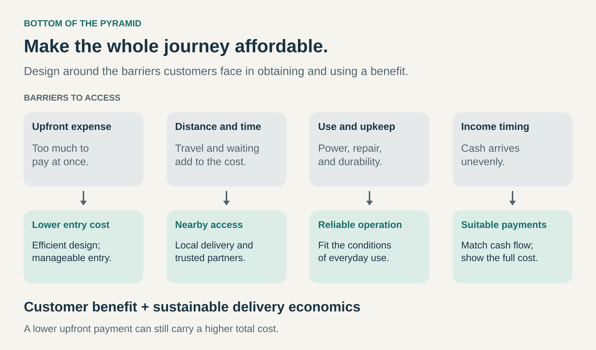

## What it is for

Use this pattern when people with limited purchasing power have an important need that conventional offerings make difficult to meet. It helps a business design useful products and services around constraints such as small or irregular incomes, costly travel, limited infrastructure, and expensive upkeep.

The opportunity is to make a valuable outcome accessible through a different combination of product design, distribution, operations, and payment arrangements.

## The core idea

A low price can still leave an offering out of reach.

An inexpensive appliance may require a long journey to purchase, electricity that is unreliable, or replacement parts that are unavailable locally. A service may be affordable in principle but require a day away from paid work. A purchase that saves money over several years may demand more cash upfront than a household can spare.

Bottom of the Pyramid starts with those conditions. The name refers to the lower-income portion of the economic distribution, but a useful business design needs a much more specific understanding of its customers.

A household paid seasonally faces different constraints from a household receiving small daily earnings. Customers in a dense neighborhood may need a different distribution system from customers in dispersed villages. Income alone does not explain their circumstances.

The defining move is to design the whole offering around a particular group’s ability to obtain, use, maintain, and pay for the benefit.

## Affordability across the whole journey

Four dimensions often determine whether an offering is accessible.

**Entry cost** concerns what customers must commit before receiving value. A smaller purchase, shared asset, or different financing arrangement may lower that threshold.

**Access cost** includes travel, waiting, information gathering, and the effort of finding a trustworthy provider. Local distribution can matter as much as production efficiency.

**Use and upkeep** determine whether the benefit survives everyday conditions. Energy requirements, maintenance, durability, and replacement supplies belong in the design.

**Payment timing** concerns the relationship between charges and available cash. A customer may be able to afford an expense over time while being unable to make a large payment today.

These dimensions can pull in different directions. Smaller packages reduce the amount needed for one purchase but can increase the price per unit. Installments reduce an upfront payment while potentially increasing the total paid. The design needs to make those trade-offs visible.

## Aravind Eye Care: reducing the cost of reaching care

Aravind Eye Care in India illustrates how access depends on both delivery economics and the patient’s journey.

Its model has long combined paying patients with subsidized and free care. Published research describes distinct patient streams, including patients reached through outreach camps whose services included transportation, food, and accommodation. [Research on Aravind’s patient streams and cataract services](https://pmc.ncbi.nlm.nih.gov/articles/PMC8225659/).

An account of the Aravind model also describes standardized processes, specialized staff roles, and organized transport as ways to reduce provider and patient costs. Group transport addresses an expense that remains even when treatment itself is free. [Aravind’s account of efficient service delivery](https://pmc.ncbi.nlm.nih.gov/articles/PMC4069777/).

For this pattern, the transferable principle is the connection between operational efficiency and practical accessibility. Lowering the treatment charge addresses one barrier; organizing the journey addresses others.

Cross-subsidy is an additional mechanism within this example. Other businesses serving lower-income customers may use different funding arrangements.

## M-PESA: connecting digital transfers to local cash access

M-PESA’s early development in Kenya illustrates the importance of fitting an offering to existing behavior and infrastructure.

Launched commercially in 2007, the service addressed a familiar need: sending money to other people, including relatives elsewhere in the country. Its early system worked through basic mobile phones and a network of retail agents where customers could exchange cash for electronic value and withdraw cash again. Agents earned fees for these services. [FSD Kenya’s account of M-PESA’s development](https://www.fsdkenya.org/thematic-areas/digital-finance/an-overview-of-m-pesa/).

The accessible proposition depended on several connected choices: a recognizable use case, devices customers could use, and physical locations linking the service to cash.

M-PESA serves a broad population, including lower-income customers. Its relevance here is the access mechanism. The software, agent network, customer trust, and operating arrangements worked together; transferring that model elsewhere requires understanding those dependencies.

## Project Shakti: building distribution through local entrepreneurs

Hindustan Unilever’s Project Shakti, launched in 2001, developed a rural distribution network involving women entrepreneurs. HUL describes training participants in its products and the basics of distribution, with continuing coaching from rural sales promoters. [HUL’s description of Project Shakti](https://hul-performance-highlights.hul.co.in/performance-highlights-fy-2021-2022/customers.html).

The model connects product availability with local commercial participation. For a business, local distributors can provide reach into places its existing channels serve poorly. For participants, the arrangement can create an income opportunity.

The quality of that opportunity depends on its economics: margins, working time, stock requirements, and financial risk. HUL’s account documents the program’s design; assessing participants’ gains requires examining those outcomes separately.

Rural location itself does not define a lower-income market. The case illustrates a distribution mechanism that can help address access barriers.

## What makes the business viable

A large population with unmet needs does not automatically become a viable market.

Customers may be costly to reach. Small transactions can carry substantial handling costs. Providers and local partners need enough income to maintain service, replenish stock, and resolve problems.

A workable model therefore needs two forms of value creation at once: meaningful benefit for customers and sustainable economics for the organizations delivering it. Efficiency, local partnerships, shared infrastructure, cross-subsidy, or third-party funding may contribute.

Thin margins combined with high volume are one possible configuration. They are not a sufficient explanation of the pattern.

## When it helps—and where it falls short

This pattern is useful when a specific group already spends significant money, time, or effort on an inadequate alternative. That existing burden can reveal an opportunity to deliver a better outcome within the resources customers actually have.

It is also useful when exclusion comes partly from assumptions built into the conventional offering: large purchase quantities, distant service locations, intensive administration, or infrastructure customers cannot reliably access.

The most common mistake is treating lower-income customers as one uniform segment. Another is equating smaller payments with better value while overlooking total cost or product usefulness.

Commercial success also needs to be distinguished from poverty reduction. The broader proposition that selling to lower-income consumers can simultaneously produce substantial profits and alleviate poverty has been contested. Aneel Karnani’s critique emphasizes employment, productive opportunities, and the role of public services alongside consumption. [Karnani’s analysis in _California Management Review_](https://cmr.berkeley.edu/2007/08/49-4-the-mirage-of-marketing-to-the-bottom-of-the-pyramid-how-the-private-sector-can-help-alleviate-poverty/).

An offering may improve access without raising household income. Sales growth establishes demand; claims about wellbeing require evidence about customers’ actual costs, benefits, and circumstances.

## Related patterns

[[no-frills|No Frills]] can lower delivery costs by removing extras. Bottom of the Pyramid additionally examines access, infrastructure, and payment constraints.

[[cross-subsidized-access|Cross-Subsidized Access]] uses revenue from one group or offering to support another, as illustrated by Aravind’s combination of patient streams.

[[pay-per-use|Pay per Use]] can reduce the commitment required before receiving value. Its suitability depends on the resulting charges and the customer’s usage.

[[reverse-innovation|Reverse Innovation]] concerns moving solutions developed in one market context into another. Offerings designed around constrained resources may become useful in additional settings.
