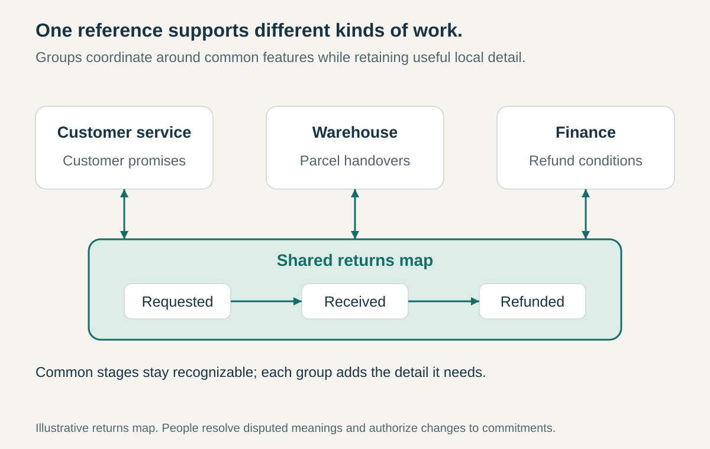

**Core question:** How can groups coordinate around the same work when they need to understand it differently?

## What it is for

Imagine a hypothetical retailer redesigning returns. Customer service thinks in promises and customer questions. Warehouse staff think in parcels, inspections, and storage. Finance thinks in evidence and refund timing. Each department’s description makes sense locally, yet the handovers remain unclear.

A shared returns map can give them something concrete to inspect together. Customer service examines what customers are told; the warehouse marks where goods change hands; finance identifies what triggers a refund. They use the same stages without needing identical internal procedures.

Boundary Objects applies across professions, functions, organizations, or other groups whose work intersects but whose concerns differ. It helps them connect those concerns through a usable reference rather than requiring everyone to adopt one group’s complete worldview.

## The core idea

**Use a shared artifact with a stable common identity and enough flexibility for each group to work with it in its own setting.**

The artifact might be a map, prototype, model, form, or organized collection. Susan Leigh Star and James R. Griesemer developed the concept in their 1989 study of Berkeley’s Museum of Vertebrate Zoology, emphasizing objects that accommodate different viewpoints while remaining recognizable across them. [Star and Griesemer’s original study](https://doi.org/10.1177/030631289019003001)

The distinction is use across a boundary. A presentation everyone receives may still express only its author’s perspective. A boundary object becomes part of several groups’ work and helps connect their contributions.

Shared identity does not require identical interpretation. The returns map can support customer explanations, warehouse planning, and financial controls while preserving common stages and handover points. However, details that determine whether work fits together need explicit agreement; flexibility is not permission to misunderstand a deadline or approval condition.

## How it works

**Start with an actual crossing.** Identify where contributions must connect: a customer journey, product interface, planning boundary, or exchange of observations. Choose an artifact people need for that work. A polished diagram disconnected from everyday decisions is unlikely to help.

**Establish the common reference.** Agree enough structure to recognize the same thing across settings. This might mean shared stages, identifiers, categories, dimensions, or version labels. In the returns example, distinguish a customer requesting a return from the warehouse receiving it. Treating both as “returned” would hide a consequential difference.

**Allow useful local detail.** Each group can add the information it needs without forcing every other group to adopt its full working model. Customer service might annotate customer messages while finance links refund conditions. Keep those additions connected to the common reference so they remain comparable when an issue crosses the boundary.

**Assign stewardship and decision rights.** Name who maintains the artifact, who contributes, and who approves changes to agreed commitments. A map’s editor does not automatically gain authority over warehouse staffing or refund policy. Content owners remain responsible for their areas, with a named route for disagreements that span them.

**Work through it together.** Use the artifact in reviews, handovers, and discussions of exceptions. Ask affected groups to show where a proposed change lands. A refund promised earlier may depend on evidence the warehouse cannot yet supply. The map makes that mismatch discussable; the relevant owners must still resolve it.

**Preserve continuity as it changes.** Keep revision history, make assumptions and unresolved points visible, and connect local views to the agreed version. Where sensitive details cannot be shared, provide an appropriate view and identify its limits. Retire obsolete copies so people do not coordinate against incompatible references.

## Why it works

A shared artifact provides a persistent point of reference beyond a single conversation. People can point to a stage, revise a drawing, or compare records instead of relying entirely on verbal descriptions that mean different things locally.

Its flexibility lets each group retain useful specialist detail. Its stable features make their contributions recognizable to others. Together, those qualities can support cooperation without requiring agreement about every purpose or interpretation.

The artifact also gives differences a place to become visible. This depends on active use, accessible information, credible contributions, and room to challenge the representation. An attractive model can conceal disagreement just as easily as expose it if participants cannot correct what it shows.

## Examples

### Berkeley’s Museum of Vertebrate Zoology — the 1907–1939 historical case

Star and Griesemer’s study describes cooperation among professional scientists, amateur collectors, patrons, and others connected to the museum. Their California maps shared the state’s outline while emphasizing different contents: collectors and conservationists used features such as trails and collecting locations, while biologists represented ecological “life zones.” Standardized collecting forms also connected observations made at dispersed sites. [The original study, pages 410–411](https://griesemer.net/wp-content/uploads/2020/12/07-star-griesemer-1989-sss19-3387-420-boundary-objects.pdf)

The maps illustrate why a boundary object need not be one identical sheet with identical annotations. Common geographic boundaries connected different local representations. The forms standardized selected information across collecting work. This is the authors’ interpretation of the historical arrangements, rather than evidence that all participants shared the same interests or that every disagreement disappeared.

### NASA — interface documents in its systems-engineering guidance

NASA’s interface-management guidance addresses development divided among government organizations, contractors, and geographically separated technical teams. It describes documents capturing interfaces and approved changes. Its interface-requirements outline calls for the participating organizations’ responsibilities, document approval powers, and change authority to be stated. [NASA’s interface-management guidance](https://www.nasa.gov/reference/6-3-interface-management/), [interface-requirements document outline](https://www.nasa.gov/reference/appendix-l-interface-requirements-document-outline/)

Viewed as a boundary object, an interface document gives separate teams a common description of where their contributions must meet. Each can develop its own product details while referring to agreed interface characteristics. This application of the concept is an interpretation of NASA’s published coordination guidance, not a label NASA uses on those pages or a claim about a particular mission’s performance. The document’s usefulness depends on the accompanying review and change process.

## Useful when

- Groups use the same words for different events, objects, or responsibilities.
- A handover fails because each unit’s internal description omits what the next unit needs.
- Specialists need different levels of detail while coordinating around common interfaces or stages.
- Decisions repeatedly depend on explanations held in separate presentations, spreadsheets, or people’s memories.

## Common mistakes and limits

**Calling any shared document a boundary object.** Access alone does not connect working practices. Check whether groups actually use it to coordinate.

**Forcing one department’s model on everyone.** This may remove the local detail others need or make their concerns difficult to express. Include affected groups in shaping the reference.

**Leaving critical meanings ambiguous.** Different perspectives can coexist, but incompatible interpretations of a release condition, measurement, or deadline require resolution.

**Treating the artifact as agreement or authority.** A box on a map does not establish ownership, funding, or consent. Confirm commitments through the appropriate decision process.

**Ignoring upkeep and participation costs.** Maintaining views, translating terms, and reconciling changes takes work. If no one can sustain it, the object becomes a misleading historical picture.

A shared artifact cannot resolve incompatible goals or unequal power by itself. Some differences require negotiation, an explicit decision, or changes to organizational boundaries.

## Related patterns

- [[liaison-networks|Liaison Networks]] supplies people who maintain cross-unit connections; boundary objects give those conversations a persistent reference.
- [[shared-strategic-measures|Shared Strategic Measures]] aligns strategic review through common measures. Those measures can support a boundary object, but this pattern also includes maps, models, and forms serving different local purposes.
- [[integrator-roles|Integrator Roles]] assigns responsibility for keeping a combined result coherent. An integrator can steward shared artifacts while the relevant authorities retain their decision rights.
